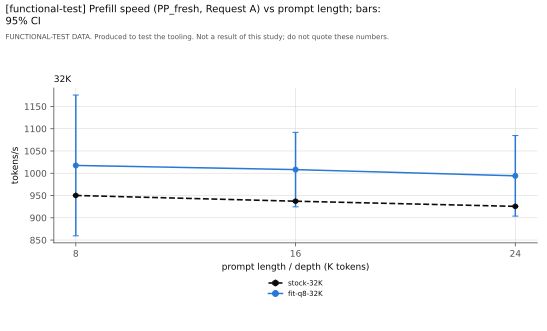
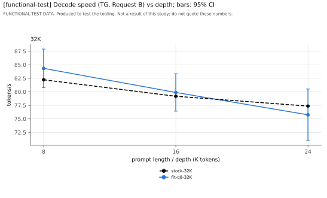
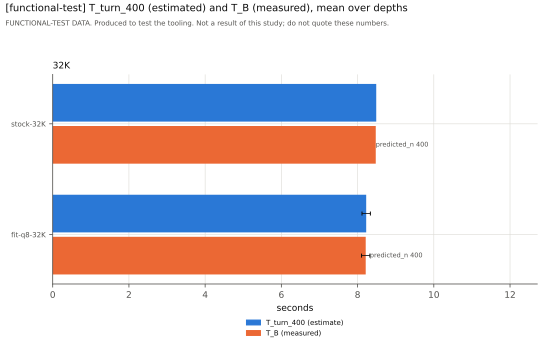
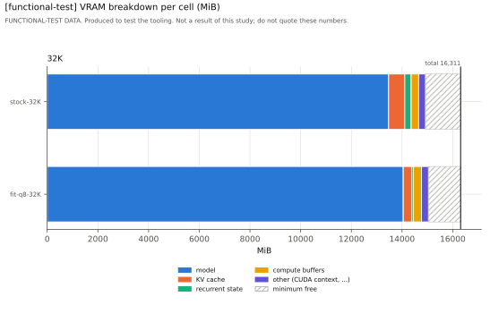
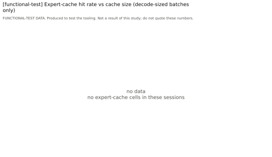

# Baseline report (functional-test)

> **FUNCTIONAL-TEST DATA. Produced to test the tooling. Not a result of this study; do not quote these numbers.**

## Provenance

- Plan version: v1.4
- Regenerate with: `python -m smallpc.report render --sessions data/raw/mini-20261109 --out reports/functional-test --label functional-test`
- Statistics: mean, n, min, max and a 95% CI (wider of the percentile-bootstrap interval, 10,000 resamples, fixed seed, and the t interval); CIs shown for n of at least 2. Paired ratios: geometric mean with the wider of the bootstrap CI and a t-interval on the log ratios, back-transformed.

> FUNCTIONAL-TEST DATA. Produced to test the tooling. Not a result of this study; do not quote these numbers.

| session | spec / sha-256 | manifest sha-256 | session commit | record commits | snapshot ids | llama.cpp | state |
|---|---|---|---|---|---|---|---|
| mini-20261109 | mini `a6e436fe5640eb72` | `ed750c1c73355d08` | 7385799622 (dirty) **--allow-dirty** | `7385799622` | `66c04f6c276af71a` | `57d04820df` | complete |

Session `mini-20261109` was run with `--allow-dirty`: its recorded commit is not exact (uncommitted paths: `src/smallpc/config.py`, `src/smallpc/envsnap.py`, `src/smallpc/flags.py`, `configs/sweeps/`, `scripts/run-sweep.sh`, `scripts/sweep-status.sh`, `src/smallpc/sweep/`).

## Session health

> FUNCTIONAL-TEST DATA. Produced to test the tooling. Not a result of this study; do not quote these numbers.

| session | systemd-inhibit | idle precondition | drift flag |
|---|---|---|---|
| mini-20261109 | checked True, active True | 5 checks, 0 failed, total wait 0 s, max busy 2.91 % | main: none |

Canaries (never part of cell statistics):

> FUNCTIONAL-TEST DATA. Produced to test the tooling. Not a result of this study; do not quote these numbers.

| session | run | phase | reps | PP_fresh 16K (tok/s) | TG 16K (tok/s) | TG short (tok/s) | flags |
|---|---|---|---|---|---|---|---|
| mini-20261109 | main | start | 3 | 1016.3 [1006.5, 1026.1] | 80.0 [79.5, 80.5] | 90.2 [89.3, 91.2] | paging |
| mini-20261109 | main | end | 3 | 1014.3 [998.1, 1030.5] | 79.6 [77.8, 81.3] | 90.8 [88.1, 93.5] | - |

## Results

### 32K

> FUNCTIONAL-TEST DATA. Produced to test the tooling. Not a result of this study; do not quote these numbers.

| cell | n_clean/n_total | PP_fresh 8K (tok/s) | PP_fresh 16K (tok/s) | PP_fresh 24K (tok/s) | TG 8K (tok/s) | TG 16K (tok/s) | TG 24K (tok/s) | T_turn_400 (s) | T_B (s) | T_reread (s) | TTFT (s) | acceptance | flags |
|---|---|---|---|---|---|---|---|---|---|---|---|---|---|
| stock-32K | 1/2 not reportable (n < 5) | 950.1 | 937.2 | 925.6 | 82.2 | 79.2 | 77.4 | 8.49 | 8.48 (predicted_n 400) | 17.55 | 3.46 | - | paging |
| fit-q8-32K | 2/2 not reportable (n < 5) | 1017.5 [859.5, 1175.6] | 1008.2 [924.6, 1091.8] | 994.2 [903.7, 1084.6] | 84.3 [80.8, 87.9] | 79.9 [76.4, 83.3] | 75.7 [71.0, 80.5] | 8.23 [8.12, 8.34] | 8.21 [8.10, 8.32] (predicted_n 400) | 16.34 [14.73, 17.96] | 3.22 [3.08, 3.36] | - | - |

Values are mean [95% CI] over clean repetitions. T_turn_400, T_B, T_reread and TTFT are means over the depths of §5.3 per repetition. T_turn_400 is an estimate (400 tokens); T_B is the measured time of Request B and is always shown with its `predicted_n`.

## Eligibility and selection

Mode **screening**: a cell needs at least 2 clean repetitions, a complete status, at least 512 MiB free VRAM at its tightest, no flagged unit and a sanity check that has not failed (`not run` is allowed).

### 32K

> FUNCTIONAL-TEST DATA. Produced to test the tooling. Not a result of this study; do not quote these numbers.

| cell | role | n_clean/n_total | mean T_turn_400 (s) [95% CI] | eligible | reasons it is not | sanity |
|---|---|---|---|---|---|---|
| fit-q8-32K | candidate | 2/2 | 8.23 [8.12, 8.34] | yes | - | not run |
| stock-32K | reference (stock) | 1/2 | 8.49 | no | flagged unit(s) mini-20261109:1 (paging); n_clean 1 is below 2 (screening mode) | not run |

**Shortlist (32K):** `fit-q8-32K` (only 1 eligible cell). Reference: `stock-32K` (never shortlisted).

- `fit-q8-32K`: VRAM model 14046, KV 340, recurrent 63, compute 318, expert cache 0, other 274.8 MiB; minimum free 1269.0 MiB; expert-cache decode-batch hit rate -.

## Paired comparisons with stock

### 32K

> FUNCTIONAL-TEST DATA. Produced to test the tooling. Not a result of this study; do not quote these numbers.

| candidate vs stock | pairs | T_turn_400 ratio | PP_fresh ratio | TG ratio |
|---|---|---|---|---|
| fit-q8-32K | 1 | 0.970 | 1.083 | 1.001 |

Geometric mean of per-repetition ratios (candidate / stock, repetitions that are clean in both cells) with a 95% interval, shown for 2 or more pairs: the wider of the percentile-bootstrap CI (10,000 resamples) and a t-interval on the log ratios, back-transformed. A T_turn_400 ratio below 1 means the candidate is faster; PP_fresh and TG ratios above 1 mean it is faster.

## Swap sensitivity

Every results table and paired comparison, recomputed without the clean units whose window shows more than 64 MiB of llama-server swap growth (`swap_activity_mib`, plan §5.5 and §5.6). Swap activity is a note, not a flag: the numbers in the other sections keep those units.

No clean unit is above 64 MiB: both versions are identical.

Units above the threshold that are already excluded by a flag (not affected here): stock-32K mini-20261109:1 (4143 MiB, paging).

### 32K

> FUNCTIONAL-TEST DATA. Produced to test the tooling. Not a result of this study; do not quote these numbers.

| cell | n_clean (all) | T_turn_400 (s), all units | n_clean (no swap-heavy) | T_turn_400 (s), without swap-heavy units |
|---|---|---|---|---|
| stock-32K | 1 | 8.49 | 1 | 8.49 |
| fit-q8-32K | 2 | 8.23 [8.12, 8.34] | 2 | 8.23 [8.12, 8.34] |

> FUNCTIONAL-TEST DATA. Produced to test the tooling. Not a result of this study; do not quote these numbers.

| candidate vs stock | pairs (all) | T_turn_400 ratio | PP_fresh ratio | TG ratio | pairs (without) | T_turn_400 ratio | PP_fresh ratio | TG ratio |
|---|---|---|---|---|---|---|---|---|
| fit-q8-32K | 1 | 0.970 | 1.083 | 1.001 | 1 | 0.970 | 1.083 | 1.001 |

**Verdict.**

No unit was removed, so no comparison changed.

## VRAM breakdown

### 32K

> FUNCTIONAL-TEST DATA. Produced to test the tooling. Not a result of this study; do not quote these numbers.

| cell | model | KV | recurrent state | compute buffers | expert cache | other | peak used | min free (final windows) | expert layers on CPU |
|---|---|---|---|---|---|---|---|---|---|
| stock-32K | 13,468 | 640 (f16) | 251 | 299 | 0 | 268 | 14,926 | 1,385 | 15 |
| fit-q8-32K | 14,046 | 340 (q8_0) | 63 | 318 | 0 | 275 | 15,042 | 1,269 | 14 |

MiB, from each cell summary's parsed placement (buffers on the GPU) and its windows. 'expert cache' is the `--moe-cache-mib` size the server reports; 'other' is peak used minus the listed parts (CUDA context, graphs, allocator slack).

## Expert cache

No expert-cache cells in these sessions.

Limitation: the server's statistics give hit rates for **decode-sized batches only** (`ubatch <= 8`); prefill-sized batches report only how many experts were copied from the cache. The counts cover everything the server served (warm-up, every repetition and attempt), not only clean repetitions.

## Excluded diagnostic results

> excluded diagnostic result. FUNCTIONAL-TEST DATA. Produced to test the tooling. Not a result of this study; do not quote these numbers.

| cell | session | repetition | attempt | flags | T_turn_400 (s), mean over depths | why |
|---|---|---|---|---|---|---|
| stock-32K | mini-20261109 | 1 | 1 | paging | 8.53 | flagged unit |

These units are not in any headline number above. Flagged units stay here with their flags; attempt 1 of a re-run unit is replaced by attempt 2.

## Appendix: screening data

Screening results (fewer than 5 clean repetitions) are used only for shortlisting and are never reported as results (§5.5).

> FUNCTIONAL-TEST DATA. Produced to test the tooling. Not a result of this study; do not quote these numbers.

| cell | context | n_clean/n_total | T_turn_400 (s) |
|---|---|---|---|
| fit-q8-32K | 32K | 2/2 not reportable (n < 5) | 8.23 [8.12, 8.34] |
| stock-32K | 32K | 1/2 not reportable (n < 5) | 8.49 |

## Figures

