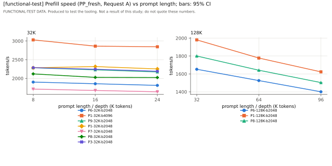
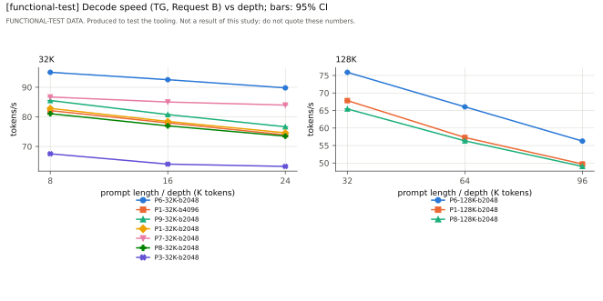
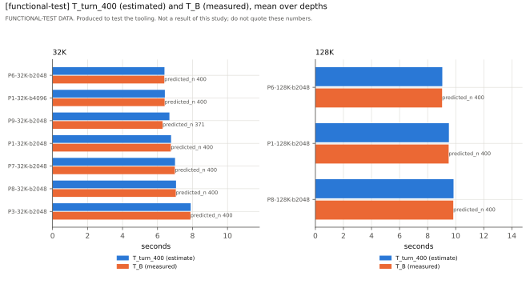
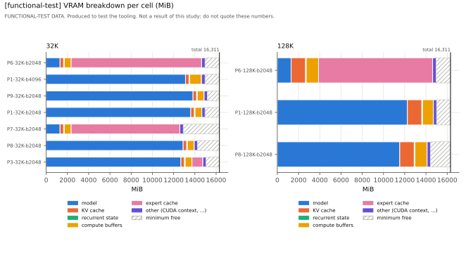
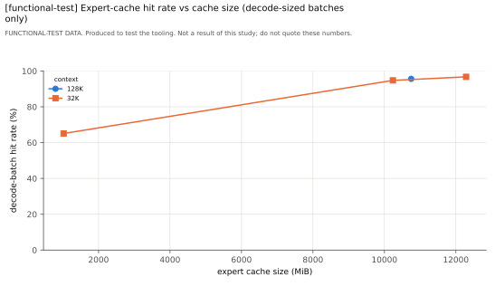

# Baseline report (functional-test)

> **FUNCTIONAL-TEST DATA. Produced to test the tooling. Not a result of this study; do not quote these numbers.**

## Provenance

- Plan version: v1.4
- Regenerate with: `python -m smallpc.report render --sessions data/raw/preflight-20261109 --out reports/preflight --label functional-test`
- Statistics: mean, n, min, max and a 95% CI (wider of the percentile-bootstrap interval, 10,000 resamples, fixed seed, and the t interval); CIs shown for n of at least 2. Paired ratios: geometric mean with the wider of the bootstrap CI and a t-interval on the log ratios, back-transformed.

> FUNCTIONAL-TEST DATA. Produced to test the tooling. Not a result of this study; do not quote these numbers.

| session | spec / sha-256 | manifest sha-256 | session commit | record commits | snapshot ids | llama.cpp | state |
|---|---|---|---|---|---|---|---|
| preflight-20261109 | preflight `65093de82110822f` | `ed750c1c73355d08` | c1d080a482 | `c1d080a482` | `66c04f6c276af71a` | `57d04820df` | complete |

## Session health

> FUNCTIONAL-TEST DATA. Produced to test the tooling. Not a result of this study; do not quote these numbers.

| session | systemd-inhibit | idle precondition | drift flag |
|---|---|---|---|
| preflight-20261109 | checked True, active True | 20 checks, 0 failed, total wait 0 s, max busy 1.5 % | no drift record |

## Results

### 32K

> FUNCTIONAL-TEST DATA. Produced to test the tooling. Not a result of this study; do not quote these numbers.

| cell | n_clean/n_total | PP_fresh 8K (tok/s) | PP_fresh 16K (tok/s) | PP_fresh 24K (tok/s) | TG 8K (tok/s) | TG 16K (tok/s) | TG 24K (tok/s) | T_turn_400 (s) | T_B (s) | T_reread (s) | TTFT (s) | acceptance | flags |
|---|---|---|---|---|---|---|---|---|---|---|---|---|---|
| P6-32K-b2048 | 1/1 not reportable (n < 5) | 1901.0 | 1856.5 | 1812.5 | 95.0 | 92.6 | 89.8 | 6.40 | 6.39 (predicted_n 400) | 8.90 | 2.07 | - | - |
| P1-32K-b4096 | 1/1 not reportable (n < 5) | 3029.8 | 2862.2 | 2844.9 | 82.1 | 78.0 | 73.9 | 6.42 | 6.41 (predicted_n 400) | 5.69 | 1.28 | - | - |
| P9-32K-b2048 | 1/1 not reportable (n < 5) | 2283.7 | 2228.9 | 2172.3 | 85.5 | 80.8 | 76.6 | 6.68 | 6.29 (predicted_n 371) | 7.42 | 1.73 | - | - |
| P1-32K-b2048 | 1/1 not reportable (n < 5) | 2282.4 | 2316.3 | 2252.4 | 82.9 | 78.5 | 74.6 | 6.77 | 6.76 (predicted_n 400) | 7.19 | 1.68 | - | - |
| P7-32K-b2048 | 1/1 not reportable (n < 5) | 1713.9 | 1676.7 | 1641.7 | 86.7 | 85.0 | 84.0 | 7.00 | 6.99 (predicted_n 400) | 9.84 | 2.31 | - | - |
| P8-32K-b2048 | 1/1 not reportable (n < 5) | 2120.0 | 2027.0 | 2023.1 | 81.1 | 77.0 | 73.5 | 7.06 | 7.05 (predicted_n 400) | 8.03 | 1.87 | - | - |
| P3-32K-b2048 | 1/1 not reportable (n < 5) | 2286.4 | 2244.4 | 2190.7 | 67.5 | 64.0 | 63.3 | 7.90 | 7.88 (predicted_n 400) | 7.37 | 1.74 | - | - |

Values are mean [95% CI] over clean repetitions. T_turn_400, T_B, T_reread and TTFT are means over the depths of §5.3 per repetition. T_turn_400 is an estimate (400 tokens); T_B is the measured time of Request B and is always shown with its `predicted_n`.

### 128K

> FUNCTIONAL-TEST DATA. Produced to test the tooling. Not a result of this study; do not quote these numbers.

| cell | n_clean/n_total | PP_fresh 32K (tok/s) | PP_fresh 64K (tok/s) | PP_fresh 96K (tok/s) | TG 32K (tok/s) | TG 64K (tok/s) | TG 96K (tok/s) | T_turn_400 (s) | T_B (s) | T_reread (s) | TTFT (s) | acceptance | flags |
|---|---|---|---|---|---|---|---|---|---|---|---|---|---|
| P6-128K-b2048 | 1/1 not reportable (n < 5) | 1652.0 | 1525.6 | 1400.5 | 75.9 | 66.0 | 56.3 | 9.05 | 9.03 (predicted_n 400) | 44.33 | 2.91 | - | - |
| P1-128K-b2048 | 1/1 not reportable (n < 5) | 1980.5 | 1777.5 | 1623.0 | 67.8 | 57.3 | 49.7 | 9.52 | 9.50 (predicted_n 400) | 37.99 | 2.55 | - | - |
| P8-128K-b2048 | 1/1 not reportable (n < 5) | 1800.1 | 1641.2 | 1503.3 | 65.4 | 56.3 | 49.0 | 9.85 | 9.83 (predicted_n 400) | 41.18 | 2.73 | - | - |

Values are mean [95% CI] over clean repetitions. T_turn_400, T_B, T_reread and TTFT are means over the depths of §5.3 per repetition. T_turn_400 is an estimate (400 tokens); T_B is the measured time of Request B and is always shown with its `predicted_n`.

## Eligibility and selection

Mode **screening**: a cell needs at least 2 clean repetitions, a complete status, at least 512 MiB free VRAM at its tightest, no flagged unit and a sanity check that has not failed (`not run` is allowed).

### 32K

> FUNCTIONAL-TEST DATA. Produced to test the tooling. Not a result of this study; do not quote these numbers.

| cell | role | n_clean/n_total | mean T_turn_400 (s) [95% CI] | eligible | reasons it is not | sanity |
|---|---|---|---|---|---|---|
| P1-32K-b2048 | candidate | 1/1 | 6.77 | no | n_clean 1 is below 2 (screening mode) | not run |
| P1-32K-b4096 | candidate | 1/1 | 6.42 | no | n_clean 1 is below 2 (screening mode) | not run |
| P3-32K-b2048 | candidate | 1/1 | 7.90 | no | n_clean 1 is below 2 (screening mode) | not run |
| P6-32K-b2048 | candidate | 1/1 | 6.40 | no | n_clean 1 is below 2 (screening mode) | not run |
| P7-32K-b2048 | candidate | 1/1 | 7.00 | no | n_clean 1 is below 2 (screening mode) | not run |
| P8-32K-b2048 | candidate | 1/1 | 7.06 | no | n_clean 1 is below 2 (screening mode) | not run |
| P9-32K-b2048 | candidate | 1/1 | 6.68 | no | n_clean 1 is below 2 (screening mode) | not run |

**Shortlist (32K):** none.

No eligible candidate in this context.

### 128K

> FUNCTIONAL-TEST DATA. Produced to test the tooling. Not a result of this study; do not quote these numbers.

| cell | role | n_clean/n_total | mean T_turn_400 (s) [95% CI] | eligible | reasons it is not | sanity |
|---|---|---|---|---|---|---|
| P1-128K-b2048 | candidate | 1/1 | 9.52 | no | n_clean 1 is below 2 (screening mode) | not run |
| P6-128K-b2048 | candidate | 1/1 | 9.05 | no | n_clean 1 is below 2 (screening mode) | not run |
| P8-128K-b2048 | candidate | 1/1 | 9.85 | no | n_clean 1 is below 2 (screening mode) | not run |

**Shortlist (128K):** none.

No eligible candidate in this context.

## Paired comparisons with stock

No context has both a stock cell and a candidate with clean repetitions.

## Swap sensitivity

Every results table and paired comparison, recomputed without the clean units whose window shows more than 64 MiB of llama-server swap growth (`swap_activity_mib`, plan §5.5 and §5.6). Swap activity is a note, not a flag: the numbers in the other sections keep those units.

No clean unit is above 64 MiB: both versions are identical.

### 32K

> FUNCTIONAL-TEST DATA. Produced to test the tooling. Not a result of this study; do not quote these numbers.

| cell | n_clean (all) | T_turn_400 (s), all units | n_clean (no swap-heavy) | T_turn_400 (s), without swap-heavy units |
|---|---|---|---|---|
| P6-32K-b2048 | 1 | 6.40 | 1 | 6.40 |
| P1-32K-b4096 | 1 | 6.42 | 1 | 6.42 |
| P9-32K-b2048 | 1 | 6.68 | 1 | 6.68 |
| P1-32K-b2048 | 1 | 6.77 | 1 | 6.77 |
| P7-32K-b2048 | 1 | 7.00 | 1 | 7.00 |
| P8-32K-b2048 | 1 | 7.06 | 1 | 7.06 |
| P3-32K-b2048 | 1 | 7.90 | 1 | 7.90 |

### 128K

> FUNCTIONAL-TEST DATA. Produced to test the tooling. Not a result of this study; do not quote these numbers.

| cell | n_clean (all) | T_turn_400 (s), all units | n_clean (no swap-heavy) | T_turn_400 (s), without swap-heavy units |
|---|---|---|---|---|
| P6-128K-b2048 | 1 | 9.05 | 1 | 9.05 |
| P1-128K-b2048 | 1 | 9.52 | 1 | 9.52 |
| P8-128K-b2048 | 1 | 9.85 | 1 | 9.85 |

**Verdict.**

No unit was removed, so no comparison changed.

## VRAM breakdown

### 32K

> FUNCTIONAL-TEST DATA. Produced to test the tooling. Not a result of this study; do not quote these numbers.

| cell | model | KV | recurrent state | compute buffers | expert cache | other | peak used | min free (final windows) | expert layers on CPU |
|---|---|---|---|---|---|---|---|---|---|
| P6-32K-b2048 | 1,303 | 340 (q8_0) | 63 | 644 | 12,286 | 326 | 14,962 | 1,349 | - |
| P1-32K-b4096 | 13,116 | 340 (q8_0) | 63 | 1,104 | 0 | 339 | 14,962 | 1,349 | 16 |
| P9-32K-b2048 | 13,825 | 340 (q8_0) | 63 | 644 | 0 | 304 | 15,176 | 1,135 | - |
| P1-32K-b2048 | 13,614 | 340 (q8_0) | 63 | 642 | 0 | 303 | 14,962 | 1,349 | 15 |
| P7-32K-b2048 | 1,303 | 340 (q8_0) | 63 | 644 | 10,237 | 325 | 12,912 | 3,399 | - |
| P8-32K-b2048 | 12,895 | 340 (q8_0) | 63 | 644 | 0 | 304 | 14,246 | 2,065 | - |
| P3-32K-b2048 | 12,684 | 340 (q8_0) | 63 | 642 | 1,022 | 308 | 15,060 | 1,251 | 17 |

### 128K

> FUNCTIONAL-TEST DATA. Produced to test the tooling. Not a result of this study; do not quote these numbers.

| cell | model | KV | recurrent state | compute buffers | expert cache | other | peak used | min free (final windows) | expert layers on CPU |
|---|---|---|---|---|---|---|---|---|---|
| P6-128K-b2048 | 1,303 | 1,360 (q8_0) | 63 | 1,156 | 10,749 | 327 | 14,958 | 1,353 | - |
| P1-128K-b2048 | 12,252 | 1,360 (q8_0) | 63 | 1,026 | 0 | 305 | 15,006 | 1,305 | 18 |
| P8-128K-b2048 | 11,533 | 1,360 (q8_0) | 63 | 1,156 | 0 | 308 | 14,420 | 1,891 | - |

MiB, from each cell summary's parsed placement (buffers on the GPU) and its windows. 'expert cache' is the `--moe-cache-mib` size the server reports; 'other' is peak used minus the listed parts (CUDA context, graphs, allocator slack).

## Expert cache

> FUNCTIONAL-TEST DATA. Produced to test the tooling. Not a result of this study; do not quote these numbers.

| cell | cache MiB | decode-batch hit rate | hits | misses | large-batch experts copied | uploaded MiB |
|---|---|---|---|---|---|---|
| P6-32K-b2048 | 12,286 | 96.7 % | 580,298 | 19,567 | 665,007 | 36,094 |
| P7-32K-b2048 | 10,237 | 94.8 % | 568,499 | 31,366 | 561,204 | 58,007 |
| P3-32K-b2048 | 1,022 | 65.1 % | 146,468 | 78,484 | 53,049 | 145,075 |
| P6-128K-b2048 | 10,749 | 95.6 % | 573,716 | 26,168 | 1,783,119 | 48,343 |

Limitation: the server's statistics give hit rates for **decode-sized batches only** (`ubatch <= 8`); prefill-sized batches report only how many experts were copied from the cache. The counts cover everything the server served (warm-up, every repetition and attempt), not only clean repetitions.

## Excluded diagnostic results

None: no flagged unit and no re-run unit.

## Appendix: screening data

Screening results (fewer than 5 clean repetitions) are used only for shortlisting and are never reported as results (§5.5).

> FUNCTIONAL-TEST DATA. Produced to test the tooling. Not a result of this study; do not quote these numbers.

| cell | context | n_clean/n_total | T_turn_400 (s) |
|---|---|---|---|
| P1-32K-b2048 | 32K | 1/1 not reportable (n < 5) | 6.77 |
| P1-32K-b4096 | 32K | 1/1 not reportable (n < 5) | 6.42 |
| P3-32K-b2048 | 32K | 1/1 not reportable (n < 5) | 7.90 |
| P6-32K-b2048 | 32K | 1/1 not reportable (n < 5) | 6.40 |
| P7-32K-b2048 | 32K | 1/1 not reportable (n < 5) | 7.00 |
| P8-32K-b2048 | 32K | 1/1 not reportable (n < 5) | 7.06 |
| P9-32K-b2048 | 32K | 1/1 not reportable (n < 5) | 6.68 |
| P1-128K-b2048 | 128K | 1/1 not reportable (n < 5) | 9.52 |
| P6-128K-b2048 | 128K | 1/1 not reportable (n < 5) | 9.05 |
| P8-128K-b2048 | 128K | 1/1 not reportable (n < 5) | 9.85 |

## Figures

