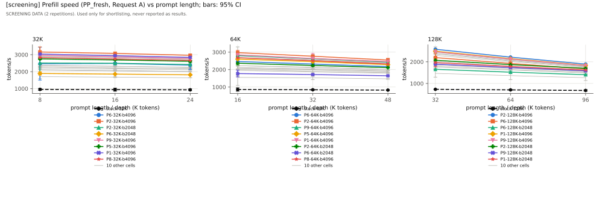
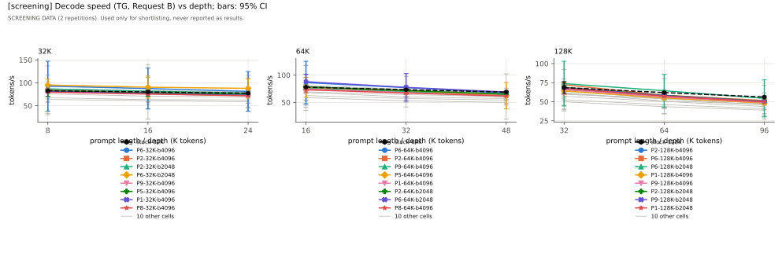
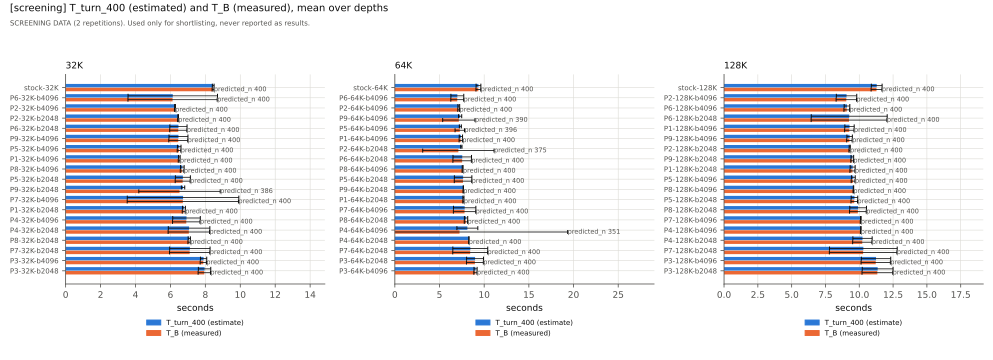
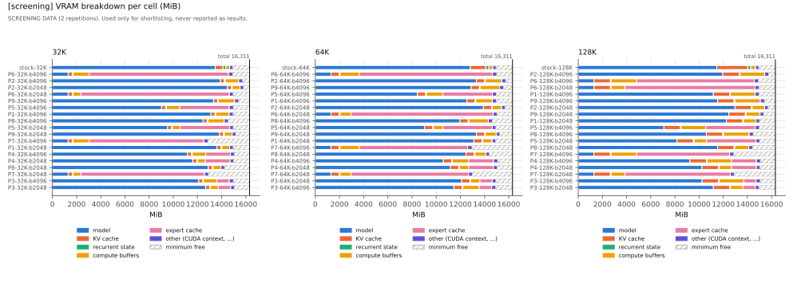
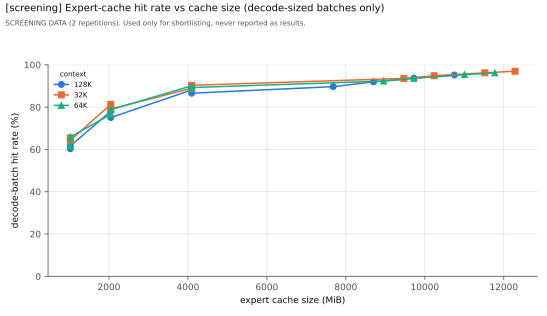

# Baseline report (screening)

> **SCREENING DATA (2 repetitions). Used only for shortlisting, never reported as results.**

## Provenance

- Plan version: v1.5
- Regenerate with: `python -m smallpc.report render --sessions data/raw/stage1-32K data/raw/stage1-64K data/raw/stage1-128K --out reports/stage1 --label screening`
- Statistics: mean, n, min, max and a 95% CI (wider of the percentile-bootstrap interval, 10,000 resamples, fixed seed, and the t interval); CIs shown for n of at least 2. Paired ratios: geometric mean with the wider of the bootstrap CI and a t-interval on the log ratios, back-transformed.

> SCREENING DATA (2 repetitions). Used only for shortlisting, never reported as results.

| session | spec / sha-256 | manifest sha-256 | session commit | record commits | snapshot ids | llama.cpp | state |
|---|---|---|---|---|---|---|---|
| stage1-32K | stage1 `0b0cd1789469c616` | `ed750c1c73355d08` | 77fbe02fd1 | `77fbe02fd1` | `df1c18a3a266c0b1` | `57d04820df` | complete |
| stage1-64K | stage1 `0b0cd1789469c616` | `ed750c1c73355d08` | 18bd4634c4 | `18bd4634c4`, `7b800c0355` | `66c04f6c276af71a`, `df1c18a3a266c0b1` | `57d04820df` | complete |
| stage1-128K | stage1 `0b0cd1789469c616` | `ed750c1c73355d08` | 47dfc69f58 | `47dfc69f58`, `60c3bfc6e7` | `66c04f6c276af71a`, `df1c18a3a266c0b1` | `57d04820df` | complete |

## Session health

> SCREENING DATA (2 repetitions). Used only for shortlisting, never reported as results.

| session | systemd-inhibit | idle precondition | drift flag |
|---|---|---|---|
| stage1-32K | checked True, active True | 31 checks, 0 failed, total wait 0 s, max busy 1.46 % | main: none |
| stage1-64K | checked True, active True | 33 checks, 0 failed, total wait 0 s, max busy 0.99 % | main: none, rerun: none |
| stage1-128K | checked True, active True | 47 checks, 0 failed, total wait 0 s, max busy 1.13 % | main: none, rerun: none |

Canaries (never part of cell statistics):

> SCREENING DATA (2 repetitions). Used only for shortlisting, never reported as results.

| session | run | phase | reps | PP_fresh 16K (tok/s) | TG 16K (tok/s) | TG short (tok/s) | flags |
|---|---|---|---|---|---|---|---|
| stage1-32K | main | start | 3 | 960.2 [951.5, 968.9] | 78.1 [77.9, 78.2] | 88.2 [87.7, 88.7] | - |
| stage1-32K | main | end | 3 | 956.5 [948.2, 964.7] | 78.9 [78.6, 79.1] | 89.0 [88.8, 89.1] | - |
| stage1-64K | main | start | 3 | 955.0 [947.3, 962.8] | 78.5 [78.2, 78.7] | 88.2 [87.5, 89.0] | - |
| stage1-64K | main | end | 3 | 962.3 [953.9, 970.7] | 78.5 [78.2, 78.9] | 88.7 [87.9, 89.5] | - |
| stage1-64K | rerun | start | 3 | 959.5 [950.6, 968.5] | 78.8 [78.0, 79.5] | 89.1 [88.4, 89.8] | - |
| stage1-64K | rerun | end | 3 | 961.1 [951.5, 970.8] | 78.3 [77.5, 79.2] | 88.7 [88.3, 89.1] | - |
| stage1-128K | main | start | 3 | 960.0 [951.5, 968.5] | 78.5 [78.2, 78.9] | 88.7 [87.7, 89.8] | - |
| stage1-128K | main | end | 3 | 962.0 [953.9, 970.1] | 78.5 [77.6, 79.4] | 89.1 [86.4, 91.8] | - |
| stage1-128K | rerun | start | 3 | 958.7 [950.2, 967.2] | 78.8 [78.2, 79.4] | 89.4 [88.5, 90.4] | - |
| stage1-128K | rerun | end | 3 | 960.3 [948.5, 972.0] | 78.0 [77.7, 78.4] | 88.0 [86.4, 89.6] | - |

## Results

### 32K

> SCREENING DATA (2 repetitions). Used only for shortlisting, never reported as results.

| cell | n_clean/n_total | PP_fresh 8K (tok/s) | PP_fresh 16K (tok/s) | PP_fresh 24K (tok/s) | TG 8K (tok/s) | TG 16K (tok/s) | TG 24K (tok/s) | T_turn_400 (s) | T_B (s) | T_reread (s) | TTFT (s) | acceptance | flags |
|---|---|---|---|---|---|---|---|---|---|---|---|---|---|
| stock-32K | 2/2 not reportable (n < 5) | 953.2 [896.0, 1010.4] | 937.1 [847.4, 1026.9] | 928.7 [879.2, 978.1] | 82.6 [81.3, 83.9] | 80.0 [77.4, 82.6] | 77.3 [76.5, 78.1] | 8.45 [8.40, 8.50] | 8.44 [8.39, 8.49] (predicted_n 400) | 17.51 [16.31, 18.71] | 3.45 [3.30, 3.60] | - | - |
| P6-32K-b4096 | 2/2 not reportable (n < 5) | 2468.3 [1502.8, 3433.9] | 2481.7 [2402.5, 2561.0] | 2384.3 [2121.5, 2647.1] | 92.6 [38.3, 146.9] | 87.5 [42.8, 132.1] | 81.3 [38.1, 124.5] | 6.14 [3.57, 8.70] | 6.12 [3.57, 8.68] (predicted_n 400) | 6.74 [6.62, 6.87] | 1.53 [1.46, 1.59] | - | - |
| P2-32K-b4096 | 2/2 not reportable (n < 5) | 3158.8 [2859.2, 3458.3] | 3076.9 [3067.3, 3086.6] | 2963.6 [2935.2, 2991.9] | 83.8 [83.0, 84.7] | 79.2 [78.0, 80.4] | 75.2 [72.5, 77.9] | 6.26 [6.24, 6.29] | 6.25 [6.23, 6.27] (predicted_n 400) | 5.40 [5.29, 5.52] | 1.22 [1.19, 1.25] | - | - |
| P2-32K-b2048 | 2/2 not reportable (n < 5) | 2509.3 [1891.6, 3127.0] | 2493.4 [2463.6, 2523.2] | 2419.9 [2378.2, 2461.6] | 86.5 [86.3, 86.7] | 81.6 [80.0, 83.3] | 77.4 [75.0, 79.7] | 6.44 [6.43, 6.46] | 6.43 [6.41, 6.45] (predicted_n 400) | 6.66 [6.48, 6.85] | 1.55 [1.52, 1.58] | - | - |
| P6-32K-b2048 | 2/2 not reportable (n < 5) | 1894.2 [1798.1, 1990.3] | 1855.3 [1848.1, 1862.5] | 1812.9 [1781.2, 1844.5] | 95.2 [82.6, 107.8] | 90.4 [66.3, 114.5] | 87.8 [66.6, 109.0] | 6.46 [5.97, 6.95] | 6.45 [5.96, 6.94] (predicted_n 400) | 8.90 [8.90, 8.91] | 2.07 [1.98, 2.16] | - | - |
| P9-32K-b4096 | 2/2 not reportable (n < 5) | 2963.5 [2947.9, 2979.1] | 2878.7 [2855.4, 2902.1] | 2782.5 [2774.8, 2790.1] | 82.4 [79.4, 85.5] | 78.1 [76.3, 79.9] | 74.1 [73.4, 74.9] | 6.46 [5.92, 7.00] | 6.45 [5.91, 6.99] (predicted_n 400) | 5.76 [5.73, 5.79] | 1.34 [0.92, 1.77] | - | - |
| P5-32K-b4096 | 2/2 not reportable (n < 5) | 2753.5 [2700.8, 2806.3] | 2690.5 [2687.6, 2693.3] | 2609.0 [2541.3, 2676.7] | 82.7 [70.6, 94.8] | 77.8 [70.9, 84.8] | 75.0 [73.2, 76.9] | 6.50 [6.40, 6.61] | 6.49 [6.39, 6.59] (predicted_n 400) | 6.16 [6.06, 6.26] | 1.41 [1.38, 1.43] | - | - |
| P1-32K-b4096 | 2/2 not reportable (n < 5) | 3037.7 [3021.0, 3054.3] | 2942.7 [2924.2, 2961.1] | 2839.9 [2791.3, 2888.4] | 80.6 [79.5, 81.7] | 76.5 [74.5, 78.5] | 72.7 [71.6, 73.9] | 6.51 [6.46, 6.56] | 6.50 [6.45, 6.54] (predicted_n 400) | 5.64 [5.58, 5.70] | 1.28 [1.23, 1.33] | - | - |
| P8-32K-b4096 | 2/2 not reportable (n < 5) | 2827.4 [2800.1, 2854.6] | 2748.0 [2721.8, 2774.1] | 2662.8 [2652.4, 2673.2] | 79.4 [79.4, 79.5] | 75.5 [73.7, 77.2] | 71.6 [71.5, 71.8] | 6.68 [6.58, 6.78] | 6.67 [6.57, 6.77] (predicted_n 400) | 6.03 [5.99, 6.07] | 1.38 [1.32, 1.44] | - | - |
| P5-32K-b2048 | 2/2 not reportable (n < 5) | 2087.0 [1991.8, 2182.2] | 2042.7 [2027.8, 2057.7] | 1997.2 [1973.9, 2020.5] | 87.0 [57.7, 116.4] | 82.8 [82.8, 82.9] | 79.1 [74.8, 83.4] | 6.71 [6.29, 7.14] | 6.70 [6.27, 7.13] (predicted_n 400) | 8.08 [7.96, 8.21] | 1.89 [1.89, 1.89] | - | - |
| P9-32K-b2048 | 2/2 not reportable (n < 5) | 2282.9 [2251.1, 2314.8] | 2224.1 [2146.9, 2301.4] | 2172.2 [2165.9, 2178.5] | 84.4 [83.6, 85.2] | 80.0 [79.8, 80.1] | 75.9 [75.6, 76.2] | 6.72 [6.63, 6.82] | 6.52 [4.19, 8.85] (predicted_n 386) | 7.42 [7.33, 7.51] | 1.72 [1.64, 1.81] | - | - |
| P7-32K-b4096 | 2/2 not reportable (n < 5) | 2354.8 [2303.3, 2406.2] | 2314.1 [2305.6, 2322.6] | 2250.5 [2184.1, 2316.9] | 83.5 [30.3, 136.6] | 80.3 [20.7, 140.0] | 73.5 [37.8, 109.3] | 6.72 [3.53, 9.92] | 6.71 [3.53, 9.90] (predicted_n 400) | 7.16 [7.04, 7.28] | 1.64 [1.59, 1.70] | - | - |
| P1-32K-b2048 | 2/2 not reportable (n < 5) | 2378.3 [2341.7, 2414.8] | 2319.7 [2287.1, 2352.3] | 2253.3 [2232.0, 2274.7] | 82.8 [78.2, 87.4] | 78.2 [77.6, 78.8] | 74.4 [73.9, 74.9] | 6.77 [6.69, 6.86] | 6.76 [6.68, 6.85] (predicted_n 400) | 7.14 [7.05, 7.22] | 1.67 [1.66, 1.68] | - | - |
| P4-32K-b4096 | 2/2 not reportable (n < 5) | 2880.5 [2861.9, 2899.0] | 2816.5 [2735.1, 2897.8] | 2724.1 [2674.6, 2773.5] | 75.6 [68.2, 83.1] | 70.9 [58.8, 82.9] | 68.9 [47.2, 90.6] | 6.92 [6.13, 7.71] | 6.91 [6.12, 7.70] (predicted_n 400) | 5.89 [5.78, 6.01] | 1.34 [1.31, 1.38] | - | - |
| P4-32K-b2048 | 2/2 not reportable (n < 5) | 2213.9 [2190.4, 2237.4] | 2164.1 [2149.3, 2178.9] | 2111.8 [2077.2, 2146.5] | 81.0 [59.2, 102.8] | 75.2 [61.3, 89.1] | 71.3 [55.0, 87.7] | 7.07 [5.88, 8.26] | 7.06 [5.87, 8.24] (predicted_n 400) | 7.64 [7.60, 7.67] | 1.78 [1.77, 1.79] | - | - |
| P8-32K-b2048 | 2/2 not reportable (n < 5) | 2119.3 [2104.5, 2134.2] | 2075.5 [2071.2, 2079.8] | 2009.3 [1813.0, 2205.7] | 80.6 [78.1, 83.2] | 76.5 [76.3, 76.6] | 72.8 [71.9, 73.7] | 7.08 [7.02, 7.15] | 7.07 [7.00, 7.13] (predicted_n 400) | 8.00 [7.60, 8.40] | 1.86 [1.76, 1.95] | - | - |
| P7-32K-b2048 | 2/2 not reportable (n < 5) | 1705.1 [1591.6, 1818.6] | 1676.3 [1650.3, 1702.3] | 1639.1 [1637.9, 1640.2] | 86.4 [84.7, 88.1] | 82.3 [52.9, 111.7] | 80.8 [45.3, 116.4] | 7.11 [5.96, 8.27] | 7.10 [5.95, 8.25] (predicted_n 400) | 9.86 [9.80, 9.92] | 2.30 [2.18, 2.42] | - | - |
| P3-32K-b4096 | 2/2 not reportable (n < 5) | 2909.8 [2894.4, 2925.3] | 2841.6 [2820.7, 2862.5] | 2748.6 [2541.0, 2956.2] | 63.7 [33.2, 94.2] | 60.9 [43.7, 78.0] | 58.6 [55.8, 61.4] | 7.90 [7.72, 8.08] | 7.88 [7.70, 8.06] (predicted_n 400) | 5.84 [5.60, 6.09] | 1.34 [1.24, 1.44] | - | - |
| P3-32K-b2048 | 2/2 not reportable (n < 5) | 2280.1 [2273.3, 2286.9] | 2211.2 [1880.4, 2542.1] | 2184.7 [2135.2, 2234.2] | 67.3 [64.8, 69.9] | 63.3 [57.4, 69.3] | 62.5 [55.6, 69.3] | 7.96 [7.60, 8.31] | 7.94 [7.59, 8.29] (predicted_n 400) | 7.42 [6.96, 7.88] | 1.74 [1.74, 1.74] | - | - |

Values are mean [95% CI] over clean repetitions. T_turn_400, T_B, T_reread and TTFT are means over the depths of §5.3 per repetition. T_turn_400 is an estimate (400 tokens); T_B is the measured time of Request B and is always shown with its `predicted_n`.

### 64K

> SCREENING DATA (2 repetitions). Used only for shortlisting, never reported as results.

| cell | n_clean/n_total | PP_fresh 16K (tok/s) | PP_fresh 32K (tok/s) | PP_fresh 48K (tok/s) | TG 16K (tok/s) | TG 32K (tok/s) | TG 48K (tok/s) | T_turn_400 (s) | T_B (s) | T_reread (s) | TTFT (s) | acceptance | flags |
|---|---|---|---|---|---|---|---|---|---|---|---|---|---|
| stock-64K | 2/2 not reportable (n < 5) | 860.4 [762.6, 958.2] | 844.0 [818.2, 869.8] | 825.7 [807.2, 844.3] | 77.9 [76.9, 79.0] | 73.2 [71.8, 74.6] | 68.8 [67.7, 70.0] | 9.36 [9.09, 9.63] | 9.35 [9.08, 9.61] (predicted_n 400) | 39.13 [37.57, 40.69] | 3.90 [3.66, 4.14] | - | 1 unit(s) re-run (attempt 2 used) |
| P6-64K-b4096 | 2/2 not reportable (n < 5) | 2462.6 [2449.0, 2476.1] | 2320.3 [2274.1, 2366.6] | 2172.0 [2129.2, 2214.8] | 86.2 [47.1, 125.4] | 77.1 [73.4, 80.7] | 67.2 [65.2, 69.1] | 7.00 [6.28, 7.72] | 6.98 [6.27, 7.70] (predicted_n 400) | 14.47 [14.21, 14.72] | 1.74 [1.70, 1.78] | - | - |
| P2-64K-b4096 | 2/2 not reportable (n < 5) | 2972.0 [2844.6, 3099.4] | 2767.6 [2733.5, 2801.8] | 2548.0 [2450.1, 2645.9] | 77.1 [72.0, 82.3] | 69.9 [67.0, 72.9] | 64.2 [61.9, 66.4] | 7.16 [7.06, 7.26] | 7.15 [7.05, 7.24] (predicted_n 400) | 12.21 [11.84, 12.59] | 1.45 [1.39, 1.51] | - | - |
| P9-64K-b4096 | 2/2 not reportable (n < 5) | 2812.3 [2786.8, 2837.7] | 2627.4 [2605.4, 2649.4] | 2436.3 [2429.9, 2442.6] | 76.5 [76.1, 76.9] | 69.5 [68.4, 70.5] | 63.7 [62.8, 64.5] | 7.31 [7.13, 7.48] | 7.16 [5.35, 8.97] (predicted_n 390) | 12.82 [12.75, 12.89] | 1.56 [1.44, 1.67] | - | - |
| P5-64K-b4096 | 2/2 not reportable (n < 5) | 2601.2 [2406.5, 2796.0] | 2457.6 [2420.9, 2494.2] | 2282.6 [2147.4, 2417.8] | 77.7 [59.4, 96.0] | 72.1 [63.9, 80.2] | 62.3 [38.0, 86.7] | 7.33 [7.22, 7.45] | 7.27 [6.74, 7.80] (predicted_n 396) | 13.72 [13.39, 14.06] | 1.63 [1.52, 1.74] | - | - |
| P1-64K-b4096 | 2/2 not reportable (n < 5) | 2845.7 [2832.0, 2859.4] | 2638.6 [2347.9, 2929.3] | 2462.4 [2447.3, 2477.5] | 74.7 [72.5, 76.9] | 68.0 [64.6, 71.3] | 62.3 [59.4, 65.1] | 7.39 [7.21, 7.58] | 7.38 [7.19, 7.56] (predicted_n 400) | 12.71 [12.21, 13.22] | 1.51 [1.47, 1.55] | - | - |
| P2-64K-b2048 | 2/2 not reportable (n < 5) | 2364.8 [2272.3, 2457.4] | 2238.8 [2190.3, 2287.3] | 2112.5 [2098.6, 2126.4] | 78.8 [78.0, 79.5] | 71.6 [70.8, 72.5] | 65.1 [62.9, 67.4] | 7.45 [7.38, 7.52] | 7.11 [3.12, 11.11] (predicted_n 375) | 14.94 [14.70, 15.19] | 1.85 [1.81, 1.89] | - | - |
| P6-64K-b2048 | 2/2 not reportable (n < 5) | 1774.3 [1580.1, 1968.5] | 1716.8 [1713.0, 1720.7] | 1647.4 [1619.6, 1675.2] | 88.0 [74.3, 101.6] | 77.6 [52.1, 103.0] | 69.0 [68.8, 69.2] | 7.55 [6.51, 8.58] | 7.53 [6.50, 8.57] (predicted_n 400) | 19.39 [18.87, 19.90] | 2.38 [2.13, 2.63] | - | - |
| P8-64K-b4096 | 2/2 not reportable (n < 5) | 2680.6 [2674.5, 2686.7] | 2513.3 [2496.8, 2529.8] | 2326.0 [2157.5, 2494.5] | 72.9 [67.8, 78.1] | 67.1 [65.3, 68.9] | 61.6 [60.3, 63.0] | 7.59 [7.54, 7.64] | 7.58 [7.53, 7.62] (predicted_n 400) | 13.43 [12.88, 13.97] | 1.62 [1.60, 1.64] | - | - |
| P5-64K-b2048 | 2/2 not reportable (n < 5) | 1945.5 [1638.0, 2253.0] | 1868.8 [1731.2, 2006.3] | 1792.5 [1789.6, 1795.4] | 81.3 [44.5, 118.1] | 73.9 [50.2, 97.7] | 65.9 [55.8, 76.0] | 7.64 [6.67, 8.62] | 7.63 [6.65, 8.60] (predicted_n 400) | 17.79 [17.79, 17.79] | 2.18 [2.14, 2.21] | - | - |
| P9-64K-b2048 | 2/2 not reportable (n < 5) | 2122.0 [1803.9, 2440.1] | 2037.0 [2031.1, 2042.9] | 1933.7 [1930.6, 1936.7] | 77.7 [74.0, 81.4] | 70.6 [69.7, 71.5] | 64.7 [64.1, 65.3] | 7.67 [7.65, 7.68] | 7.65 [7.64, 7.66] (predicted_n 400) | 16.41 [15.99, 16.82] | 2.01 [1.93, 2.08] | - | - |
| P1-64K-b2048 | 2/2 not reportable (n < 5) | 2225.2 [2186.8, 2263.6] | 2108.1 [2036.7, 2179.5] | 1998.0 [1988.1, 2008.0] | 77.0 [76.8, 77.2] | 69.9 [69.7, 70.0] | 63.9 [63.3, 64.4] | 7.68 [7.62, 7.74] | 7.66 [7.60, 7.72] (predicted_n 400) | 15.84 [15.58, 16.09] | 1.96 [1.92, 1.99] | - | - |
| P7-64K-b4096 | 2/2 not reportable (n < 5) | 2220.8 [1677.2, 2764.3] | 2144.2 [2092.3, 2196.0] | 2006.9 [1838.9, 2174.8] | 76.3 [35.0, 117.6] | 68.7 [61.4, 76.0] | 59.4 [47.6, 71.3] | 7.82 [6.57, 9.07] | 7.80 [6.55, 9.05] (predicted_n 400) | 15.72 [15.51, 15.92] | 1.89 [1.82, 1.95] | - | - |
| P8-64K-b2048 | 2/2 not reportable (n < 5) | 2009.1 [2007.0, 2011.1] | 1892.4 [1613.3, 2171.5] | 1822.8 [1820.2, 1825.4] | 75.2 [74.3, 76.1] | 68.4 [67.7, 69.1] | 62.7 [62.0, 63.5] | 7.97 [7.79, 8.16] | 7.96 [7.77, 8.14] (predicted_n 400) | 17.48 [16.61, 18.35] | 2.13 [1.97, 2.29] | - | - |
| P4-64K-b4096 | 2/2 not reportable (n < 5) | 2679.3 [2057.6, 3301.1] | 2535.8 [2204.3, 2867.3] | 2378.5 [2331.1, 2425.9] | 68.2 [41.1, 95.4] | 59.8 [58.4, 61.3] | 57.0 [55.8, 58.3] | 8.12 [6.95, 9.29] | 7.24 [-4.86, 19.34] (predicted_n 351) | 13.24 [12.06, 14.41] | 1.60 [1.21, 1.99] | - | - |
| P4-64K-b2048 | 2/2 not reportable (n < 5) | 2050.6 [1736.0, 2365.1] | 1964.6 [1752.8, 2176.5] | 1872.0 [1797.4, 1946.6] | 69.2 [66.9, 71.4] | 64.2 [52.9, 75.4] | 60.6 [53.3, 67.9] | 8.29 [8.29, 8.29] | 8.28 [8.28, 8.28] (predicted_n 400) | 16.98 [16.32, 17.64] | 2.09 [2.05, 2.13] | - | - |
| P7-64K-b2048 | 2/2 not reportable (n < 5) | 1551.9 [1092.6, 2011.2] | 1529.4 [1423.3, 1635.5] | 1472.3 [1439.2, 1505.3] | 77.6 [54.5, 100.8] | 70.7 [70.3, 71.1] | 60.8 [19.2, 102.4] | 8.45 [6.49, 10.40] | 8.43 [6.48, 10.38] (predicted_n 400) | 21.79 [20.50, 23.08] | 2.65 [2.59, 2.70] | - | - |
| P3-64K-b2048 | 2/2 not reportable (n < 5) | 2102.4 [1792.7, 2412.1] | 2009.0 [1822.7, 2195.3] | 1920.8 [1918.0, 1923.7] | 62.4 [52.9, 71.9] | 57.1 [54.6, 59.5] | 54.2 [44.8, 63.6] | 8.98 [8.03, 9.93] | 8.96 [8.02, 9.91] (predicted_n 400) | 16.56 [15.67, 17.46] | 2.05 [1.95, 2.15] | - | - |
| P3-64K-b4096 | 2/2 not reportable (n < 5) | 2756.5 [2747.2, 2765.8] | 2583.1 [2580.5, 2585.8] | 2401.2 [2401.0, 2401.3] | 58.6 [47.7, 69.6] | 52.7 [41.5, 64.0] | 50.0 [47.7, 52.4] | 9.03 [8.86, 9.21] | 9.02 [8.84, 9.19] (predicted_n 400) | 13.03 [13.02, 13.04] | 1.57 [1.50, 1.64] | - | - |

Values are mean [95% CI] over clean repetitions. T_turn_400, T_B, T_reread and TTFT are means over the depths of §5.3 per repetition. T_turn_400 is an estimate (400 tokens); T_B is the measured time of Request B and is always shown with its `predicted_n`.

### 128K

> SCREENING DATA (2 repetitions). Used only for shortlisting, never reported as results.

| cell | n_clean/n_total | PP_fresh 32K (tok/s) | PP_fresh 64K (tok/s) | PP_fresh 96K (tok/s) | TG 32K (tok/s) | TG 64K (tok/s) | TG 96K (tok/s) | T_turn_400 (s) | T_B (s) | T_reread (s) | TTFT (s) | acceptance | flags |
|---|---|---|---|---|---|---|---|---|---|---|---|---|---|
| stock-128K | 2/2 not reportable (n < 5) | 730.4 [730.3, 730.5] | 704.8 [686.2, 723.4] | 678.6 [644.4, 712.7] | 68.5 [60.8, 76.3] | 62.0 [61.2, 62.8] | 56.2 [55.9, 56.5] | 11.29 [10.89, 11.69] | 11.27 [10.88, 11.67] (predicted_n 400) | 94.24 [90.99, 97.48] | 4.83 [4.25, 5.41] | - | 1 unit(s) re-run (attempt 2 used) |
| P2-128K-b4096 | 2/2 not reportable (n < 5) | 2578.0 [2548.5, 2607.5] | 2215.7 [2211.4, 2220.0] | 1893.0 [1881.6, 1904.4] | 66.6 [63.5, 69.7] | 56.7 [53.2, 60.2] | 49.3 [49.1, 49.4] | 9.06 [8.30, 9.81] | 9.04 [8.29, 9.80] (predicted_n 400) | 31.41 [31.37, 31.44] | 2.01 [1.48, 2.53] | - | 1 unit(s) re-run (attempt 2 used) |
| P6-128K-b4096 | 2/2 not reportable (n < 5) | 2192.6 [1994.4, 2390.7] | 1925.2 [1733.1, 2117.2] | 1672.8 [1557.0, 1788.5] | 72.3 [69.0, 75.6] | 58.5 [53.2, 63.8] | 51.6 [50.4, 52.7] | 9.09 [8.88, 9.30] | 9.07 [8.87, 9.28] (predicted_n 400) | 35.92 [32.98, 38.86] | 2.39 [2.11, 2.67] | - | 1 unit(s) re-run (attempt 2 used) |
| P6-128K-b2048 | 2/2 not reportable (n < 5) | 1653.8 [1648.4, 1659.1] | 1521.8 [1465.5, 1578.0] | 1404.2 [1381.4, 1427.0] | 73.7 [44.4, 103.0] | 64.4 [43.0, 85.9] | 54.4 [30.1, 78.7] | 9.26 [6.45, 12.06] | 9.24 [6.44, 12.04] (predicted_n 400) | 44.30 [44.17, 44.43] | 2.93 [2.63, 3.24] | - | 1 unit(s) re-run (attempt 2 used) |
| P1-128K-b4096 | 2/2 not reportable (n < 5) | 2490.6 [2451.7, 2529.4] | 2147.5 [2135.8, 2159.3] | 1837.3 [1813.9, 1860.7] | 64.2 [59.0, 69.4] | 55.1 [53.6, 56.5] | 48.3 [46.1, 50.5] | 9.28 [8.93, 9.63] | 9.26 [8.92, 9.61] (predicted_n 400) | 32.39 [32.18, 32.61] | 2.03 [2.02, 2.04] | - | - |
| P9-128K-b4096 | 2/2 not reportable (n < 5) | 2461.3 [2450.9, 2471.8] | 2125.1 [2118.8, 2131.3] | 1825.7 [1802.6, 1848.7] | 65.9 [59.4, 72.5] | 56.3 [55.2, 57.3] | 49.0 [47.7, 50.3] | 9.29 [9.09, 9.49] | 9.27 [9.07, 9.47] (predicted_n 400) | 32.67 [32.39, 32.94] | 2.18 [2.07, 2.30] | - | - |
| P2-128K-b2048 | 2/2 not reportable (n < 5) | 2070.7 [1934.3, 2207.0] | 1869.8 [1815.4, 1924.3] | 1696.7 [1686.6, 1706.9] | 68.8 [68.1, 69.5] | 58.4 [58.1, 58.7] | 50.5 [49.2, 51.8] | 9.29 [9.25, 9.34] | 9.28 [9.24, 9.32] (predicted_n 400) | 36.27 [36.15, 36.39] | 2.44 [2.42, 2.46] | - | 1 unit(s) re-run (attempt 2 used) |
| P9-128K-b2048 | 2/2 not reportable (n < 5) | 1892.1 [1888.1, 1896.1] | 1736.3 [1717.0, 1755.5] | 1584.9 [1581.1, 1588.7] | 68.3 [67.7, 68.8] | 58.0 [57.0, 59.0] | 50.3 [49.5, 51.1] | 9.49 [9.39, 9.58] | 9.47 [9.37, 9.57] (predicted_n 400) | 39.03 [38.83, 39.23] | 2.60 [2.49, 2.71] | - | - |
| P1-128K-b2048 | 2/2 not reportable (n < 5) | 1962.9 [1764.6, 2161.3] | 1786.1 [1782.3, 1789.8] | 1621.8 [1591.1, 1652.5] | 67.6 [66.9, 68.3] | 57.4 [55.3, 59.5] | 49.8 [48.7, 50.9] | 9.51 [9.33, 9.70] | 9.49 [9.31, 9.68] (predicted_n 400) | 38.00 [37.79, 38.21] | 2.55 [2.53, 2.57] | - | 1 unit(s) re-run (attempt 2 used) |
| P5-128K-b4096 | 2/2 not reportable (n < 5) | 2294.2 [1901.5, 2686.8] | 2010.9 [1977.2, 2044.6] | 1742.9 [1717.3, 1768.4] | 59.7 [39.5, 79.9] | 54.3 [53.7, 54.9] | 48.8 [39.6, 58.1] | 9.56 [9.42, 9.70] | 9.54 [9.40, 9.68] (predicted_n 400) | 34.43 [33.15, 35.70] | 2.15 [2.02, 2.28] | - | 1 unit(s) re-run (attempt 2 used) |
| P8-128K-b4096 | 2/2 not reportable (n < 5) | 2358.2 [2344.6, 2371.8] | 2045.3 [1984.2, 2106.4] | 1769.8 [1749.1, 1790.4] | 63.6 [62.9, 64.3] | 54.6 [54.1, 55.1] | 47.7 [47.6, 47.8] | 9.57 [9.56, 9.59] | 9.55 [9.54, 9.57] (predicted_n 400) | 33.83 [33.70, 33.96] | 2.25 [2.23, 2.27] | - | - |
| P5-128K-b2048 | 2/2 not reportable (n < 5) | 1752.6 [1694.7, 1810.6] | 1621.7 [1620.0, 1623.5] | 1487.0 [1486.8, 1487.3] | 68.9 [62.5, 75.3] | 58.5 [57.3, 59.7] | 49.8 [41.7, 57.8] | 9.65 [9.40, 9.89] | 9.63 [9.39, 9.87] (predicted_n 400) | 41.74 [41.52, 41.96] | 2.76 [2.72, 2.80] | - | 1 unit(s) re-run (attempt 2 used) |
| P8-128K-b2048 | 2/2 not reportable (n < 5) | 1797.3 [1781.6, 1813.0] | 1643.0 [1639.5, 1646.5] | 1504.0 [1469.3, 1538.7] | 65.5 [65.1, 65.9] | 55.9 [55.3, 56.6] | 48.8 [48.5, 49.0] | 9.92 [9.30, 10.53] | 9.90 [9.28, 10.51] (predicted_n 400) | 41.16 [40.74, 41.58] | 2.77 [2.10, 3.44] | - | - |
| P7-128K-b4096 | 2/2 not reportable (n < 5) | 2026.7 [2020.5, 2032.9] | 1783.3 [1678.4, 1888.2] | 1572.5 [1557.7, 1587.2] | 61.7 [52.1, 71.3] | 50.9 [42.1, 59.7] | 46.8 [32.3, 61.4] | 10.11 [10.09, 10.14] | 10.10 [10.07, 10.12] (predicted_n 400) | 38.48 [37.94, 39.02] | 2.49 [2.42, 2.57] | - | 1 unit(s) re-run (attempt 2 used) |
| P4-128K-b4096 | 2/2 not reportable (n < 5) | 2379.7 [2171.6, 2587.7] | 2078.2 [2073.6, 2082.7] | 1791.0 [1771.7, 1810.3] | 57.2 [45.1, 69.3] | 50.4 [46.1, 54.7] | 43.8 [39.3, 48.2] | 10.12 [10.10, 10.13] | 10.10 [10.08, 10.11] (predicted_n 400) | 33.40 [33.22, 33.58] | 2.10 [2.07, 2.13] | - | 1 unit(s) re-run (attempt 2 used) |
| P4-128K-b2048 | 2/2 not reportable (n < 5) | 1851.5 [1705.8, 1997.3] | 1700.4 [1677.9, 1722.9] | 1551.3 [1547.6, 1555.0] | 60.7 [56.2, 65.2] | 53.7 [42.1, 65.3] | 45.8 [45.0, 46.7] | 10.24 [9.53, 10.95] | 10.22 [9.51, 10.93] (predicted_n 400) | 39.87 [39.52, 40.21] | 2.66 [2.60, 2.72] | - | 1 unit(s) re-run (attempt 2 used) |
| P7-128K-b2048 | 2/2 not reportable (n < 5) | 1468.4 [1291.3, 1645.4] | 1362.3 [1180.5, 1544.2] | 1268.5 [1135.7, 1401.3] | 66.4 [40.4, 92.3] | 57.4 [34.4, 80.3] | 49.3 [27.2, 71.4] | 10.30 [7.80, 12.80] | 10.28 [7.79, 12.78] (predicted_n 400) | 49.31 [43.57, 55.05] | 3.27 [2.84, 3.69] | - | 1 unit(s) re-run (attempt 2 used) |
| P3-128K-b4096 | 2/2 not reportable (n < 5) | 2432.1 [2422.2, 2442.0] | 2104.2 [2088.2, 2120.1] | 1801.0 [1745.9, 1856.1] | 49.8 [45.4, 54.3] | 43.6 [34.0, 53.2] | 39.0 [30.5, 47.5] | 11.24 [10.15, 12.33] | 11.22 [10.13, 12.30] (predicted_n 400) | 33.07 [32.57, 33.56] | 2.09 [2.00, 2.18] | - | 1 unit(s) re-run (attempt 2 used) |
| P3-128K-b2048 | 2/2 not reportable (n < 5) | 1894.4 [1888.4, 1900.4] | 1714.5 [1678.9, 1750.2] | 1569.3 [1563.5, 1575.0] | 52.6 [38.1, 67.0] | 46.1 [40.7, 51.6] | 41.0 [34.4, 47.7] | 11.36 [10.22, 12.50] | 11.34 [10.20, 12.47] (predicted_n 400) | 39.39 [39.22, 39.56] | 2.69 [2.26, 3.12] | - | 1 unit(s) re-run (attempt 2 used) |

Values are mean [95% CI] over clean repetitions. T_turn_400, T_B, T_reread and TTFT are means over the depths of §5.3 per repetition. T_turn_400 is an estimate (400 tokens); T_B is the measured time of Request B and is always shown with its `predicted_n`.

## Eligibility and selection

Mode **screening**: a cell needs at least 2 clean repetitions, a complete status, at least 512 MiB free VRAM at its tightest, no flagged unit and a sanity check that has not failed (`not run` is allowed).

### 32K

> SCREENING DATA (2 repetitions). Used only for shortlisting, never reported as results.

| cell | role | n_clean/n_total | mean T_turn_400 (s) [95% CI] | eligible | reasons it is not | sanity |
|---|---|---|---|---|---|---|
| P1-32K-b2048 | candidate | 2/2 | 6.77 [6.69, 6.86] | yes | - | not run |
| P1-32K-b4096 | candidate | 2/2 | 6.51 [6.46, 6.56] | yes | - | not run |
| P2-32K-b2048 | candidate | 2/2 | 6.44 [6.43, 6.46] | no | minimum free VRAM 485 MiB is below 512 | not run |
| P2-32K-b4096 | candidate | 2/2 | 6.26 [6.24, 6.29] | yes | - | not run |
| P3-32K-b2048 | candidate | 2/2 | 7.96 [7.60, 8.31] | yes | - | not run |
| P3-32K-b4096 | candidate | 2/2 | 7.90 [7.72, 8.08] | yes | - | not run |
| P4-32K-b2048 | candidate | 2/2 | 7.07 [5.88, 8.26] | yes | - | not run |
| P4-32K-b4096 | candidate | 2/2 | 6.92 [6.13, 7.71] | yes | - | not run |
| P5-32K-b2048 | candidate | 2/2 | 6.71 [6.29, 7.14] | yes | - | not run |
| P5-32K-b4096 | candidate | 2/2 | 6.50 [6.40, 6.61] | yes | - | not run |
| P6-32K-b2048 | candidate | 2/2 | 6.46 [5.97, 6.95] | yes | - | not run |
| P6-32K-b4096 | candidate | 2/2 | 6.14 [3.57, 8.70] | yes | - | not run |
| P7-32K-b2048 | candidate | 2/2 | 7.11 [5.96, 8.27] | yes | - | not run |
| P7-32K-b4096 | candidate | 2/2 | 6.72 [3.53, 9.92] | yes | - | not run |
| P8-32K-b2048 | candidate | 2/2 | 7.08 [7.02, 7.15] | yes | - | not run |
| P8-32K-b4096 | candidate | 2/2 | 6.68 [6.58, 6.78] | yes | - | not run |
| P9-32K-b2048 | candidate | 2/2 | 6.72 [6.63, 6.82] | yes | - | not run |
| P9-32K-b4096 | candidate | 2/2 | 6.46 [5.92, 7.00] | yes | - | not run |
| stock-32K | reference (stock) | 2/2 | 8.45 [8.40, 8.50] | yes | - | not run |

**Shortlist (32K):** `P6-32K-b4096`, `P2-32K-b4096`. Reference: `stock-32K` (never shortlisted).

Ranking by mean T_turn_400: `P6-32K-b4096` < `P2-32K-b4096` < `P6-32K-b2048` < `P9-32K-b4096` < `P5-32K-b4096` < `P1-32K-b4096` < `P8-32K-b4096` < `P5-32K-b2048` < `P9-32K-b2048` < `P7-32K-b4096` < `P1-32K-b2048` < `P4-32K-b4096` < `P4-32K-b2048` < `P8-32K-b2048` < `P7-32K-b2048` < `P3-32K-b4096` < `P3-32K-b2048`

- `P6-32K-b4096` and `P2-32K-b4096`: too close to call at n = 2 (means differ by 0.130 s, larger range 0.403 s).
- `P6-32K-b4096` and `P6-32K-b2048`: too close to call at n = 2 (means differ by 0.326 s, larger range 0.403 s).
- `P6-32K-b4096` and `P9-32K-b4096`: too close to call at n = 2 (means differ by 0.326 s, larger range 0.403 s).
- `P6-32K-b2048` and `P9-32K-b4096`: too close to call at n = 2 (means differ by 0.000 s, larger range 0.085 s).

- `P6-32K-b4096`: VRAM model 1303, KV 340, recurrent 63, compute 1348, expert cache 11520, other 358.6 MiB; minimum free 1379.0 MiB; expert-cache decode-batch hit rate 96.2%.
- `P2-32K-b4096`: VRAM model 13900, KV 340, recurrent 63, compute 1104, expert cache 0, other 337.3 MiB; minimum free 567.0 MiB; expert-cache decode-batch hit rate -.

### 64K

> SCREENING DATA (2 repetitions). Used only for shortlisting, never reported as results.

| cell | role | n_clean/n_total | mean T_turn_400 (s) [95% CI] | eligible | reasons it is not | sanity |
|---|---|---|---|---|---|---|
| P1-64K-b2048 | candidate | 2/2 | 7.68 [7.62, 7.74] | yes | - | not run |
| P1-64K-b4096 | candidate | 2/2 | 7.39 [7.21, 7.58] | yes | - | not run |
| P2-64K-b2048 | candidate | 2/2 | 7.45 [7.38, 7.52] | yes | - | not run |
| P2-64K-b4096 | candidate | 2/2 | 7.16 [7.06, 7.26] | yes | - | not run |
| P3-64K-b2048 | candidate | 2/2 | 8.98 [8.03, 9.93] | yes | - | not run |
| P3-64K-b4096 | candidate | 2/2 | 9.03 [8.86, 9.21] | yes | - | not run |
| P4-64K-b2048 | candidate | 2/2 | 8.29 [8.29, 8.29] | yes | - | not run |
| P4-64K-b4096 | candidate | 2/2 | 8.12 [6.95, 9.29] | yes | - | not run |
| P5-64K-b2048 | candidate | 2/2 | 7.64 [6.67, 8.62] | yes | - | not run |
| P5-64K-b4096 | candidate | 2/2 | 7.33 [7.22, 7.45] | yes | - | not run |
| P6-64K-b2048 | candidate | 2/2 | 7.55 [6.51, 8.58] | yes | - | not run |
| P6-64K-b4096 | candidate | 2/2 | 7.00 [6.28, 7.72] | yes | - | not run |
| P7-64K-b2048 | candidate | 2/2 | 8.45 [6.49, 10.40] | yes | - | not run |
| P7-64K-b4096 | candidate | 2/2 | 7.82 [6.57, 9.07] | yes | - | not run |
| P8-64K-b2048 | candidate | 2/2 | 7.97 [7.79, 8.16] | yes | - | not run |
| P8-64K-b4096 | candidate | 2/2 | 7.59 [7.54, 7.64] | yes | - | not run |
| P9-64K-b2048 | candidate | 2/2 | 7.67 [7.65, 7.68] | yes | - | not run |
| P9-64K-b4096 | candidate | 2/2 | 7.31 [7.13, 7.48] | yes | - | not run |
| stock-64K | reference (stock) | 2/2 | 9.36 [9.09, 9.63] | yes | - | not run |

**Shortlist (64K):** `P6-64K-b4096`, `P2-64K-b4096`. Reference: `stock-64K` (never shortlisted).

Ranking by mean T_turn_400: `P6-64K-b4096` < `P2-64K-b4096` < `P9-64K-b4096` < `P5-64K-b4096` < `P1-64K-b4096` < `P2-64K-b2048` < `P6-64K-b2048` < `P8-64K-b4096` < `P5-64K-b2048` < `P9-64K-b2048` < `P1-64K-b2048` < `P7-64K-b4096` < `P8-64K-b2048` < `P4-64K-b4096` < `P4-64K-b2048` < `P7-64K-b2048` < `P3-64K-b2048` < `P3-64K-b4096`

- `P9-64K-b4096` and `P5-64K-b4096`: too close to call at n = 2 (means differ by 0.026 s, larger range 0.028 s).

- `P6-64K-b4096`: VRAM model 1303, KV 680, recurrent 63, compute 1604, expert cache 11007, other 358.8 MiB; minimum free 1295.0 MiB; expert-cache decode-batch hit rate 95.3%.
- `P2-64K-b4096`: VRAM model 13323, KV 680, recurrent 63, compute 1360, expert cache 0, other 337.8 MiB; minimum free 547.0 MiB; expert-cache decode-batch hit rate -.

### 128K

> SCREENING DATA (2 repetitions). Used only for shortlisting, never reported as results.

| cell | role | n_clean/n_total | mean T_turn_400 (s) [95% CI] | eligible | reasons it is not | sanity |
|---|---|---|---|---|---|---|
| P1-128K-b2048 | candidate | 2/2 | 9.51 [9.33, 9.70] | yes | - | not run |
| P1-128K-b4096 | candidate | 2/2 | 9.28 [8.93, 9.63] | yes | - | not run |
| P2-128K-b2048 | candidate | 2/2 | 9.29 [9.25, 9.34] | yes | - | not run |
| P2-128K-b4096 | candidate | 2/2 | 9.06 [8.30, 9.81] | yes | - | not run |
| P3-128K-b2048 | candidate | 2/2 | 11.36 [10.22, 12.50] | yes | - | not run |
| P3-128K-b4096 | candidate | 2/2 | 11.24 [10.15, 12.33] | yes | - | not run |
| P4-128K-b2048 | candidate | 2/2 | 10.24 [9.53, 10.95] | yes | - | not run |
| P4-128K-b4096 | candidate | 2/2 | 10.12 [10.10, 10.13] | yes | - | not run |
| P5-128K-b2048 | candidate | 2/2 | 9.65 [9.40, 9.89] | yes | - | not run |
| P5-128K-b4096 | candidate | 2/2 | 9.56 [9.42, 9.70] | yes | - | not run |
| P6-128K-b2048 | candidate | 2/2 | 9.26 [6.45, 12.06] | yes | - | not run |
| P6-128K-b4096 | candidate | 2/2 | 9.09 [8.88, 9.30] | yes | - | not run |
| P7-128K-b2048 | candidate | 2/2 | 10.30 [7.80, 12.80] | yes | - | not run |
| P7-128K-b4096 | candidate | 2/2 | 10.11 [10.09, 10.14] | yes | - | not run |
| P8-128K-b2048 | candidate | 2/2 | 9.92 [9.30, 10.53] | yes | - | not run |
| P8-128K-b4096 | candidate | 2/2 | 9.57 [9.56, 9.59] | yes | - | not run |
| P9-128K-b2048 | candidate | 2/2 | 9.49 [9.39, 9.58] | yes | - | not run |
| P9-128K-b4096 | candidate | 2/2 | 9.29 [9.09, 9.49] | yes | - | not run |
| stock-128K | reference (stock) | 2/2 | 11.29 [10.89, 11.69] | yes | - | not run |

**Shortlist (128K):** `P2-128K-b4096`, `P6-128K-b4096`. Reference: `stock-128K` (never shortlisted).

Ranking by mean T_turn_400: `P2-128K-b4096` < `P6-128K-b4096` < `P6-128K-b2048` < `P1-128K-b4096` < `P9-128K-b4096` < `P2-128K-b2048` < `P9-128K-b2048` < `P1-128K-b2048` < `P5-128K-b4096` < `P8-128K-b4096` < `P5-128K-b2048` < `P8-128K-b2048` < `P7-128K-b4096` < `P4-128K-b4096` < `P4-128K-b2048` < `P7-128K-b2048` < `P3-128K-b4096` < `P3-128K-b2048`

- `P2-128K-b4096` and `P6-128K-b4096`: too close to call at n = 2 (means differ by 0.032 s, larger range 0.119 s).
- `P2-128K-b4096` and `P6-128K-b2048`: too close to call at n = 2 (means differ by 0.198 s, larger range 0.442 s).
- `P6-128K-b4096` and `P6-128K-b2048`: too close to call at n = 2 (means differ by 0.166 s, larger range 0.442 s).
- `P6-128K-b2048` and `P1-128K-b4096`: too close to call at n = 2 (means differ by 0.022 s, larger range 0.442 s).

- `P2-128K-b4096`: VRAM model 11961, KV 1360, recurrent 63, compute 2034, expert cache 0, other 341.8 MiB; minimum free 551.0 MiB; expert-cache decode-batch hit rate -.
- `P6-128K-b4096`: VRAM model 1303, KV 1360, recurrent 63, compute 2116, expert cache 9725, other 361.2 MiB; minimum free 1383.0 MiB; expert-cache decode-batch hit rate 93.7%.

## Paired comparisons with stock

### 32K

> SCREENING DATA (2 repetitions). Used only for shortlisting, never reported as results.

| candidate vs stock | pairs | T_turn_400 ratio | PP_fresh ratio | TG ratio |
|---|---|---|---|---|
| P6-32K-b4096 | 2 | 0.726 [0.481, 1.095] | 2.602 [2.507, 2.700] | 1.089 [0.619, 1.913] |
| P2-32K-b4096 | 2 | 0.741 [0.734, 0.748] | 3.263 [3.158, 3.373] | 0.993 [0.983, 1.003] |
| P2-32K-b2048 | 2 | 0.763 [0.760, 0.765] | 2.633 [2.282, 3.039] | 1.024 [1.006, 1.042] |
| P6-32K-b2048 | 2 | 0.765 [0.713, 0.820] | 1.973 [1.864, 2.088] | 1.140 [0.991, 1.310] |
| P9-32K-b4096 | 2 | 0.765 [0.707, 0.827] | 3.060 [2.869, 3.263] | 0.978 [0.937, 1.022] |
| P5-32K-b4096 | 2 | 0.770 [0.753, 0.787] | 2.857 [2.704, 3.018] | 0.982 [0.973, 0.991] |
| P1-32K-b4096 | 2 | 0.770 [0.760, 0.781] | 3.129 [2.935, 3.336] | 0.958 [0.956, 0.959] |
| P8-32K-b4096 | 2 | 0.791 [0.783, 0.798] | 2.922 [2.747, 3.109] | 0.944 [0.918, 0.971] |
| P5-32K-b2048 | 2 | 0.795 [0.741, 0.852] | 2.173 [2.072, 2.280] | 1.038 [0.958, 1.125] |
| P9-32K-b2048 | 2 | 0.796 [0.780, 0.812] | 2.369 [2.244, 2.502] | 1.002 [0.984, 1.019] |
| P7-32K-b4096 | 2 | 0.795 [0.497, 1.271] | 2.455 [2.326, 2.590] | 0.988 [0.518, 1.886] |
| P1-32K-b2048 | 2 | 0.802 [0.787, 0.816] | 2.466 [2.330, 2.610] | 0.981 [0.981, 0.982] |
| P4-32K-b4096 | 2 | 0.819 [0.735, 0.913] | 2.987 [2.836, 3.147] | 0.898 [0.779, 1.035] |
| P4-32K-b2048 | 2 | 0.836 [0.711, 0.984] | 2.302 [2.146, 2.470] | 0.948 [0.740, 1.216] |
| P8-32K-b2048 | 2 | 0.838 [0.825, 0.851] | 2.201 [2.122, 2.282] | 0.958 [0.933, 0.984] |
| P7-32K-b2048 | 2 | 0.842 [0.720, 0.984] | 1.781 [1.691, 1.876] | 1.040 [0.791, 1.367] |
| P3-32K-b4096 | 2 | 0.935 [0.908, 0.962] | 3.015 [2.894, 3.141] | 0.763 [0.735, 0.793] |
| P3-32K-b2048 | 2 | 0.941 [0.906, 0.978] | 2.368 [2.341, 2.396] | 0.805 [0.749, 0.866] |

### 64K

> SCREENING DATA (2 repetitions). Used only for shortlisting, never reported as results.

| candidate vs stock | pairs | T_turn_400 ratio | PP_fresh ratio | TG ratio |
|---|---|---|---|---|
| P6-64K-b4096 | 2 | 0.747 [0.655, 0.852] | 2.749 [2.637, 2.865] | 1.048 [0.885, 1.240] |
| P2-64K-b4096 | 2 | 0.765 [0.733, 0.798] | 3.276 [3.195, 3.358] | 0.960 [0.954, 0.966] |
| P9-64K-b4096 | 2 | 0.781 [0.741, 0.823] | 3.113 [2.963, 3.270] | 0.953 [0.937, 0.969] |
| P5-64K-b4096 | 2 | 0.783 [0.773, 0.794] | 2.902 [2.735, 3.079] | 0.964 [0.949, 0.980] |
| P1-64K-b4096 | 2 | 0.790 [0.749, 0.833] | 3.141 [3.091, 3.191] | 0.932 [0.908, 0.956] |
| P2-64K-b2048 | 2 | 0.796 [0.780, 0.811] | 2.654 [2.568, 2.744] | 0.980 [0.969, 0.991] |
| P6-64K-b2048 | 2 | 0.806 [0.683, 0.952] | 2.031 [2.006, 2.056] | 1.066 [0.898, 1.266] |
| P8-64K-b4096 | 2 | 0.811 [0.783, 0.840] | 2.972 [2.882, 3.065] | 0.917 [0.902, 0.931] |
| P5-64K-b2048 | 2 | 0.816 [0.698, 0.955] | 2.216 [2.158, 2.275] | 1.005 [0.796, 1.270] |
| P9-64K-b2048 | 2 | 0.819 [0.795, 0.844] | 2.408 [2.402, 2.414] | 0.968 [0.944, 0.993] |
| P1-64K-b2048 | 2 | 0.820 [0.791, 0.851] | 2.502 [2.411, 2.597] | 0.958 [0.948, 0.968] |
| P7-64K-b4096 | 2 | 0.835 [0.692, 1.009] | 2.518 [2.263, 2.803] | 0.929 [0.738, 1.170] |
| P8-64K-b2048 | 2 | 0.852 [0.847, 0.856] | 2.262 [2.035, 2.515] | 0.938 [0.935, 0.941] |
| P4-64K-b4096 | 2 | 0.867 [0.730, 1.031] | 3.001 [2.783, 3.237] | 0.841 [0.721, 0.981] |
| P4-64K-b2048 | 2 | 0.886 [0.861, 0.912] | 2.327 [2.279, 2.375] | 0.882 [0.879, 0.884] |
| P7-64K-b2048 | 2 | 0.902 [0.696, 1.170] | 1.800 [1.694, 1.912] | 0.950 [0.694, 1.301] |
| P3-64K-b2048 | 2 | 0.959 [0.839, 1.097] | 2.384 [2.322, 2.448] | 0.789 [0.694, 0.898] |
| P3-64K-b4096 | 2 | 0.965 [0.956, 0.974] | 3.059 [2.888, 3.241] | 0.734 [0.726, 0.742] |

### 128K

> SCREENING DATA (2 repetitions). Used only for shortlisting, never reported as results.

| candidate vs stock | pairs | T_turn_400 ratio | PP_fresh ratio | TG ratio |
|---|---|---|---|---|
| P2-128K-b4096 | 2 | 0.802 [0.713, 0.903] | 3.163 [3.075, 3.254] | 0.924 [0.923, 0.926] |
| P6-128K-b4096 | 2 | 0.805 [0.795, 0.815] | 2.739 [2.448, 3.065] | 0.977 [0.947, 1.007] |
| P6-128K-b2048 | 2 | 0.820 [0.584, 1.150] | 2.167 [2.100, 2.235] | 1.031 [0.724, 1.468] |
| P1-128K-b4096 | 2 | 0.822 [0.820, 0.823] | 3.063 [2.986, 3.142] | 0.897 [0.821, 0.981] |
| P9-128K-b4096 | 2 | 0.823 [0.777, 0.871] | 3.033 [2.941, 3.129] | 0.917 [0.902, 0.932] |
| P2-128K-b2048 | 2 | 0.823 [0.791, 0.857] | 2.667 [2.644, 2.690] | 0.952 [0.923, 0.981] |
| P9-128K-b2048 | 2 | 0.840 [0.820, 0.862] | 2.466 [2.418, 2.515] | 0.946 [0.917, 0.976] |
| P1-128K-b2048 | 2 | 0.842 [0.829, 0.856] | 2.541 [2.401, 2.689] | 0.936 [0.883, 0.992] |
| P5-128K-b4096 | 2 | 0.847 [0.830, 0.865] | 2.861 [2.590, 3.161] | 0.872 [0.784, 0.971] |
| P8-128K-b4096 | 2 | 0.848 [0.820, 0.877] | 2.920 [2.874, 2.968] | 0.889 [0.859, 0.919] |
| P5-128K-b2048 | 2 | 0.854 [0.846, 0.863] | 2.300 [2.216, 2.387] | 0.949 [0.913, 0.985] |
| P8-128K-b2048 | 2 | 0.878 [0.855, 0.902] | 2.339 [2.274, 2.406] | 0.912 [0.886, 0.938] |
| P7-128K-b4096 | 2 | 0.896 [0.863, 0.930] | 2.546 [2.440, 2.658] | 0.854 [0.804, 0.907] |
| P4-128K-b4096 | 2 | 0.896 [0.864, 0.930] | 2.956 [2.943, 2.970] | 0.810 [0.765, 0.859] |
| P4-128K-b2048 | 2 | 0.907 [0.876, 0.939] | 2.414 [2.297, 2.537] | 0.858 [0.753, 0.978] |
| P7-128K-b2048 | 2 | 0.912 [0.691, 1.205] | 1.939 [1.678, 2.241] | 0.926 [0.637, 1.347] |
| P3-128K-b4096 | 2 | 0.995 [0.936, 1.058] | 2.998 [2.902, 3.098] | 0.709 [0.617, 0.814] |
| P3-128K-b2048 | 2 | 1.006 [0.943, 1.074] | 2.450 [2.401, 2.500] | 0.748 [0.597, 0.938] |

Geometric mean of per-repetition ratios (candidate / stock, repetitions that are clean in both cells) with a 95% interval, shown for 2 or more pairs: the wider of the percentile-bootstrap CI (10,000 resamples) and a t-interval on the log ratios, back-transformed. A T_turn_400 ratio below 1 means the candidate is faster; PP_fresh and TG ratios above 1 mean it is faster.

## Swap sensitivity

Every results table and paired comparison, recomputed without the clean units whose window shows more than 64 MiB of llama-server swap growth (`swap_activity_mib`, plan §5.5 and §5.6). Swap activity is a note, not a flag: the numbers in the other sections keep those units.

> SCREENING DATA (2 repetitions). Used only for shortlisting, never reported as results.

| removed unit (cell, session, repetition) | swap growth (MiB) | source |
|---|---|---|
| P2-128K-b4096, stage1-128K, 0 | 330.6 | summary |
| P7-128K-b2048, stage1-128K, 0 | 71.4 | summary |
| P8-128K-b2048, stage1-128K, 1 | 2277.1 | summary |
| P8-128K-b4096, stage1-128K, 0 | 333.3 | summary |
| P9-128K-b4096, stage1-128K, 0 | 172.6 | summary |
| P9-128K-b4096, stage1-128K, 1 | 652.3 | summary |
| stock-128K, stage1-128K, 0 | 823.5 | summary |
| stock-128K, stage1-128K, 1 | 2366.4 | summary |
| P4-64K-b2048, stage1-64K, 1 | 358.6 | summary |
| P5-64K-b2048, stage1-64K, 1 | 730.0 | summary |
| P7-64K-b2048, stage1-64K, 1 | 2557.1 | summary |
| P8-64K-b2048, stage1-64K, 1 | 500.1 | summary |
| P8-64K-b4096, stage1-64K, 1 | 2665.2 | summary |

### 32K

> SCREENING DATA (2 repetitions). Used only for shortlisting, never reported as results.

| cell | n_clean (all) | T_turn_400 (s), all units | n_clean (no swap-heavy) | T_turn_400 (s), without swap-heavy units |
|---|---|---|---|---|
| stock-32K | 2 | 8.45 [8.40, 8.50] | 2 | 8.45 [8.40, 8.50] |
| P6-32K-b4096 | 2 | 6.14 [3.57, 8.70] | 2 | 6.14 [3.57, 8.70] |
| P2-32K-b4096 | 2 | 6.26 [6.24, 6.29] | 2 | 6.26 [6.24, 6.29] |
| P2-32K-b2048 | 2 | 6.44 [6.43, 6.46] | 2 | 6.44 [6.43, 6.46] |
| P6-32K-b2048 | 2 | 6.46 [5.97, 6.95] | 2 | 6.46 [5.97, 6.95] |
| P9-32K-b4096 | 2 | 6.46 [5.92, 7.00] | 2 | 6.46 [5.92, 7.00] |
| P5-32K-b4096 | 2 | 6.50 [6.40, 6.61] | 2 | 6.50 [6.40, 6.61] |
| P1-32K-b4096 | 2 | 6.51 [6.46, 6.56] | 2 | 6.51 [6.46, 6.56] |
| P8-32K-b4096 | 2 | 6.68 [6.58, 6.78] | 2 | 6.68 [6.58, 6.78] |
| P5-32K-b2048 | 2 | 6.71 [6.29, 7.14] | 2 | 6.71 [6.29, 7.14] |
| P9-32K-b2048 | 2 | 6.72 [6.63, 6.82] | 2 | 6.72 [6.63, 6.82] |
| P7-32K-b4096 | 2 | 6.72 [3.53, 9.92] | 2 | 6.72 [3.53, 9.92] |
| P1-32K-b2048 | 2 | 6.77 [6.69, 6.86] | 2 | 6.77 [6.69, 6.86] |
| P4-32K-b4096 | 2 | 6.92 [6.13, 7.71] | 2 | 6.92 [6.13, 7.71] |
| P4-32K-b2048 | 2 | 7.07 [5.88, 8.26] | 2 | 7.07 [5.88, 8.26] |
| P8-32K-b2048 | 2 | 7.08 [7.02, 7.15] | 2 | 7.08 [7.02, 7.15] |
| P7-32K-b2048 | 2 | 7.11 [5.96, 8.27] | 2 | 7.11 [5.96, 8.27] |
| P3-32K-b4096 | 2 | 7.90 [7.72, 8.08] | 2 | 7.90 [7.72, 8.08] |
| P3-32K-b2048 | 2 | 7.96 [7.60, 8.31] | 2 | 7.96 [7.60, 8.31] |

> SCREENING DATA (2 repetitions). Used only for shortlisting, never reported as results.

| candidate vs stock | pairs (all) | T_turn_400 ratio | PP_fresh ratio | TG ratio | pairs (without) | T_turn_400 ratio | PP_fresh ratio | TG ratio |
|---|---|---|---|---|---|---|---|---|
| P6-32K-b4096 | 2 | 0.726 [0.481, 1.095] | 2.602 [2.507, 2.700] | 1.089 [0.619, 1.913] | 2 | 0.726 [0.481, 1.095] | 2.602 [2.507, 2.700] | 1.089 [0.619, 1.913] |
| P2-32K-b4096 | 2 | 0.741 [0.734, 0.748] | 3.263 [3.158, 3.373] | 0.993 [0.983, 1.003] | 2 | 0.741 [0.734, 0.748] | 3.263 [3.158, 3.373] | 0.993 [0.983, 1.003] |
| P2-32K-b2048 | 2 | 0.763 [0.760, 0.765] | 2.633 [2.282, 3.039] | 1.024 [1.006, 1.042] | 2 | 0.763 [0.760, 0.765] | 2.633 [2.282, 3.039] | 1.024 [1.006, 1.042] |
| P6-32K-b2048 | 2 | 0.765 [0.713, 0.820] | 1.973 [1.864, 2.088] | 1.140 [0.991, 1.310] | 2 | 0.765 [0.713, 0.820] | 1.973 [1.864, 2.088] | 1.140 [0.991, 1.310] |
| P9-32K-b4096 | 2 | 0.765 [0.707, 0.827] | 3.060 [2.869, 3.263] | 0.978 [0.937, 1.022] | 2 | 0.765 [0.707, 0.827] | 3.060 [2.869, 3.263] | 0.978 [0.937, 1.022] |
| P5-32K-b4096 | 2 | 0.770 [0.753, 0.787] | 2.857 [2.704, 3.018] | 0.982 [0.973, 0.991] | 2 | 0.770 [0.753, 0.787] | 2.857 [2.704, 3.018] | 0.982 [0.973, 0.991] |
| P1-32K-b4096 | 2 | 0.770 [0.760, 0.781] | 3.129 [2.935, 3.336] | 0.958 [0.956, 0.959] | 2 | 0.770 [0.760, 0.781] | 3.129 [2.935, 3.336] | 0.958 [0.956, 0.959] |
| P8-32K-b4096 | 2 | 0.791 [0.783, 0.798] | 2.922 [2.747, 3.109] | 0.944 [0.918, 0.971] | 2 | 0.791 [0.783, 0.798] | 2.922 [2.747, 3.109] | 0.944 [0.918, 0.971] |
| P5-32K-b2048 | 2 | 0.795 [0.741, 0.852] | 2.173 [2.072, 2.280] | 1.038 [0.958, 1.125] | 2 | 0.795 [0.741, 0.852] | 2.173 [2.072, 2.280] | 1.038 [0.958, 1.125] |
| P9-32K-b2048 | 2 | 0.796 [0.780, 0.812] | 2.369 [2.244, 2.502] | 1.002 [0.984, 1.019] | 2 | 0.796 [0.780, 0.812] | 2.369 [2.244, 2.502] | 1.002 [0.984, 1.019] |
| P7-32K-b4096 | 2 | 0.795 [0.497, 1.271] | 2.455 [2.326, 2.590] | 0.988 [0.518, 1.886] | 2 | 0.795 [0.497, 1.271] | 2.455 [2.326, 2.590] | 0.988 [0.518, 1.886] |
| P1-32K-b2048 | 2 | 0.802 [0.787, 0.816] | 2.466 [2.330, 2.610] | 0.981 [0.981, 0.982] | 2 | 0.802 [0.787, 0.816] | 2.466 [2.330, 2.610] | 0.981 [0.981, 0.982] |
| P4-32K-b4096 | 2 | 0.819 [0.735, 0.913] | 2.987 [2.836, 3.147] | 0.898 [0.779, 1.035] | 2 | 0.819 [0.735, 0.913] | 2.987 [2.836, 3.147] | 0.898 [0.779, 1.035] |
| P4-32K-b2048 | 2 | 0.836 [0.711, 0.984] | 2.302 [2.146, 2.470] | 0.948 [0.740, 1.216] | 2 | 0.836 [0.711, 0.984] | 2.302 [2.146, 2.470] | 0.948 [0.740, 1.216] |
| P8-32K-b2048 | 2 | 0.838 [0.825, 0.851] | 2.201 [2.122, 2.282] | 0.958 [0.933, 0.984] | 2 | 0.838 [0.825, 0.851] | 2.201 [2.122, 2.282] | 0.958 [0.933, 0.984] |
| P7-32K-b2048 | 2 | 0.842 [0.720, 0.984] | 1.781 [1.691, 1.876] | 1.040 [0.791, 1.367] | 2 | 0.842 [0.720, 0.984] | 1.781 [1.691, 1.876] | 1.040 [0.791, 1.367] |
| P3-32K-b4096 | 2 | 0.935 [0.908, 0.962] | 3.015 [2.894, 3.141] | 0.763 [0.735, 0.793] | 2 | 0.935 [0.908, 0.962] | 3.015 [2.894, 3.141] | 0.763 [0.735, 0.793] |
| P3-32K-b2048 | 2 | 0.941 [0.906, 0.978] | 2.368 [2.341, 2.396] | 0.805 [0.749, 0.866] | 2 | 0.941 [0.906, 0.978] | 2.368 [2.341, 2.396] | 0.805 [0.749, 0.866] |

### 64K

> SCREENING DATA (2 repetitions). Used only for shortlisting, never reported as results.

| cell | n_clean (all) | T_turn_400 (s), all units | n_clean (no swap-heavy) | T_turn_400 (s), without swap-heavy units |
|---|---|---|---|---|
| stock-64K | 2 | 9.36 [9.09, 9.63] | 2 | 9.36 [9.09, 9.63] |
| P6-64K-b4096 | 2 | 7.00 [6.28, 7.72] | 2 | 7.00 [6.28, 7.72] |
| P2-64K-b4096 | 2 | 7.16 [7.06, 7.26] | 2 | 7.16 [7.06, 7.26] |
| P9-64K-b4096 | 2 | 7.31 [7.13, 7.48] | 2 | 7.31 [7.13, 7.48] |
| P5-64K-b4096 | 2 | 7.33 [7.22, 7.45] | 2 | 7.33 [7.22, 7.45] |
| P1-64K-b4096 | 2 | 7.39 [7.21, 7.58] | 2 | 7.39 [7.21, 7.58] |
| P2-64K-b2048 | 2 | 7.45 [7.38, 7.52] | 2 | 7.45 [7.38, 7.52] |
| P6-64K-b2048 | 2 | 7.55 [6.51, 8.58] | 2 | 7.55 [6.51, 8.58] |
| P8-64K-b4096 | 2 | 7.59 [7.54, 7.64] | 1 | 7.59 |
| P5-64K-b2048 | 2 | 7.64 [6.67, 8.62] | 1 | 7.57 |
| P9-64K-b2048 | 2 | 7.67 [7.65, 7.68] | 2 | 7.67 [7.65, 7.68] |
| P1-64K-b2048 | 2 | 7.68 [7.62, 7.74] | 2 | 7.68 [7.62, 7.74] |
| P7-64K-b4096 | 2 | 7.82 [6.57, 9.07] | 2 | 7.82 [6.57, 9.07] |
| P8-64K-b2048 | 2 | 7.97 [7.79, 8.16] | 1 | 7.99 |
| P4-64K-b4096 | 2 | 8.12 [6.95, 9.29] | 2 | 8.12 [6.95, 9.29] |
| P4-64K-b2048 | 2 | 8.29 [8.29, 8.29] | 1 | 8.29 |
| P7-64K-b2048 | 2 | 8.45 [6.49, 10.40] | 1 | 8.29 |
| P3-64K-b2048 | 2 | 8.98 [8.03, 9.93] | 2 | 8.98 [8.03, 9.93] |
| P3-64K-b4096 | 2 | 9.03 [8.86, 9.21] | 2 | 9.03 [8.86, 9.21] |

> SCREENING DATA (2 repetitions). Used only for shortlisting, never reported as results.

| candidate vs stock | pairs (all) | T_turn_400 ratio | PP_fresh ratio | TG ratio | pairs (without) | T_turn_400 ratio | PP_fresh ratio | TG ratio |
|---|---|---|---|---|---|---|---|---|
| P6-64K-b4096 | 2 | 0.747 [0.655, 0.852] | 2.749 [2.637, 2.865] | 1.048 [0.885, 1.240] | 2 | 0.747 [0.655, 0.852] | 2.749 [2.637, 2.865] | 1.048 [0.885, 1.240] |
| P2-64K-b4096 | 2 | 0.765 [0.733, 0.798] | 3.276 [3.195, 3.358] | 0.960 [0.954, 0.966] | 2 | 0.765 [0.733, 0.798] | 3.276 [3.195, 3.358] | 0.960 [0.954, 0.966] |
| P9-64K-b4096 | 2 | 0.781 [0.741, 0.823] | 3.113 [2.963, 3.270] | 0.953 [0.937, 0.969] | 2 | 0.781 [0.741, 0.823] | 3.113 [2.963, 3.270] | 0.953 [0.937, 0.969] |
| P5-64K-b4096 | 2 | 0.783 [0.773, 0.794] | 2.902 [2.735, 3.079] | 0.964 [0.949, 0.980] | 2 | 0.783 [0.773, 0.794] | 2.902 [2.735, 3.079] | 0.964 [0.949, 0.980] |
| P1-64K-b4096 | 2 | 0.790 [0.749, 0.833] | 3.141 [3.091, 3.191] | 0.932 [0.908, 0.956] | 2 | 0.790 [0.749, 0.833] | 3.141 [3.091, 3.191] | 0.932 [0.908, 0.956] |
| P2-64K-b2048 | 2 | 0.796 [0.780, 0.811] | 2.654 [2.568, 2.744] | 0.980 [0.969, 0.991] | 2 | 0.796 [0.780, 0.811] | 2.654 [2.568, 2.744] | 0.980 [0.969, 0.991] |
| P6-64K-b2048 | 2 | 0.806 [0.683, 0.952] | 2.031 [2.006, 2.056] | 1.066 [0.898, 1.266] | 2 | 0.806 [0.683, 0.952] | 2.031 [2.006, 2.056] | 1.066 [0.898, 1.266] |
| P8-64K-b4096 | 2 | 0.811 [0.783, 0.840] | 2.972 [2.882, 3.065] | 0.917 [0.902, 0.931] | 1 | 0.809 | 2.965 | 0.918 |
| P5-64K-b2048 | 2 | 0.816 [0.698, 0.955] | 2.216 [2.158, 2.275] | 1.005 [0.796, 1.270] | 1 | 0.806 | 2.211 | 1.024 |
| P9-64K-b2048 | 2 | 0.819 [0.795, 0.844] | 2.408 [2.402, 2.414] | 0.968 [0.944, 0.993] | 2 | 0.819 [0.795, 0.844] | 2.408 [2.402, 2.414] | 0.968 [0.944, 0.993] |
| P1-64K-b2048 | 2 | 0.820 [0.791, 0.851] | 2.502 [2.411, 2.597] | 0.958 [0.948, 0.968] | 2 | 0.820 [0.791, 0.851] | 2.502 [2.411, 2.597] | 0.958 [0.948, 0.968] |
| P7-64K-b4096 | 2 | 0.835 [0.692, 1.009] | 2.518 [2.263, 2.803] | 0.929 [0.738, 1.170] | 2 | 0.835 [0.692, 1.009] | 2.518 [2.263, 2.803] | 0.929 [0.738, 1.170] |
| P8-64K-b2048 | 2 | 0.852 [0.847, 0.856] | 2.262 [2.035, 2.515] | 0.938 [0.935, 0.941] | 1 | 0.851 | 2.244 | 0.938 |
| P4-64K-b4096 | 2 | 0.867 [0.730, 1.031] | 3.001 [2.783, 3.237] | 0.841 [0.721, 0.981] | 2 | 0.867 [0.730, 1.031] | 3.001 [2.783, 3.237] | 0.841 [0.721, 0.981] |
| P4-64K-b2048 | 2 | 0.886 [0.861, 0.912] | 2.327 [2.279, 2.375] | 0.882 [0.879, 0.884] | 1 | 0.884 | 2.331 | 0.882 |
| P7-64K-b2048 | 2 | 0.902 [0.696, 1.170] | 1.800 [1.694, 1.912] | 0.950 [0.694, 1.301] | 1 | 0.884 | 1.808 | 0.974 |
| P3-64K-b2048 | 2 | 0.959 [0.839, 1.097] | 2.384 [2.322, 2.448] | 0.789 [0.694, 0.898] | 2 | 0.959 [0.839, 1.097] | 2.384 [2.322, 2.448] | 0.789 [0.694, 0.898] |
| P3-64K-b4096 | 2 | 0.965 [0.956, 0.974] | 3.059 [2.888, 3.241] | 0.734 [0.726, 0.742] | 2 | 0.965 [0.956, 0.974] | 3.059 [2.888, 3.241] | 0.734 [0.726, 0.742] |

### 128K

> SCREENING DATA (2 repetitions). Used only for shortlisting, never reported as results.

| cell | n_clean (all) | T_turn_400 (s), all units | n_clean (no swap-heavy) | T_turn_400 (s), without swap-heavy units |
|---|---|---|---|---|
| stock-128K | 2 | 11.29 [10.89, 11.69] | 0 | - |
| P2-128K-b4096 | 2 | 9.06 [8.30, 9.81] | 1 | 9.12 |
| P6-128K-b4096 | 2 | 9.09 [8.88, 9.30] | 2 | 9.09 [8.88, 9.30] |
| P6-128K-b2048 | 2 | 9.26 [6.45, 12.06] | 2 | 9.26 [6.45, 12.06] |
| P1-128K-b4096 | 2 | 9.28 [8.93, 9.63] | 2 | 9.28 [8.93, 9.63] |
| P9-128K-b4096 | 2 | 9.29 [9.09, 9.49] | 0 | - |
| P2-128K-b2048 | 2 | 9.29 [9.25, 9.34] | 2 | 9.29 [9.25, 9.34] |
| P9-128K-b2048 | 2 | 9.49 [9.39, 9.58] | 2 | 9.49 [9.39, 9.58] |
| P1-128K-b2048 | 2 | 9.51 [9.33, 9.70] | 2 | 9.51 [9.33, 9.70] |
| P5-128K-b4096 | 2 | 9.56 [9.42, 9.70] | 2 | 9.56 [9.42, 9.70] |
| P8-128K-b4096 | 2 | 9.57 [9.56, 9.59] | 1 | 9.57 |
| P5-128K-b2048 | 2 | 9.65 [9.40, 9.89] | 2 | 9.65 [9.40, 9.89] |
| P8-128K-b2048 | 2 | 9.92 [9.30, 10.53] | 1 | 9.96 |
| P7-128K-b4096 | 2 | 10.11 [10.09, 10.14] | 2 | 10.11 [10.09, 10.14] |
| P4-128K-b4096 | 2 | 10.12 [10.10, 10.13] | 2 | 10.12 [10.10, 10.13] |
| P4-128K-b2048 | 2 | 10.24 [9.53, 10.95] | 2 | 10.24 [9.53, 10.95] |
| P7-128K-b2048 | 2 | 10.30 [7.80, 12.80] | 1 | 10.50 |
| P3-128K-b4096 | 2 | 11.24 [10.15, 12.33] | 2 | 11.24 [10.15, 12.33] |
| P3-128K-b2048 | 2 | 11.36 [10.22, 12.50] | 2 | 11.36 [10.22, 12.50] |

> SCREENING DATA (2 repetitions). Used only for shortlisting, never reported as results.

| candidate vs stock | pairs (all) | T_turn_400 ratio | PP_fresh ratio | TG ratio | pairs (without) | T_turn_400 ratio | PP_fresh ratio | TG ratio |
|---|---|---|---|---|---|---|---|---|
| P2-128K-b4096 | 2 | 0.802 [0.713, 0.903] | 3.163 [3.075, 3.254] | 0.924 [0.923, 0.926] | 0 | - | - | - |
| P6-128K-b4096 | 2 | 0.805 [0.795, 0.815] | 2.739 [2.448, 3.065] | 0.977 [0.947, 1.007] | 0 | - | - | - |
| P6-128K-b2048 | 2 | 0.820 [0.584, 1.150] | 2.167 [2.100, 2.235] | 1.031 [0.724, 1.468] | 0 | - | - | - |
| P1-128K-b4096 | 2 | 0.822 [0.820, 0.823] | 3.063 [2.986, 3.142] | 0.897 [0.821, 0.981] | 0 | - | - | - |
| P9-128K-b4096 | 2 | 0.823 [0.777, 0.871] | 3.033 [2.941, 3.129] | 0.917 [0.902, 0.932] | 0 | - | - | - |
| P2-128K-b2048 | 2 | 0.823 [0.791, 0.857] | 2.667 [2.644, 2.690] | 0.952 [0.923, 0.981] | 0 | - | - | - |
| P9-128K-b2048 | 2 | 0.840 [0.820, 0.862] | 2.466 [2.418, 2.515] | 0.946 [0.917, 0.976] | 0 | - | - | - |
| P1-128K-b2048 | 2 | 0.842 [0.829, 0.856] | 2.541 [2.401, 2.689] | 0.936 [0.883, 0.992] | 0 | - | - | - |
| P5-128K-b4096 | 2 | 0.847 [0.830, 0.865] | 2.861 [2.590, 3.161] | 0.872 [0.784, 0.971] | 0 | - | - | - |
| P8-128K-b4096 | 2 | 0.848 [0.820, 0.877] | 2.920 [2.874, 2.968] | 0.889 [0.859, 0.919] | 0 | - | - | - |
| P5-128K-b2048 | 2 | 0.854 [0.846, 0.863] | 2.300 [2.216, 2.387] | 0.949 [0.913, 0.985] | 0 | - | - | - |
| P8-128K-b2048 | 2 | 0.878 [0.855, 0.902] | 2.339 [2.274, 2.406] | 0.912 [0.886, 0.938] | 0 | - | - | - |
| P7-128K-b4096 | 2 | 0.896 [0.863, 0.930] | 2.546 [2.440, 2.658] | 0.854 [0.804, 0.907] | 0 | - | - | - |
| P4-128K-b4096 | 2 | 0.896 [0.864, 0.930] | 2.956 [2.943, 2.970] | 0.810 [0.765, 0.859] | 0 | - | - | - |
| P4-128K-b2048 | 2 | 0.907 [0.876, 0.939] | 2.414 [2.297, 2.537] | 0.858 [0.753, 0.978] | 0 | - | - | - |
| P7-128K-b2048 | 2 | 0.912 [0.691, 1.205] | 1.939 [1.678, 2.241] | 0.926 [0.637, 1.347] | 0 | - | - | - |
| P3-128K-b4096 | 2 | 0.995 [0.936, 1.058] | 2.998 [2.902, 3.098] | 0.709 [0.617, 0.814] | 0 | - | - | - |
| P3-128K-b2048 | 2 | 1.006 [0.943, 1.074] | 2.450 [2.401, 2.500] | 0.748 [0.597, 0.938] | 0 | - | - | - |

**Verdict.**

- A headline comparison changed sign: **YES**: 128K: order of the two fastest candidates ['P2-128K-b4096', 'P6-128K-b4096'] -> ['P6-128K-b4096', 'P2-128K-b4096']
- An interval changed materially (an endpoint moved by more than the interval's half-width): **YES**: P4-64K-b2048: T_turn_400 interval; P4-64K-b2048: T_turn_400 ratio interval; P4-64K-b2048: PP_fresh ratio interval; P4-64K-b2048: TG ratio interval; P5-64K-b2048: T_turn_400 interval; P5-64K-b2048: T_turn_400 ratio interval; P5-64K-b2048: PP_fresh ratio interval; P5-64K-b2048: TG ratio interval; P7-64K-b2048: T_turn_400 interval; P7-64K-b2048: T_turn_400 ratio interval; P7-64K-b2048: PP_fresh ratio interval; P7-64K-b2048: TG ratio interval; P8-64K-b2048: T_turn_400 interval; P8-64K-b2048: T_turn_400 ratio interval; P8-64K-b2048: PP_fresh ratio interval; P8-64K-b2048: TG ratio interval; P8-64K-b4096: T_turn_400 interval; P8-64K-b4096: T_turn_400 ratio interval; P8-64K-b4096: PP_fresh ratio interval; P8-64K-b4096: TG ratio interval; P1-128K-b2048: T_turn_400 ratio (no pairs left); P1-128K-b2048: PP_fresh ratio (no pairs left); P1-128K-b2048: TG ratio (no pairs left); P1-128K-b4096: T_turn_400 ratio (no pairs left); P1-128K-b4096: PP_fresh ratio (no pairs left); P1-128K-b4096: TG ratio (no pairs left); P2-128K-b2048: T_turn_400 ratio (no pairs left); P2-128K-b2048: PP_fresh ratio (no pairs left); P2-128K-b2048: TG ratio (no pairs left); P2-128K-b4096: T_turn_400 interval; P2-128K-b4096: T_turn_400 ratio (no pairs left); P2-128K-b4096: PP_fresh ratio (no pairs left); P2-128K-b4096: TG ratio (no pairs left); P3-128K-b2048: T_turn_400 ratio (no pairs left); P3-128K-b2048: PP_fresh ratio (no pairs left); P3-128K-b2048: TG ratio (no pairs left); P3-128K-b4096: T_turn_400 ratio (no pairs left); P3-128K-b4096: PP_fresh ratio (no pairs left); P3-128K-b4096: TG ratio (no pairs left); P4-128K-b2048: T_turn_400 ratio (no pairs left); P4-128K-b2048: PP_fresh ratio (no pairs left); P4-128K-b2048: TG ratio (no pairs left); P4-128K-b4096: T_turn_400 ratio (no pairs left); P4-128K-b4096: PP_fresh ratio (no pairs left); P4-128K-b4096: TG ratio (no pairs left); P5-128K-b2048: T_turn_400 ratio (no pairs left); P5-128K-b2048: PP_fresh ratio (no pairs left); P5-128K-b2048: TG ratio (no pairs left); P5-128K-b4096: T_turn_400 ratio (no pairs left); P5-128K-b4096: PP_fresh ratio (no pairs left); P5-128K-b4096: TG ratio (no pairs left); P6-128K-b2048: T_turn_400 ratio (no pairs left); P6-128K-b2048: PP_fresh ratio (no pairs left); P6-128K-b2048: TG ratio (no pairs left); P6-128K-b4096: T_turn_400 ratio (no pairs left); P6-128K-b4096: PP_fresh ratio (no pairs left); P6-128K-b4096: TG ratio (no pairs left); P7-128K-b2048: T_turn_400 interval; P7-128K-b2048: T_turn_400 ratio (no pairs left); P7-128K-b2048: PP_fresh ratio (no pairs left); P7-128K-b2048: TG ratio (no pairs left); P7-128K-b4096: T_turn_400 ratio (no pairs left); P7-128K-b4096: PP_fresh ratio (no pairs left); P7-128K-b4096: TG ratio (no pairs left); P8-128K-b2048: T_turn_400 interval; P8-128K-b2048: T_turn_400 ratio (no pairs left); P8-128K-b2048: PP_fresh ratio (no pairs left); P8-128K-b2048: TG ratio (no pairs left); P8-128K-b4096: T_turn_400 interval; P8-128K-b4096: T_turn_400 ratio (no pairs left); P8-128K-b4096: PP_fresh ratio (no pairs left); P8-128K-b4096: TG ratio (no pairs left); P9-128K-b2048: T_turn_400 ratio (no pairs left); P9-128K-b2048: PP_fresh ratio (no pairs left); P9-128K-b2048: TG ratio (no pairs left); P9-128K-b4096: T_turn_400 interval; P9-128K-b4096: T_turn_400 ratio (no pairs left); P9-128K-b4096: PP_fresh ratio (no pairs left); P9-128K-b4096: TG ratio (no pairs left); stock-128K: T_turn_400 interval

## VRAM breakdown

### 32K

> SCREENING DATA (2 repetitions). Used only for shortlisting, never reported as results.

| cell | model | KV | recurrent state | compute buffers | expert cache | other | peak used | min free (final windows) | expert layers on CPU |
|---|---|---|---|---|---|---|---|---|---|
| stock-32K | 13,468 | 640 (f16) | 251 | 299 | 0 | 268 | 14,926 | 1,385 | 15 |
| P6-32K-b4096 | 1,303 | 340 (q8_0) | 63 | 1,348 | 11,520 | 359 | 14,932 | 1,379 | - |
| P2-32K-b4096 | 13,900 | 340 (q8_0) | 63 | 1,104 | 0 | 337 | 15,744 | 567 | 14 |
| P2-32K-b2048 | 14,478 | 340 (q8_0) | 63 | 642 | 0 | 303 | 15,826 | 485 | 13 |
| P6-32K-b2048 | 1,303 | 340 (q8_0) | 63 | 644 | 12,286 | 326 | 14,962 | 1,349 | - |
| P9-32K-b4096 | 13,327 | 340 (q8_0) | 63 | 1,348 | 0 | 340 | 15,418 | 893 | - |
| P5-32K-b4096 | 9,030 | 340 (q8_0) | 63 | 1,104 | 4,094 | 345 | 14,976 | 1,335 | 25 |
| P1-32K-b4096 | 13,116 | 340 (q8_0) | 63 | 1,104 | 0 | 339 | 14,962 | 1,349 | 16 |
| P8-32K-b4096 | 12,463 | 340 (q8_0) | 63 | 1,348 | 0 | 340 | 14,554 | 1,757 | - |
| P5-32K-b2048 | 9,528 | 340 (q8_0) | 63 | 642 | 4,094 | 309 | 14,976 | 1,335 | 24 |
| P9-32K-b2048 | 13,825 | 340 (q8_0) | 63 | 644 | 0 | 304 | 15,176 | 1,135 | - |
| P7-32K-b4096 | 1,303 | 340 (q8_0) | 63 | 1,348 | 9,471 | 360 | 12,884 | 3,427 | - |
| P1-32K-b2048 | 13,614 | 340 (q8_0) | 63 | 642 | 0 | 303 | 14,962 | 1,349 | 15 |
| P4-32K-b4096 | 11,176 | 340 (q8_0) | 63 | 1,104 | 2,047 | 342 | 15,072 | 1,239 | 20 |
| P4-32K-b2048 | 11,608 | 340 (q8_0) | 63 | 642 | 2,047 | 307 | 15,006 | 1,305 | 19 |
| P8-32K-b2048 | 12,895 | 340 (q8_0) | 63 | 644 | 0 | 304 | 14,246 | 2,065 | - |
| P7-32K-b2048 | 1,303 | 340 (q8_0) | 63 | 644 | 10,237 | 325 | 12,912 | 3,399 | - |
| P3-32K-b4096 | 12,106 | 340 (q8_0) | 63 | 1,104 | 1,023 | 343 | 14,978 | 1,333 | 18 |
| P3-32K-b2048 | 12,684 | 340 (q8_0) | 63 | 642 | 1,022 | 308 | 15,060 | 1,251 | 17 |

### 64K

> SCREENING DATA (2 repetitions). Used only for shortlisting, never reported as results.

| cell | model | KV | recurrent state | compute buffers | expert cache | other | peak used | min free (final windows) | expert layers on CPU |
|---|---|---|---|---|---|---|---|---|---|
| stock-64K | 12,825 | 1,280 (f16) | 251 | 331 | 0 | 269 | 14,956 | 1,353 | 16 |
| P6-64K-b4096 | 1,303 | 680 (q8_0) | 63 | 1,604 | 11,007 | 359 | 15,016 | 1,295 | - |
| P2-64K-b4096 | 13,323 | 680 (q8_0) | 63 | 1,360 | 0 | 338 | 15,764 | 547 | 15 |
| P9-64K-b4096 | 12,895 | 680 (q8_0) | 63 | 1,604 | 0 | 340 | 15,582 | 729 | - |
| P5-64K-b4096 | 8,452 | 680 (q8_0) | 63 | 1,360 | 4,094 | 345 | 14,994 | 1,317 | 26 |
| P1-64K-b4096 | 12,538 | 680 (q8_0) | 63 | 1,360 | 0 | 341 | 14,982 | 1,329 | 17 |
| P2-64K-b2048 | 13,900 | 680 (q8_0) | 63 | 770 | 0 | 301 | 15,714 | 597 | 14 |
| P6-64K-b2048 | 1,303 | 680 (q8_0) | 63 | 900 | 11,774 | 324 | 15,044 | 1,267 | - |
| P8-64K-b4096 | 11,965 | 680 (q8_0) | 63 | 1,604 | 0 | 340 | 14,652 | 1,659 | - |
| P5-64K-b2048 | 9,030 | 680 (q8_0) | 63 | 770 | 4,094 | 311 | 14,948 | 1,363 | 25 |
| P9-64K-b2048 | 13,327 | 680 (q8_0) | 63 | 900 | 0 | 304 | 15,274 | 1,037 | - |
| P1-64K-b2048 | 13,116 | 680 (q8_0) | 63 | 770 | 0 | 305 | 14,934 | 1,377 | 16 |
| P7-64K-b4096 | 1,303 | 680 (q8_0) | 63 | 1,604 | 8,959 | 362 | 12,970 | 3,341 | - |
| P8-64K-b2048 | 12,463 | 680 (q8_0) | 63 | 900 | 0 | 306 | 14,412 | 1,899 | - |
| P4-64K-b4096 | 10,599 | 680 (q8_0) | 63 | 1,360 | 2,045 | 345 | 15,092 | 1,219 | 21 |
| P4-64K-b2048 | 11,176 | 680 (q8_0) | 63 | 770 | 2,047 | 307 | 15,042 | 1,269 | 20 |
| P7-64K-b2048 | 1,303 | 680 (q8_0) | 63 | 900 | 9,725 | 325 | 12,996 | 3,315 | - |
| P3-64K-b2048 | 12,106 | 680 (q8_0) | 63 | 770 | 1,023 | 307 | 14,948 | 1,363 | 18 |
| P3-64K-b4096 | 11,463 | 680 (q8_0) | 63 | 1,360 | 1,022 | 344 | 14,932 | 1,379 | 19 |

### 128K

> SCREENING DATA (2 repetitions). Used only for shortlisting, never reported as results.

| cell | model | KV | recurrent state | compute buffers | expert cache | other | peak used | min free (final windows) | expert layers on CPU |
|---|---|---|---|---|---|---|---|---|---|
| stock-128K | 11,463 | 2,560 (f16) | 251 | 396 | 0 | 276 | 14,946 | 1,365 | 19 |
| P2-128K-b4096 | 11,961 | 1,360 (q8_0) | 63 | 2,034 | 0 | 342 | 15,760 | 551 | 18 |
| P6-128K-b4096 | 1,303 | 1,360 (q8_0) | 63 | 2,116 | 9,725 | 361 | 14,928 | 1,383 | - |
| P6-128K-b2048 | 1,303 | 1,360 (q8_0) | 63 | 1,156 | 10,749 | 325 | 14,956 | 1,353 | - |
| P1-128K-b4096 | 11,176 | 1,360 (q8_0) | 63 | 2,034 | 0 | 341 | 14,974 | 1,337 | 20 |
| P9-128K-b4096 | 11,533 | 1,360 (q8_0) | 63 | 2,116 | 0 | 346 | 15,418 | 893 | - |
| P2-128K-b2048 | 12,970 | 1,360 (q8_0) | 63 | 1,026 | 0 | 304 | 15,722 | 589 | 16 |
| P9-128K-b2048 | 12,463 | 1,360 (q8_0) | 63 | 1,156 | 0 | 306 | 15,348 | 963 | - |
| P1-128K-b2048 | 12,252 | 1,360 (q8_0) | 63 | 1,026 | 0 | 305 | 15,006 | 1,305 | 18 |
| P5-128K-b4096 | 7,090 | 1,360 (q8_0) | 63 | 2,034 | 4,094 | 353 | 14,994 | 1,317 | 29 |
| P8-128K-b4096 | 10,603 | 1,360 (q8_0) | 63 | 2,116 | 0 | 346 | 14,488 | 1,823 | - |
| P5-128K-b2048 | 8,166 | 1,360 (q8_0) | 63 | 1,026 | 4,093 | 309 | 15,018 | 1,293 | 27 |
| P8-128K-b2048 | 11,533 | 1,360 (q8_0) | 63 | 1,156 | 0 | 310 | 14,422 | 1,889 | - |
| P7-128K-b4096 | 1,303 | 1,360 (q8_0) | 63 | 2,116 | 7,680 | 362 | 12,884 | 3,427 | - |
| P4-128K-b4096 | 9,237 | 1,360 (q8_0) | 63 | 2,034 | 2,046 | 348 | 15,088 | 1,223 | 24 |
| P4-128K-b2048 | 10,246 | 1,360 (q8_0) | 63 | 1,026 | 2,045 | 306 | 15,046 | 1,265 | 22 |
| P7-128K-b2048 | 1,303 | 1,360 (q8_0) | 63 | 1,156 | 8,701 | 326 | 12,908 | 3,401 | - |
| P3-128K-b4096 | 10,246 | 1,360 (q8_0) | 63 | 2,034 | 1,021 | 345 | 15,068 | 1,243 | 22 |
| P3-128K-b2048 | 11,176 | 1,360 (q8_0) | 63 | 1,026 | 1,022 | 306 | 14,952 | 1,357 | 20 |

MiB, from each cell summary's parsed placement (buffers on the GPU) and its windows. 'expert cache' is the `--moe-cache-mib` size the server reports; 'other' is peak used minus the listed parts (CUDA context, graphs, allocator slack).

## Expert cache

> SCREENING DATA (2 repetitions). Used only for shortlisting, never reported as results.

| cell | cache MiB | decode-batch hit rate | hits | misses | large-batch experts copied | uploaded MiB |
|---|---|---|---|---|---|---|
| P6-32K-b4096 | 11,520 | 96.2 % | 1,073,806 | 42,376 | 619,149 | 78,159 |
| P6-32K-b2048 | 12,286 | 97.0 % | 1,082,478 | 33,691 | 1,250,106 | 62,247 |
| P5-32K-b4096 | 4,094 | 88.9 % | 570,961 | 71,004 | 211,149 | 129,909 |
| P5-32K-b2048 | 4,094 | 90.3 % | 554,589 | 59,457 | 396,444 | 109,199 |
| P7-32K-b4096 | 9,471 | 93.6 % | 1,044,469 | 71,713 | 510,009 | 132,361 |
| P4-32K-b4096 | 2,047 | 79.1 % | 397,239 | 105,228 | 102,255 | 193,662 |
| P4-32K-b2048 | 2,047 | 81.3 % | 385,775 | 88,792 | 190,443 | 163,107 |
| P7-32K-b2048 | 10,237 | 94.8 % | 1,058,550 | 57,619 | 1,047,333 | 106,614 |
| P3-32K-b4096 | 1,023 | 64.3 % | 287,088 | 159,563 | 51,339 | 293,690 |
| P3-32K-b2048 | 1,022 | 65.4 % | 274,005 | 144,689 | 94,836 | 267,594 |
| P6-64K-b4096 | 11,007 | 95.3 % | 1,064,231 | 51,925 | 1,005,945 | 95,934 |
| P5-64K-b4096 | 4,094 | 89.2 % | 594,023 | 71,565 | 358,665 | 131,266 |
| P6-64K-b2048 | 11,774 | 96.2 % | 1,073,780 | 42,365 | 2,073,438 | 78,236 |
| P5-64K-b2048 | 4,094 | 90.1 % | 578,165 | 63,730 | 682,704 | 116,695 |
| P7-64K-b4096 | 8,959 | 92.3 % | 1,030,421 | 85,735 | 817,827 | 158,409 |
| P4-64K-b4096 | 2,045 | 76.6 % | 391,636 | 119,538 | 176,148 | 218,700 |
| P4-64K-b2048 | 2,047 | 78.8 % | 395,976 | 106,441 | 327,375 | 196,004 |
| P7-64K-b2048 | 9,725 | 93.6 % | 1,044,839 | 71,306 | 1,712,394 | 131,793 |
| P3-64K-b2048 | 1,023 | 65.9 % | 294,099 | 152,484 | 159,930 | 280,687 |
| P3-64K-b4096 | 1,022 | 61.6 % | 309,588 | 192,838 | 86,292 | 354,093 |
| P6-128K-b4096 | 9,725 | 93.7 % | 1,607,440 | 108,639 | 2,447,577 | 200,733 |
| P6-128K-b2048 | 10,749 | 95.2 % | 1,633,796 | 82,291 | 5,260,959 | 151,943 |
| P5-128K-b4096 | 4,094 | 86.6 % | 1,002,890 | 155,394 | 992,889 | 284,275 |
| P5-128K-b2048 | 4,093 | 88.1 % | 945,148 | 127,566 | 1,901,109 | 233,314 |
| P7-128K-b4096 | 7,680 | 89.7 % | 1,538,902 | 177,177 | 1,929,489 | 327,339 |
| P4-128K-b4096 | 2,046 | 75.1 % | 740,899 | 246,034 | 492,588 | 448,593 |
| P4-128K-b2048 | 2,045 | 78.0 % | 669,820 | 188,439 | 916,965 | 344,978 |
| P7-128K-b2048 | 8,701 | 92.0 % | 1,578,019 | 138,068 | 4,237,284 | 255,047 |
| P3-128K-b4096 | 1,021 | 60.3 % | 517,537 | 340,702 | 240,048 | 621,954 |
| P3-128K-b2048 | 1,022 | 61.6 % | 475,944 | 296,533 | 453,510 | 544,886 |

Limitation: the server's statistics give hit rates for **decode-sized batches only** (`ubatch <= 8`); prefill-sized batches report only how many experts were copied from the cache. The counts cover everything the server served (warm-up, every repetition and attempt), not only clean repetitions.

## Excluded diagnostic results

> excluded diagnostic result. SCREENING DATA (2 repetitions). Used only for shortlisting, never reported as results.

| cell | session | repetition | attempt | flags | T_turn_400 (s), mean over depths | why |
|---|---|---|---|---|---|---|
| P1-128K-b2048 | stage1-128K | 1 | 1 | paging | 9.55 | attempt 1 of a unit re-run as attempt 2 |
| P2-128K-b2048 | stage1-128K | 1 | 1 | paging | 9.28 | attempt 1 of a unit re-run as attempt 2 |
| P2-128K-b4096 | stage1-128K | 1 | 1 | paging | 9.02 | attempt 1 of a unit re-run as attempt 2 |
| P3-128K-b2048 | stage1-128K | 1 | 1 | paging | 11.20 | attempt 1 of a unit re-run as attempt 2 |
| P3-128K-b4096 | stage1-128K | 1 | 1 | paging | 11.26 | attempt 1 of a unit re-run as attempt 2 |
| P4-128K-b2048 | stage1-128K | 1 | 1 | paging | 10.25 | attempt 1 of a unit re-run as attempt 2 |
| P4-128K-b4096 | stage1-128K | 1 | 1 | paging | 10.24 | attempt 1 of a unit re-run as attempt 2 |
| P5-128K-b2048 | stage1-128K | 1 | 1 | paging | 10.13 | attempt 1 of a unit re-run as attempt 2 |
| P5-128K-b4096 | stage1-128K | 1 | 1 | paging | 9.52 | attempt 1 of a unit re-run as attempt 2 |
| P6-128K-b2048 | stage1-128K | 1 | 1 | paging | 9.44 | attempt 1 of a unit re-run as attempt 2 |
| P6-128K-b4096 | stage1-128K | 1 | 1 | paging | 9.24 | attempt 1 of a unit re-run as attempt 2 |
| P7-128K-b2048 | stage1-128K | 1 | 1 | paging | 10.75 | attempt 1 of a unit re-run as attempt 2 |
| P7-128K-b4096 | stage1-128K | 1 | 1 | paging | 10.56 | attempt 1 of a unit re-run as attempt 2 |
| stock-128K | stage1-128K | 1 | 1 | paging | 11.21 | attempt 1 of a unit re-run as attempt 2 |
| stock-64K | stage1-64K | 1 | 1 | paging | 9.37 | attempt 1 of a unit re-run as attempt 2 |

These units are not in any headline number above. Flagged units stay here with their flags; attempt 1 of a re-run unit is replaced by attempt 2.

## Appendix: screening data

Screening results (fewer than 5 clean repetitions) are used only for shortlisting and are never reported as results (§5.5).

> SCREENING DATA (2 repetitions). Used only for shortlisting, never reported as results.

| cell | context | n_clean/n_total | T_turn_400 (s) |
|---|---|---|---|
| P1-32K-b2048 | 32K | 2/2 not reportable (n < 5) | 6.77 [6.69, 6.86] |
| P1-32K-b4096 | 32K | 2/2 not reportable (n < 5) | 6.51 [6.46, 6.56] |
| P2-32K-b2048 | 32K | 2/2 not reportable (n < 5) | 6.44 [6.43, 6.46] |
| P2-32K-b4096 | 32K | 2/2 not reportable (n < 5) | 6.26 [6.24, 6.29] |
| P3-32K-b2048 | 32K | 2/2 not reportable (n < 5) | 7.96 [7.60, 8.31] |
| P3-32K-b4096 | 32K | 2/2 not reportable (n < 5) | 7.90 [7.72, 8.08] |
| P4-32K-b2048 | 32K | 2/2 not reportable (n < 5) | 7.07 [5.88, 8.26] |
| P4-32K-b4096 | 32K | 2/2 not reportable (n < 5) | 6.92 [6.13, 7.71] |
| P5-32K-b2048 | 32K | 2/2 not reportable (n < 5) | 6.71 [6.29, 7.14] |
| P5-32K-b4096 | 32K | 2/2 not reportable (n < 5) | 6.50 [6.40, 6.61] |
| P6-32K-b2048 | 32K | 2/2 not reportable (n < 5) | 6.46 [5.97, 6.95] |
| P6-32K-b4096 | 32K | 2/2 not reportable (n < 5) | 6.14 [3.57, 8.70] |
| P7-32K-b2048 | 32K | 2/2 not reportable (n < 5) | 7.11 [5.96, 8.27] |
| P7-32K-b4096 | 32K | 2/2 not reportable (n < 5) | 6.72 [3.53, 9.92] |
| P8-32K-b2048 | 32K | 2/2 not reportable (n < 5) | 7.08 [7.02, 7.15] |
| P8-32K-b4096 | 32K | 2/2 not reportable (n < 5) | 6.68 [6.58, 6.78] |
| P9-32K-b2048 | 32K | 2/2 not reportable (n < 5) | 6.72 [6.63, 6.82] |
| P9-32K-b4096 | 32K | 2/2 not reportable (n < 5) | 6.46 [5.92, 7.00] |
| stock-32K | 32K | 2/2 not reportable (n < 5) | 8.45 [8.40, 8.50] |
| P1-64K-b2048 | 64K | 2/2 not reportable (n < 5) | 7.68 [7.62, 7.74] |
| P1-64K-b4096 | 64K | 2/2 not reportable (n < 5) | 7.39 [7.21, 7.58] |
| P2-64K-b2048 | 64K | 2/2 not reportable (n < 5) | 7.45 [7.38, 7.52] |
| P2-64K-b4096 | 64K | 2/2 not reportable (n < 5) | 7.16 [7.06, 7.26] |
| P3-64K-b2048 | 64K | 2/2 not reportable (n < 5) | 8.98 [8.03, 9.93] |
| P3-64K-b4096 | 64K | 2/2 not reportable (n < 5) | 9.03 [8.86, 9.21] |
| P4-64K-b2048 | 64K | 2/2 not reportable (n < 5) | 8.29 [8.29, 8.29] |
| P4-64K-b4096 | 64K | 2/2 not reportable (n < 5) | 8.12 [6.95, 9.29] |
| P5-64K-b2048 | 64K | 2/2 not reportable (n < 5) | 7.64 [6.67, 8.62] |
| P5-64K-b4096 | 64K | 2/2 not reportable (n < 5) | 7.33 [7.22, 7.45] |
| P6-64K-b2048 | 64K | 2/2 not reportable (n < 5) | 7.55 [6.51, 8.58] |
| P6-64K-b4096 | 64K | 2/2 not reportable (n < 5) | 7.00 [6.28, 7.72] |
| P7-64K-b2048 | 64K | 2/2 not reportable (n < 5) | 8.45 [6.49, 10.40] |
| P7-64K-b4096 | 64K | 2/2 not reportable (n < 5) | 7.82 [6.57, 9.07] |
| P8-64K-b2048 | 64K | 2/2 not reportable (n < 5) | 7.97 [7.79, 8.16] |
| P8-64K-b4096 | 64K | 2/2 not reportable (n < 5) | 7.59 [7.54, 7.64] |
| P9-64K-b2048 | 64K | 2/2 not reportable (n < 5) | 7.67 [7.65, 7.68] |
| P9-64K-b4096 | 64K | 2/2 not reportable (n < 5) | 7.31 [7.13, 7.48] |
| stock-64K | 64K | 2/2 not reportable (n < 5) | 9.36 [9.09, 9.63] |
| P1-128K-b2048 | 128K | 2/2 not reportable (n < 5) | 9.51 [9.33, 9.70] |
| P1-128K-b4096 | 128K | 2/2 not reportable (n < 5) | 9.28 [8.93, 9.63] |
| P2-128K-b2048 | 128K | 2/2 not reportable (n < 5) | 9.29 [9.25, 9.34] |
| P2-128K-b4096 | 128K | 2/2 not reportable (n < 5) | 9.06 [8.30, 9.81] |
| P3-128K-b2048 | 128K | 2/2 not reportable (n < 5) | 11.36 [10.22, 12.50] |
| P3-128K-b4096 | 128K | 2/2 not reportable (n < 5) | 11.24 [10.15, 12.33] |
| P4-128K-b2048 | 128K | 2/2 not reportable (n < 5) | 10.24 [9.53, 10.95] |
| P4-128K-b4096 | 128K | 2/2 not reportable (n < 5) | 10.12 [10.10, 10.13] |
| P5-128K-b2048 | 128K | 2/2 not reportable (n < 5) | 9.65 [9.40, 9.89] |
| P5-128K-b4096 | 128K | 2/2 not reportable (n < 5) | 9.56 [9.42, 9.70] |
| P6-128K-b2048 | 128K | 2/2 not reportable (n < 5) | 9.26 [6.45, 12.06] |
| P6-128K-b4096 | 128K | 2/2 not reportable (n < 5) | 9.09 [8.88, 9.30] |
| P7-128K-b2048 | 128K | 2/2 not reportable (n < 5) | 10.30 [7.80, 12.80] |
| P7-128K-b4096 | 128K | 2/2 not reportable (n < 5) | 10.11 [10.09, 10.14] |
| P8-128K-b2048 | 128K | 2/2 not reportable (n < 5) | 9.92 [9.30, 10.53] |
| P8-128K-b4096 | 128K | 2/2 not reportable (n < 5) | 9.57 [9.56, 9.59] |
| P9-128K-b2048 | 128K | 2/2 not reportable (n < 5) | 9.49 [9.39, 9.58] |
| P9-128K-b4096 | 128K | 2/2 not reportable (n < 5) | 9.29 [9.09, 9.49] |
| stock-128K | 128K | 2/2 not reportable (n < 5) | 11.29 [10.89, 11.69] |

## Figures

