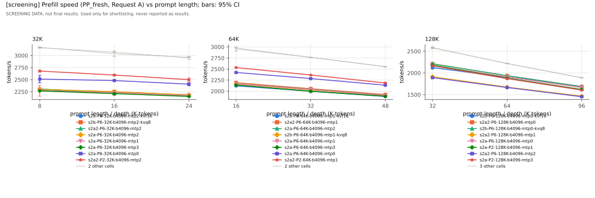
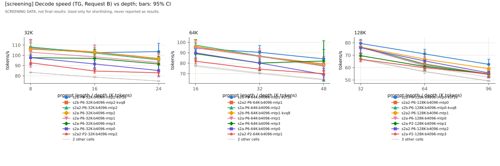
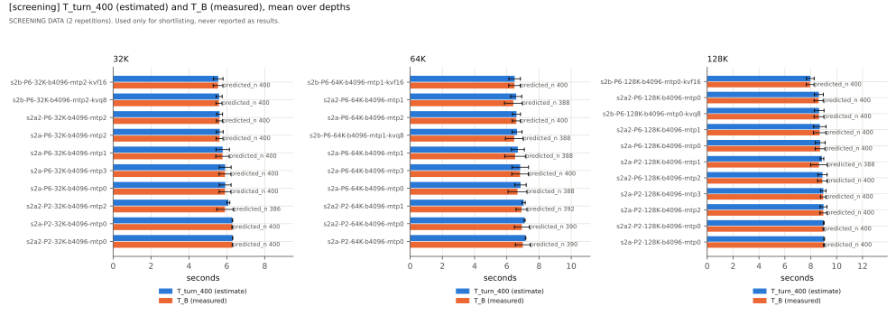
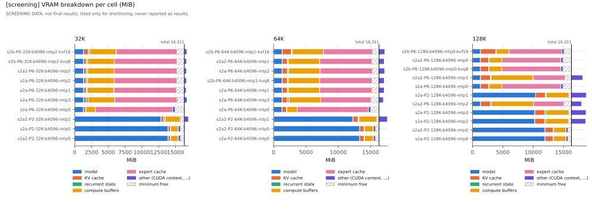
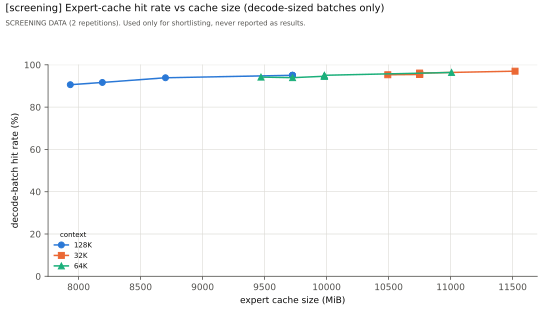

# Baseline report (screening)

> **SCREENING DATA (2 repetitions). Used only for shortlisting, never reported as results.**

## Provenance

- Plan version: v1.6
- Regenerate with: `python -m smallpc.report render --sessions data/raw/s2a-32K data/raw/s2a-64K data/raw/s2a-128K data/raw/s2a2-32K data/raw/s2a2-64K data/raw/s2a2-128K data/raw/s2b data/raw/s2b-32K data/raw/s2b-128K --out reports/stage2 --label screening`
- Statistics: mean, n, min, max and a 95% CI (wider of the percentile-bootstrap interval, 10,000 resamples, fixed seed, and the t interval); CIs shown for n of at least 2. Paired ratios: geometric mean with the wider of the bootstrap CI and a t-interval on the log ratios, back-transformed.

> SCREENING DATA (2 repetitions). Used only for shortlisting, never reported as results.

| session | spec / sha-256 | manifest sha-256 | session commit | record commits | snapshot ids | llama.cpp | state |
|---|---|---|---|---|---|---|---|
| s2a-32K | stage2-2a `a4e031802c25d405` | `ed750c1c73355d08` | 60edde1c8f | `60edde1c8f`, `fa75fdb674` | `66c04f6c276af71a` | `57d04820df` | complete |
| s2a-64K | stage2-2a `a4e031802c25d405` | `ed750c1c73355d08` | f0ae746670 | `d660916310`, `f0ae746670` | `66c04f6c276af71a` | `57d04820df` | complete |
| s2a-128K | stage2-2a `a4e031802c25d405` | `ed750c1c73355d08` | 6ec38e010f | `6ec38e010f`, `ba25f94cc9` | `66c04f6c276af71a` | `57d04820df` | complete |
| s2a2-32K | stage2-2a2 `06624dd84bcf4517` | `ed750c1c73355d08` | 803d129ecb | `803d129ecb` | `df1c18a3a266c0b1` | `57d04820df` | complete |
| s2a2-64K | stage2-2a2 `06624dd84bcf4517` | `ed750c1c73355d08` | 248d83e78a | `248d83e78a` | `df1c18a3a266c0b1` | `57d04820df` | complete |
| s2a2-128K | stage2-2a2 `06624dd84bcf4517` | `ed750c1c73355d08` | 7b60e03586 | `7b60e03586` | `df1c18a3a266c0b1` | `57d04820df` | complete |
| s2b | stage2-2b `2d2cbfb7bdb11b18` | `ed750c1c73355d08` | e7d5312279 | `ba9622cfd1`, `e7d5312279` | `df1c18a3a266c0b1` | `57d04820df` | complete |
| s2b-32K | stage2-2b `63f476b9b217051a` | `ed750c1c73355d08` | 47c6186a3a | `47c6186a3a` | `df1c18a3a266c0b1` | `57d04820df` | complete |
| s2b-128K | stage2-2b `63f476b9b217051a` | `ed750c1c73355d08` | 0d5ecfab67 | `0d5ecfab67` | `df1c18a3a266c0b1` | `57d04820df` | complete |

## Session health

> SCREENING DATA (2 repetitions). Used only for shortlisting, never reported as results.

| session | systemd-inhibit | idle precondition | drift flag |
|---|---|---|---|
| s2a-32K | checked True, active True | 23 checks, 0 failed, total wait 0 s, max busy 1.52 % | main: none, rerun: none |
| s2a-64K | checked True, active True | 23 checks, 0 failed, total wait 0 s, max busy 1.65 % | main: none, rerun: none |
| s2a-128K | checked True, active True | 11 checks, 0 failed, total wait 0 s, max busy 1.42 % | main: none, rerun: none |
| s2a2-32K | checked True, active True | 5 checks, 0 failed, total wait 0 s, max busy 0.51 % | main: none |
| s2a2-64K | checked True, active True | 5 checks, 0 failed, total wait 0 s, max busy 0.53 % | main: none |
| s2a2-128K | checked True, active True | 14 checks, 0 failed, total wait 0 s, max busy 1.44 % | main: none |
| s2b | checked True, active True | 10 checks, 0 failed, total wait 0 s, max busy 0.25 % | main: none, rerun: none |
| s2b-32K | checked True, active True | 8 checks, 0 failed, total wait 0 s, max busy 1.21 % | main: none |
| s2b-128K | checked True, active True | 8 checks, 0 failed, total wait 0 s, max busy 0.5 % | main: none |

Canaries (never part of cell statistics):

> SCREENING DATA (2 repetitions). Used only for shortlisting, never reported as results.

| session | run | phase | reps | PP_fresh 16K (tok/s) | TG 16K (tok/s) | TG short (tok/s) | flags |
|---|---|---|---|---|---|---|---|
| s2a-32K | main | start | 3 | 950.4 [943.7, 957.1] | 78.6 [77.9, 79.3] | 88.9 [87.6, 90.2] | - |
| s2a-32K | main | end | 3 | 959.3 [952.5, 966.2] | 78.3 [78.0, 78.6] | 88.4 [86.6, 90.3] | - |
| s2a-32K | rerun | start | 3 | 958.7 [950.0, 967.3] | 78.6 [78.3, 78.9] | 88.7 [88.5, 88.9] | - |
| s2a-32K | rerun | end | 3 | 957.2 [937.9, 976.6] | 78.0 [77.0, 79.0] | 88.0 [87.1, 88.9] | - |
| s2a-64K | main | start | 3 | 957.4 [954.3, 960.6] | 78.5 [77.9, 79.1] | 88.4 [87.8, 89.0] | - |
| s2a-64K | main | end | 3 | 961.7 [954.4, 969.0] | 78.4 [77.2, 79.5] | 88.9 [87.6, 90.2] | - |
| s2a-64K | rerun | start | 3 | 955.5 [946.7, 964.3] | 78.2 [78.0, 78.3] | 88.3 [88.2, 88.3] | - |
| s2a-64K | rerun | end | 3 | 957.9 [941.3, 974.5] | 78.2 [78.0, 78.4] | 88.3 [87.3, 89.2] | - |
| s2a-128K | main | start | 3 | 956.7 [947.8, 965.6] | 78.7 [77.4, 79.9] | 88.5 [87.5, 89.6] | - |
| s2a-128K | main | end | 3 | 958.7 [935.9, 981.5] | 78.1 [78.0, 78.3] | 88.3 [87.8, 88.8] | - |
| s2a-128K | rerun | start | 3 | 948.0 [931.0, 964.9] | 78.1 [77.5, 78.7] | 88.4 [87.0, 89.9] | - |
| s2a-128K | rerun | end | 3 | 961.0 [952.2, 969.9] | 78.2 [77.5, 79.0] | 88.2 [87.8, 88.6] | - |
| s2a2-32K | main | start | 3 | 956.7 [941.7, 971.7] | 78.3 [77.8, 78.9] | 88.2 [87.7, 88.6] | - |
| s2a2-32K | main | end | 3 | 962.3 [952.4, 972.1] | 78.3 [77.8, 78.8] | 88.5 [87.3, 89.7] | - |
| s2a2-64K | main | start | 3 | 959.9 [951.4, 968.3] | 78.1 [77.9, 78.3] | 88.3 [88.0, 88.6] | - |
| s2a2-64K | main | end | 3 | 958.1 [949.8, 966.4] | 79.0 [78.6, 79.4] | 89.4 [89.1, 89.6] | - |
| s2a2-128K | main | start | 3 | 955.9 [948.2, 963.5] | 78.6 [78.5, 78.7] | 88.6 [88.6, 88.7] | - |
| s2a2-128K | main | end | 3 | 957.7 [948.5, 966.9] | 78.7 [78.5, 78.8] | 88.7 [88.4, 89.0] | - |
| s2b | main | start | 3 | 955.3 [947.2, 963.3] | 79.2 [79.0, 79.4] | 89.3 [88.7, 90.0] | - |
| s2b | main | end | 3 | 958.3 [950.1, 966.4] | 78.3 [76.7, 80.0] | 88.8 [88.5, 89.0] | - |
| s2b | rerun | start | 3 | 954.8 [945.8, 963.7] | 78.7 [78.6, 78.8] | 88.9 [88.6, 89.1] | - |
| s2b | rerun | end | 3 | 957.4 [948.0, 966.8] | 78.4 [76.0, 80.8] | 89.3 [87.8, 90.9] | - |
| s2b-32K | main | start | 3 | 961.7 [954.3, 969.1] | 78.9 [78.8, 79.0] | 89.1 [89.0, 89.2] | - |
| s2b-32K | main | end | 3 | 956.6 [934.2, 979.0] | 77.8 [76.6, 78.9] | 88.5 [87.8, 89.1] | - |
| s2b-128K | main | start | 3 | 961.7 [953.5, 969.9] | 79.1 [78.8, 79.4] | 89.2 [88.3, 90.1] | - |
| s2b-128K | main | end | 3 | 956.4 [945.3, 967.6] | 78.4 [77.5, 79.3] | 89.1 [87.0, 91.1] | - |

## Results

### 32K

> SCREENING DATA (2 repetitions). Used only for shortlisting, never reported as results.

| cell | n_clean/n_total | PP_fresh 8K (tok/s) | PP_fresh 16K (tok/s) | PP_fresh 24K (tok/s) | TG 8K (tok/s) | TG 16K (tok/s) | TG 24K (tok/s) | T_turn_400 (s) | T_B (s) | T_reread (s) | TTFT (s) | acceptance | flags |
|---|---|---|---|---|---|---|---|---|---|---|---|---|---|
| s2b-P6-32K-b4096-mtp2-kvf16 | 5/5 | 2290.5 [2284.8, 2296.2] | 2236.6 [2230.3, 2243.0] | 2170.7 [2163.1, 2178.2] | 106.4 [99.8, 112.9] | 102.6 [95.1, 110.1] | 103.6 [95.5, 111.8] | 5.55 [5.29, 5.80] | 5.54 [5.28, 5.79] (predicted_n 400) | 7.41 [7.39, 7.43] | 1.70 [1.69, 1.71] | 66.2 [63.5, 69.0] % (pooled 66.2 %) | - |
| s2b-P6-32K-b4096-mtp2-kvq8 | 5/5 | 2297.6 [2279.0, 2316.2] | 2251.5 [2250.1, 2252.9] | 2181.3 [2176.0, 2186.7] | 107.4 [100.0, 114.8] | 103.3 [99.0, 107.6] | 96.9 [91.8, 101.9] | 5.60 [5.44, 5.76] | 5.59 [5.43, 5.75] (predicted_n 400) | 7.37 [7.35, 7.38] | 1.68 [1.68, 1.69] | 66.8 [63.0, 70.5] % (pooled 66.7 %) | - |
| s2a2-P6-32K-b4096-mtp2 | 5/5 | 2307.0 [2300.4, 2313.6] | 2229.6 [2187.0, 2272.1] | 2186.1 [2182.0, 2190.2] | 108.2 [101.3, 115.1] | 102.2 [98.4, 106.0] | 95.5 [90.4, 100.7] | 5.62 [5.47, 5.77] | 5.61 [5.46, 5.76] (predicted_n 400) | 7.38 [7.34, 7.42] | 1.68 [1.68, 1.69] | 66.7 [62.9, 70.5] % (pooled 66.7 %) | - |
| s2a-P6-32K-b4096-mtp2 | 5/5 | 2297.4 [2260.1, 2334.8] | 2249.0 [2238.5, 2259.5] | 2185.0 [2179.6, 2190.5] | 106.0 [100.4, 111.5] | 102.9 [98.2, 107.7] | 96.3 [90.1, 102.5] | 5.63 [5.45, 5.81] | 5.62 [5.44, 5.80] (predicted_n 400) | 7.37 [7.34, 7.40] | 1.69 [1.67, 1.70] | 66.6 [62.9, 70.3] % (pooled 66.5 %) | - |
| s2a-P6-32K-b4096-mtp1 | 4/5 not reportable (n < 5) | 2269.2 [2158.5, 2379.9] | 2231.7 [2174.9, 2288.5] | 2170.2 [2141.8, 2198.6] | 103.0 [90.4, 115.6] | 98.5 [87.0, 109.9] | 92.9 [85.1, 100.7] | 5.78 [5.43, 6.14] | 5.77 [5.42, 6.13] (predicted_n 400) | 7.43 [7.35, 7.50] | 1.69 [1.68, 1.69] | 79.7 [76.2, 83.1] % (pooled 79.6 %) | paging, 3 unit(s) re-run (attempt 2 used) |
| s2a-P6-32K-b4096-mtp3 | 5/5 | 2267.6 [2261.8, 2273.3] | 2211.0 [2188.0, 2234.1] | 2152.7 [2147.8, 2157.6] | 97.7 [91.8, 103.7] | 96.9 [88.1, 105.8] | 91.5 [84.1, 98.9] | 5.91 [5.60, 6.23] | 5.90 [5.59, 6.22] (predicted_n 400) | 7.48 [7.46, 7.50] | 1.71 [1.70, 1.71] | 55.4 [50.9, 59.8] % (pooled 55.2 %) | - |
| s2a-P6-32K-b4096-mtp0 | 5/5 | 2512.1 [2433.8, 2590.3] | 2481.9 [2467.5, 2496.3] | 2406.9 [2374.7, 2439.1] | 97.7 [90.8, 104.6] | 91.5 [86.1, 97.0] | 85.1 [78.9, 91.3] | 5.92 [5.61, 6.22] | 5.90 [5.60, 6.21] (predicted_n 400) | 6.69 [6.62, 6.77] | 1.52 [1.50, 1.54] | - | 1 unit(s) re-run (attempt 2 used) |
| s2a2-P2-32K-b4096-mtp2 | 5/5 | 2678.3 [2658.3, 2698.2] | 2595.4 [2579.0, 2611.8] | 2500.6 [2468.9, 2532.3] | 92.7 [88.4, 96.9] | 84.7 [82.6, 86.7] | 82.9 [80.1, 85.7] | 6.08 [6.01, 6.16] | 5.90 [5.47, 6.33] (predicted_n 386) | 6.40 [6.34, 6.46] | 1.46 [1.45, 1.47] | 67.4 [66.3, 68.5] % (pooled 67.4 %) | - |
| s2a-P2-32K-b4096-mtp0 | 5/5 | 3168.7 [3160.7, 3176.7] | 3038.0 [2982.1, 3093.8] | 2961.2 [2960.3, 2962.1] | 83.3 [83.0, 83.6] | 78.7 [78.3, 79.0] | 74.9 [74.7, 75.1] | 6.30 [6.28, 6.31] | 6.28 [6.27, 6.30] (predicted_n 400) | 5.43 [5.39, 5.46] | 1.22 [1.22, 1.22] | - | - |
| s2a2-P2-32K-b4096-mtp0 | 5/5 | 3160.9 [3150.5, 3171.2] | 3069.2 [3066.1, 3072.2] | 2949.8 [2920.3, 2979.2] | 83.3 [82.8, 83.7] | 78.6 [78.3, 79.0] | 74.8 [74.6, 75.1] | 6.31 [6.30, 6.31] | 6.29 [6.28, 6.30] (predicted_n 400) | 5.42 [5.39, 5.45] | 1.23 [1.23, 1.23] | - | - |

Values are mean [95% CI] over clean repetitions. T_turn_400, T_B, T_reread and TTFT are means over the depths of §5.3 per repetition. T_turn_400 is an estimate (400 tokens); T_B is the measured time of Request B and is always shown with its `predicted_n`.

### 64K

> SCREENING DATA (2 repetitions). Used only for shortlisting, never reported as results.

| cell | n_clean/n_total | PP_fresh 16K (tok/s) | PP_fresh 32K (tok/s) | PP_fresh 48K (tok/s) | TG 16K (tok/s) | TG 32K (tok/s) | TG 48K (tok/s) | T_turn_400 (s) | T_B (s) | T_reread (s) | TTFT (s) | acceptance | flags |
|---|---|---|---|---|---|---|---|---|---|---|---|---|---|
| s2b-P6-64K-b4096-mtp1-kvf16 | 5/5 | 2120.5 [2114.7, 2126.3] | 1997.3 [1977.0, 2017.6] | 1880.9 [1868.9, 1892.8] | 94.2 [89.2, 99.1] | 90.4 [83.9, 96.9] | 84.1 [75.0, 93.3] | 6.49 [6.13, 6.84] | 6.48 [6.12, 6.83] (predicted_n 400) | 16.76 [16.69, 16.82] | 2.00 [1.99, 2.01] | 77.1 [74.5, 79.6] % (pooled 77.1 %) | 1 unit(s) re-run (attempt 2 used) |
| s2a2-P6-64K-b4096-mtp1 | 5/5 | 2192.4 [2187.0, 2197.7] | 2055.9 [2035.8, 2076.1] | 1924.5 [1918.2, 1930.8] | 95.7 [89.6, 101.9] | 86.6 [79.4, 93.8] | 79.3 [72.2, 86.5] | 6.58 [6.24, 6.93] | 6.41 [5.86, 6.96] (predicted_n 388) | 16.32 [16.26, 16.37] | 1.96 [1.95, 1.97] | 78.8 [74.7, 82.9] % (pooled 78.9 %) | - |
| s2a-P6-64K-b4096-mtp2 | 5/5 | 2167.3 [2144.1, 2190.5] | 2043.5 [2019.3, 2067.8] | 1907.7 [1881.2, 1934.1] | 97.3 [91.8, 102.8] | 86.9 [82.1, 91.6] | 77.8 [73.4, 82.2] | 6.60 [6.35, 6.85] | 6.59 [6.34, 6.84] (predicted_n 400) | 16.45 [16.25, 16.66] | 1.98 [1.96, 2.01] | 65.3 [62.6, 68.0] % (pooled 65.3 %) | 3 unit(s) re-run (attempt 2 used) |
| s2b-P6-64K-b4096-mtp1-kvq8 | 5/5 | 2158.0 [2154.6, 2161.3] | 2028.5 [2015.5, 2041.5] | 1899.4 [1896.0, 1902.8] | 96.2 [90.0, 102.3] | 86.4 [81.4, 91.4] | 78.3 [71.9, 84.7] | 6.64 [6.33, 6.94] | 6.46 [5.92, 7.01] (predicted_n 388) | 16.54 [16.50, 16.59] | 2.00 [1.97, 2.03] | 78.9 [74.7, 83.1] % (pooled 78.9 %) | - |
| s2a-P6-64K-b4096-mtp1 | 5/5 | 2164.9 [2137.6, 2192.2] | 2038.8 [2017.0, 2060.7] | 1903.9 [1875.8, 1932.0] | 94.6 [88.7, 100.6] | 86.5 [80.6, 92.3] | 77.2 [68.8, 85.5] | 6.69 [6.28, 7.09] | 6.51 [5.87, 7.16] (predicted_n 388) | 16.49 [16.30, 16.67] | 1.99 [1.95, 2.04] | 78.8 [74.6, 83.1] % (pooled 78.9 %) | 3 unit(s) re-run (attempt 2 used) |
| s2a-P6-64K-b4096-mtp3 | 5/5 | 2138.6 [2131.7, 2145.6] | 1998.9 [1976.4, 2021.4] | 1885.0 [1870.3, 1899.7] | 89.1 [83.2, 95.0] | 80.2 [73.0, 87.3] | 82.1 [62.7, 101.5] | 6.83 [6.32, 7.35] | 6.82 [6.31, 7.33] (predicted_n 400) | 16.71 [16.64, 16.78] | 2.01 [2.00, 2.01] | 56.2 [51.1, 61.3] % (pooled 56.1 %) | - |
| s2a-P6-64K-b4096-mtp0 | 5/5 | 2423.0 [2419.2, 2426.7] | 2285.2 [2280.6, 2289.7] | 2135.3 [2124.9, 2145.7] | 89.9 [85.1, 94.7] | 80.2 [74.4, 85.9] | 69.3 [63.5, 75.1] | 6.86 [6.50, 7.21] | 6.66 [6.08, 7.25] (predicted_n 388) | 14.71 [14.68, 14.73] | 1.78 [1.74, 1.81] | - | - |
| s2a2-P2-64K-b4096-mtp1 | 5/5 | 2534.3 [2523.6, 2545.1] | 2365.9 [2361.1, 2370.8] | 2184.8 [2172.1, 2197.5] | 81.9 [79.3, 84.4] | 74.2 [72.6, 75.8] | 69.9 [66.9, 73.0] | 7.05 [6.95, 7.15] | 6.92 [6.58, 7.25] (predicted_n 392) | 14.27 [14.23, 14.31] | 1.72 [1.67, 1.76] | 78.5 [74.5, 82.5] % (pooled 78.4 %) | - |
| s2a2-P2-64K-b4096-mtp0 | 5/5 | 2975.4 [2973.4, 2977.3] | 2767.7 [2763.6, 2771.8] | 2555.9 [2554.4, 2557.3] | 78.0 [77.6, 78.4] | 70.7 [70.4, 71.0] | 64.7 [64.5, 65.0] | 7.11 [7.08, 7.14] | 6.93 [6.47, 7.39] (predicted_n 390) | 12.19 [12.18, 12.20] | 1.46 [1.43, 1.49] | - | - |
| s2a-P2-64K-b4096-mtp0 | 5/5 | 2953.7 [2908.0, 2999.4] | 2763.9 [2758.5, 2769.4] | 2550.8 [2546.1, 2555.5] | 76.9 [76.8, 77.1] | 69.9 [69.6, 70.2] | 64.0 [63.7, 64.3] | 7.17 [7.15, 7.18] | 6.99 [6.54, 7.45] (predicted_n 390) | 12.22 [12.20, 12.25] | 1.45 [1.45, 1.45] | - | - |

Values are mean [95% CI] over clean repetitions. T_turn_400, T_B, T_reread and TTFT are means over the depths of §5.3 per repetition. T_turn_400 is an estimate (400 tokens); T_B is the measured time of Request B and is always shown with its `predicted_n`.

### 128K

> SCREENING DATA (2 repetitions). Used only for shortlisting, never reported as results.

| cell | n_clean/n_total | PP_fresh 32K (tok/s) | PP_fresh 64K (tok/s) | PP_fresh 96K (tok/s) | TG 32K (tok/s) | TG 64K (tok/s) | TG 96K (tok/s) | T_turn_400 (s) | T_B (s) | T_reread (s) | TTFT (s) | acceptance | flags |
|---|---|---|---|---|---|---|---|---|---|---|---|---|---|
| s2b-P6-128K-b4096-mtp0-kvf16 | 5/5 | 2121.1 [2100.6, 2141.5] | 1907.4 [1906.2, 1908.7] | 1689.1 [1685.3, 1693.0] | 79.4 [76.1, 82.7] | 71.0 [67.3, 74.8] | 62.6 [58.4, 66.8] | 7.97 [7.67, 8.27] | 7.95 [7.66, 8.25] (predicted_n 400) | 36.00 [35.93, 36.07] | 2.28 [2.27, 2.29] | - | - |
| s2a2-P6-128K-b4096-mtp0 | 5/5 | 2213.3 [2210.0, 2216.6] | 1937.5 [1935.6, 1939.3] | 1686.0 [1684.6, 1687.5] | 76.6 [71.2, 82.0] | 63.0 [59.4, 66.6] | 54.7 [52.3, 57.2] | 8.63 [8.27, 8.98] | 8.61 [8.26, 8.96] (predicted_n 400) | 35.65 [35.62, 35.67] | 2.33 [2.32, 2.34] | - | - |
| s2b-P6-128K-b4096-mtp0-kvq8 | 5/5 | 2210.2 [2207.0, 2213.3] | 1936.9 [1935.5, 1938.3] | 1685.0 [1683.2, 1686.8] | 76.8 [71.6, 81.9] | 62.4 [58.1, 66.7] | 54.7 [52.3, 57.2] | 8.65 [8.27, 9.03] | 8.63 [8.26, 9.01] (predicted_n 400) | 35.67 [35.64, 35.69] | 2.34 [2.33, 2.35] | - | - |
| s2a2-P6-128K-b4096-mtp1 | 5/5 | 1913.3 [1910.1, 1916.4] | 1673.4 [1662.6, 1684.3] | 1466.0 [1465.4, 1466.5] | 76.6 [71.7, 81.5] | 66.8 [60.7, 72.9] | 59.2 [55.8, 62.6] | 8.70 [8.22, 9.18] | 8.69 [8.21, 9.16] (predicted_n 400) | 41.12 [41.03, 41.20] | 2.70 [2.64, 2.77] | 78.6 [74.7, 82.6] % (pooled 78.6 %) | - |
| s2a-P6-128K-b4096-mtp0 | 5/5 | 2174.5 [2171.3, 2177.7] | 1908.6 [1906.9, 1910.4] | 1661.5 [1658.8, 1664.3] | 76.3 [70.7, 81.8] | 61.5 [57.9, 65.2] | 54.3 [51.8, 56.8] | 8.73 [8.35, 9.11] | 8.72 [8.34, 9.09] (predicted_n 400) | 36.19 [36.15, 36.23] | 2.36 [2.35, 2.37] | - | - |
| s2a-P2-128K-b4096-mtp1 | 5/5 | 2180.6 [2169.7, 2191.5] | 1881.2 [1871.3, 1891.1] | 1618.1 [1613.3, 1622.8] | 69.6 [67.3, 71.8] | 60.9 [58.9, 62.9] | 55.0 [52.9, 57.2] | 8.87 [8.73, 9.01] | 8.63 [8.00, 9.27] (predicted_n 388) | 36.87 [36.78, 36.97] | 2.34 [2.29, 2.40] | 77.8 [73.4, 82.1] % (pooled 77.6 %) | - |
| s2a2-P6-128K-b4096-mtp2 | 5/5 | 1891.8 [1871.3, 1912.3] | 1664.1 [1659.9, 1668.2] | 1452.2 [1446.5, 1457.9] | 76.0 [71.6, 80.3] | 65.4 [62.1, 68.6] | 55.7 [51.8, 59.7] | 8.91 [8.54, 9.27] | 8.89 [8.53, 9.25] (predicted_n 400) | 41.47 [41.39, 41.54] | 2.72 [2.71, 2.73] | 65.5 [62.0, 69.0] % (pooled 65.5 %) | - |
| s2a-P2-128K-b4096-mtp3 | 5/5 | 2167.5 [2160.9, 2174.1] | 1870.2 [1861.0, 1879.5] | 1605.9 [1591.8, 1620.0] | 66.7 [64.6, 68.8] | 59.9 [57.6, 62.1] | 55.0 [51.8, 58.2] | 8.97 [8.77, 9.18] | 8.96 [8.75, 9.16] (predicted_n 400) | 37.13 [36.93, 37.32] | 2.32 [2.31, 2.34] | 56.8 [53.6, 60.0] % (pooled 56.8 %) | 3 unit(s) re-run (attempt 2 used) |
| s2a-P2-128K-b4096-mtp2 | 3/5 not reportable (n < 5) | 2139.8 [2083.9, 2195.8] | 1864.9 [1845.8, 1884.1] | 1601.3 [1587.9, 1614.8] | 69.8 [65.4, 74.2] | 60.6 [55.2, 66.0] | 52.3 [51.9, 52.6] | 8.99 [8.72, 9.26] | 8.97 [8.71, 9.24] (predicted_n 400) | 37.28 [37.08, 37.48] | 2.33 [2.32, 2.35] | 65.7 [61.5, 69.9] % (pooled 65.7 %) | paging, 2 unit(s) re-run (attempt 2 used) |
| s2a2-P2-128K-b4096-mtp0 | 5/5 | 2577.9 [2556.7, 2599.0] | 2218.6 [2217.6, 2219.6] | 1890.6 [1888.9, 1892.3] | 66.9 [66.6, 67.2] | 57.0 [56.6, 57.3] | 49.4 [49.0, 49.8] | 9.00 [8.97, 9.04] | 8.99 [8.96, 9.02] (predicted_n 400) | 31.42 [31.37, 31.46] | 1.98 [1.94, 2.02] | - | - |
| s2a-P2-128K-b4096-mtp0 | 5/5 | 2584.6 [2581.1, 2588.2] | 2215.7 [2212.0, 2219.3] | 1889.4 [1885.1, 1893.6] | 66.4 [65.8, 66.9] | 56.6 [56.4, 56.7] | 49.2 [49.0, 49.3] | 9.04 [9.01, 9.07] | 9.02 [8.99, 9.05] (predicted_n 400) | 31.43 [31.39, 31.46] | 1.97 [1.96, 1.97] | - | - |

Values are mean [95% CI] over clean repetitions. T_turn_400, T_B, T_reread and TTFT are means over the depths of §5.3 per repetition. T_turn_400 is an estimate (400 tokens); T_B is the measured time of Request B and is always shown with its `predicted_n`.

## Eligibility and selection

Mode **screening**: a cell needs at least 2 clean repetitions, a complete status, at least 512 MiB free VRAM at its tightest, no flagged unit and a sanity check that has not failed (`not run` is allowed).

### 32K

> SCREENING DATA (2 repetitions). Used only for shortlisting, never reported as results.

| cell | role | n_clean/n_total | mean T_turn_400 (s) [95% CI] | eligible | reasons it is not | sanity |
|---|---|---|---|---|---|---|
| s2a-P2-32K-b4096-mtp0 | candidate | 5/5 | 6.30 [6.28, 6.31] | yes | - | not run |
| s2a-P6-32K-b4096-mtp0 | candidate | 5/5 | 5.92 [5.61, 6.22] | yes | - | not run |
| s2a-P6-32K-b4096-mtp1 | candidate | 4/5 | 5.78 [5.43, 6.14] | no | flagged unit(s) s2a-32K:4 (paging) | not run |
| s2a-P6-32K-b4096-mtp2 | candidate | 5/5 | 5.63 [5.45, 5.81] | yes | - | not run |
| s2a-P6-32K-b4096-mtp3 | candidate | 5/5 | 5.91 [5.60, 6.23] | yes | - | not run |
| s2a2-P2-32K-b4096-mtp0 | candidate | 5/5 | 6.31 [6.30, 6.31] | yes | - | not run |
| s2a2-P2-32K-b4096-mtp2 | candidate | 5/5 | 6.08 [6.01, 6.16] | no | failed the output sanity check | fail |
| s2a2-P6-32K-b4096-mtp2 | candidate | 5/5 | 5.62 [5.47, 5.77] | yes | - | not run |
| s2b-P6-32K-b4096-mtp2-kvf16 | candidate | 5/5 | 5.55 [5.29, 5.80] | no | failed the output sanity check | fail |
| s2b-P6-32K-b4096-mtp2-kvq8 | candidate | 5/5 | 5.60 [5.44, 5.76] | yes | - | not run |

**Shortlist (32K):** `s2b-P6-32K-b4096-mtp2-kvq8`, `s2a2-P6-32K-b4096-mtp2`.

Ranking by mean T_turn_400: `s2b-P6-32K-b4096-mtp2-kvq8` < `s2a2-P6-32K-b4096-mtp2` < `s2a-P6-32K-b4096-mtp2` < `s2a-P6-32K-b4096-mtp3` < `s2a-P6-32K-b4096-mtp0` < `s2a-P2-32K-b4096-mtp0` < `s2a2-P2-32K-b4096-mtp0`

- `s2b-P6-32K-b4096-mtp2-kvq8` and `s2a2-P6-32K-b4096-mtp2`: too close to call at n = 2 (means differ by 0.024 s, larger range 0.291 s).
- `s2b-P6-32K-b4096-mtp2-kvq8` and `s2a-P6-32K-b4096-mtp2`: too close to call at n = 2 (means differ by 0.031 s, larger range 0.346 s).
- `s2b-P6-32K-b4096-mtp2-kvq8` and `s2a-P6-32K-b4096-mtp3`: too close to call at n = 2 (means differ by 0.318 s, larger range 0.584 s).
- `s2a2-P6-32K-b4096-mtp2` and `s2a-P6-32K-b4096-mtp2`: too close to call at n = 2 (means differ by 0.008 s, larger range 0.346 s).
- `s2a2-P6-32K-b4096-mtp2` and `s2a-P6-32K-b4096-mtp3`: too close to call at n = 2 (means differ by 0.295 s, larger range 0.584 s).
- `s2a-P6-32K-b4096-mtp2` and `s2a-P6-32K-b4096-mtp3`: too close to call at n = 2 (means differ by 0.287 s, larger range 0.584 s).

- `s2b-P6-32K-b4096-mtp2-kvq8`: VRAM model 1326, KV 404, recurrent 188, compute 3973, expert cache 10750, other -1461.2 MiB; minimum free 1131.0 MiB; expert-cache decode-batch hit rate 95.5%.
- `s2a2-P6-32K-b4096-mtp2`: VRAM model 1326, KV 404, recurrent 188, compute 3973, expert cache 10750, other -1461.2 MiB; minimum free 1131.0 MiB; expert-cache decode-batch hit rate 95.5%.

### 64K

> SCREENING DATA (2 repetitions). Used only for shortlisting, never reported as results.

| cell | role | n_clean/n_total | mean T_turn_400 (s) [95% CI] | eligible | reasons it is not | sanity |
|---|---|---|---|---|---|---|
| s2a-P2-64K-b4096-mtp0 | candidate | 5/5 | 7.17 [7.15, 7.18] | yes | - | not run |
| s2a-P6-64K-b4096-mtp0 | candidate | 5/5 | 6.86 [6.50, 7.21] | yes | - | not run |
| s2a-P6-64K-b4096-mtp1 | candidate | 5/5 | 6.69 [6.28, 7.09] | yes | - | not run |
| s2a-P6-64K-b4096-mtp2 | candidate | 5/5 | 6.60 [6.35, 6.85] | yes | - | not run |
| s2a-P6-64K-b4096-mtp3 | candidate | 5/5 | 6.83 [6.32, 7.35] | yes | - | not run |
| s2a2-P2-64K-b4096-mtp0 | candidate | 5/5 | 7.11 [7.08, 7.14] | yes | - | pass |
| s2a2-P2-64K-b4096-mtp1 | candidate | 5/5 | 7.05 [6.95, 7.15] | no | minimum free VRAM 397 MiB is below 512 | not run |
| s2a2-P6-64K-b4096-mtp1 | candidate | 5/5 | 6.58 [6.24, 6.93] | yes | - | not run |
| s2b-P6-64K-b4096-mtp1-kvf16 | candidate | 5/5 | 6.49 [6.13, 6.84] | yes | - | pass |
| s2b-P6-64K-b4096-mtp1-kvq8 | candidate | 5/5 | 6.64 [6.33, 6.94] | yes | - | not run |

**Shortlist (64K):** `s2b-P6-64K-b4096-mtp1-kvf16`, `s2a2-P6-64K-b4096-mtp1`.

Ranking by mean T_turn_400: `s2b-P6-64K-b4096-mtp1-kvf16` < `s2a2-P6-64K-b4096-mtp1` < `s2a-P6-64K-b4096-mtp2` < `s2b-P6-64K-b4096-mtp1-kvq8` < `s2a-P6-64K-b4096-mtp1` < `s2a-P6-64K-b4096-mtp3` < `s2a-P6-64K-b4096-mtp0` < `s2a2-P2-64K-b4096-mtp0` < `s2a-P2-64K-b4096-mtp0`

- `s2b-P6-64K-b4096-mtp1-kvf16` and `s2a2-P6-64K-b4096-mtp1`: too close to call at n = 2 (means differ by 0.097 s, larger range 0.733 s).
- `s2b-P6-64K-b4096-mtp1-kvf16` and `s2a-P6-64K-b4096-mtp2`: too close to call at n = 2 (means differ by 0.116 s, larger range 0.733 s).
- `s2b-P6-64K-b4096-mtp1-kvf16` and `s2b-P6-64K-b4096-mtp1-kvq8`: too close to call at n = 2 (means differ by 0.151 s, larger range 0.733 s).
- `s2a2-P6-64K-b4096-mtp1` and `s2a-P6-64K-b4096-mtp2`: too close to call at n = 2 (means differ by 0.019 s, larger range 0.671 s).
- `s2a2-P6-64K-b4096-mtp1` and `s2b-P6-64K-b4096-mtp1-kvq8`: too close to call at n = 2 (means differ by 0.054 s, larger range 0.671 s).
- `s2a-P6-64K-b4096-mtp2` and `s2b-P6-64K-b4096-mtp1-kvq8`: too close to call at n = 2 (means differ by 0.035 s, larger range 0.582 s).

- `s2b-P6-64K-b4096-mtp1-kvf16`: VRAM model 1326, KV 1408, recurrent 126, compute 4872, expert cache 9471, other -1913.0 MiB; minimum free 1019.0 MiB; expert-cache decode-batch hit rate 94.2%.
- `s2a2-P6-64K-b4096-mtp1`: VRAM model 1326, KV 808, recurrent 126, compute 4872, expert cache 9982, other -1908.3 MiB; minimum free 1105.0 MiB; expert-cache decode-batch hit rate 94.7%.

### 128K

> SCREENING DATA (2 repetitions). Used only for shortlisting, never reported as results.

| cell | role | n_clean/n_total | mean T_turn_400 (s) [95% CI] | eligible | reasons it is not | sanity |
|---|---|---|---|---|---|---|
| s2a-P2-128K-b4096-mtp0 | candidate | 5/5 | 9.04 [9.01, 9.07] | yes | - | not run |
| s2a-P2-128K-b4096-mtp1 | candidate | 5/5 | 8.87 [8.73, 9.01] | no | minimum free VRAM 421 MiB is below 512 | not run |
| s2a-P2-128K-b4096-mtp2 | candidate | 3/5 | 8.99 [8.72, 9.26] | no | minimum free VRAM 503 MiB is below 512; flagged unit(s) s2a-128K:0, s2a-128K:1 (paging) | not run |
| s2a-P2-128K-b4096-mtp3 | candidate | 5/5 | 8.97 [8.77, 9.18] | no | minimum free VRAM 443 MiB is below 512 | not run |
| s2a-P6-128K-b4096-mtp0 | candidate | 5/5 | 8.73 [8.35, 9.11] | yes | - | not run |
| s2a2-P2-128K-b4096-mtp0 | candidate | 5/5 | 9.00 [8.97, 9.04] | yes | - | not run |
| s2a2-P6-128K-b4096-mtp0 | candidate | 5/5 | 8.63 [8.27, 8.98] | yes | - | not run |
| s2a2-P6-128K-b4096-mtp1 | candidate | 5/5 | 8.70 [8.22, 9.18] | yes | - | pass |
| s2a2-P6-128K-b4096-mtp2 | candidate | 5/5 | 8.91 [8.54, 9.27] | yes | - | not run |
| s2b-P6-128K-b4096-mtp0-kvf16 | candidate | 5/5 | 7.97 [7.67, 8.27] | yes | - | pass |
| s2b-P6-128K-b4096-mtp0-kvq8 | candidate | 5/5 | 8.65 [8.27, 9.03] | yes | - | not run |

**Shortlist (128K):** `s2b-P6-128K-b4096-mtp0-kvf16`, `s2a2-P6-128K-b4096-mtp0`.

Ranking by mean T_turn_400: `s2b-P6-128K-b4096-mtp0-kvf16` < `s2a2-P6-128K-b4096-mtp0` < `s2b-P6-128K-b4096-mtp0-kvq8` < `s2a2-P6-128K-b4096-mtp1` < `s2a-P6-128K-b4096-mtp0` < `s2a2-P6-128K-b4096-mtp2` < `s2a2-P2-128K-b4096-mtp0` < `s2a-P2-128K-b4096-mtp0`

- `s2b-P6-128K-b4096-mtp0-kvf16` and `s2a2-P6-128K-b4096-mtp1`: too close to call at n = 2 (means differ by 0.734 s, larger range 0.908 s).
- `s2a2-P6-128K-b4096-mtp0` and `s2b-P6-128K-b4096-mtp0-kvq8`: too close to call at n = 2 (means differ by 0.025 s, larger range 0.617 s).
- `s2a2-P6-128K-b4096-mtp0` and `s2a2-P6-128K-b4096-mtp1`: too close to call at n = 2 (means differ by 0.075 s, larger range 0.908 s).
- `s2b-P6-128K-b4096-mtp0-kvq8` and `s2a2-P6-128K-b4096-mtp1`: too close to call at n = 2 (means differ by 0.051 s, larger range 0.908 s).

- `s2b-P6-128K-b4096-mtp0-kvf16`: VRAM model 1303, KV 2560, recurrent 63, compute 2116, expert cache 8701, other 357.7 MiB; minimum free 1211.0 MiB; expert-cache decode-batch hit rate 93.9%.
- `s2a2-P6-128K-b4096-mtp0`: VRAM model 1303, KV 1360, recurrent 63, compute 2116, expert cache 9725, other 363.2 MiB; minimum free 1381.0 MiB; expert-cache decode-batch hit rate 95.1%.

## Paired comparisons with stock

No context has both a stock cell and a candidate with clean repetitions.

## Swap sensitivity

Every results table and paired comparison, recomputed without the clean units whose window shows more than 64 MiB of llama-server swap growth (`swap_activity_mib`, plan §5.5 and §5.6). Swap activity is a note, not a flag: the numbers in the other sections keep those units.

> SCREENING DATA (2 repetitions). Used only for shortlisting, never reported as results.

| removed unit (cell, session, repetition) | swap growth (MiB) | source |
|---|---|---|
| s2a-P6-128K-b4096-mtp0, s2a-128K, 3 | 362.2 | summary |
| s2a-P2-32K-b4096-mtp0, s2a-32K, 2 | 266.7 | summary |
| s2a-P2-32K-b4096-mtp0, s2a-32K, 3 | 214.6 | summary |
| s2a-P6-32K-b4096-mtp1, s2a-32K, 1 | 848.3 | summary |
| s2a-P6-32K-b4096-mtp2, s2a-32K, 2 | 749.3 | summary |
| s2a-P6-64K-b4096-mtp0, s2a-64K, 3 | 425.5 | summary |
| s2a-P6-64K-b4096-mtp0, s2a-64K, 4 | 111.8 | summary |
| s2a-P6-64K-b4096-mtp1, s2a-64K, 1 | 2208.6 | summary |
| s2a-P6-64K-b4096-mtp1, s2a-64K, 4 | 486.5 | summary |
| s2a-P6-64K-b4096-mtp2, s2a-64K, 1 | 431.6 | summary |
| s2a-P6-64K-b4096-mtp3, s2a-64K, 0 | 426.8 | summary |
| s2a-P6-64K-b4096-mtp3, s2a-64K, 1 | 170.5 | summary |
| s2a-P6-64K-b4096-mtp3, s2a-64K, 2 | 87.2 | summary |
| s2a2-P2-128K-b4096-mtp0, s2a2-128K, 4 | 339.2 | summary |
| s2a2-P6-128K-b4096-mtp1, s2a2-128K, 2 | 384.6 | summary |
| s2a2-P6-128K-b4096-mtp1, s2a2-128K, 3 | 380.5 | summary |
| s2a2-P6-128K-b4096-mtp2, s2a2-128K, 4 | 304.0 | summary |
| s2a2-P2-32K-b4096-mtp2, s2a2-32K, 3 | 831.3 | summary |
| s2a2-P6-32K-b4096-mtp2, s2a2-32K, 3 | 163.8 | summary |
| s2a2-P6-32K-b4096-mtp2, s2a2-32K, 4 | 354.3 | summary |
| s2a2-P2-64K-b4096-mtp1, s2a2-64K, 1 | 389.7 | summary |
| s2a2-P2-64K-b4096-mtp1, s2a2-64K, 2 | 361.9 | summary |
| s2b-P6-64K-b4096-mtp1-kvf16, s2b, 1 | 343.8 | summary |
| s2b-P6-64K-b4096-mtp1-kvf16, s2b, 3 | 267.5 | summary |
| s2b-P6-64K-b4096-mtp1-kvf16, s2b, 4 | 136.2 | summary |
| s2b-P6-64K-b4096-mtp1-kvq8, s2b, 1 | 308.7 | summary |
| s2b-P6-64K-b4096-mtp1-kvq8, s2b, 2 | 508.2 | summary |
| s2b-P6-128K-b4096-mtp0-kvq8, s2b-128K, 3 | 231.7 | summary |
| s2b-P6-128K-b4096-mtp0-kvq8, s2b-128K, 4 | 178.8 | summary |
| s2b-P6-32K-b4096-mtp2-kvf16, s2b-32K, 1 | 698.8 | summary |
| s2b-P6-32K-b4096-mtp2-kvq8, s2b-32K, 1 | 637.4 | summary |

Units above the threshold that are already excluded by a flag (not affected here): s2a-P2-128K-b4096-mtp2 s2a-128K:0 (749 MiB, paging).

### 32K

> SCREENING DATA (2 repetitions). Used only for shortlisting, never reported as results.

| cell | n_clean (all) | T_turn_400 (s), all units | n_clean (no swap-heavy) | T_turn_400 (s), without swap-heavy units |
|---|---|---|---|---|
| s2b-P6-32K-b4096-mtp2-kvf16 | 5 | 5.55 [5.29, 5.80] | 4 | 5.47 [5.26, 5.68] |
| s2b-P6-32K-b4096-mtp2-kvq8 | 5 | 5.60 [5.44, 5.76] | 4 | 5.55 [5.40, 5.70] |
| s2a2-P6-32K-b4096-mtp2 | 5 | 5.62 [5.47, 5.77] | 3 | 5.66 [5.28, 6.04] |
| s2a-P6-32K-b4096-mtp2 | 5 | 5.63 [5.45, 5.81] | 4 | 5.65 [5.41, 5.90] |
| s2a-P6-32K-b4096-mtp1 | 4 | 5.78 [5.43, 6.14] | 3 | 5.68 [5.49, 5.86] |
| s2a-P6-32K-b4096-mtp3 | 5 | 5.91 [5.60, 6.23] | 5 | 5.91 [5.60, 6.23] |
| s2a-P6-32K-b4096-mtp0 | 5 | 5.92 [5.61, 6.22] | 5 | 5.92 [5.61, 6.22] |
| s2a2-P2-32K-b4096-mtp2 | 5 | 6.08 [6.01, 6.16] | 4 | 6.10 [6.00, 6.19] |
| s2a-P2-32K-b4096-mtp0 | 5 | 6.30 [6.28, 6.31] | 3 | 6.29 [6.26, 6.33] |
| s2a2-P2-32K-b4096-mtp0 | 5 | 6.31 [6.30, 6.31] | 5 | 6.31 [6.30, 6.31] |

### 64K

> SCREENING DATA (2 repetitions). Used only for shortlisting, never reported as results.

| cell | n_clean (all) | T_turn_400 (s), all units | n_clean (no swap-heavy) | T_turn_400 (s), without swap-heavy units |
|---|---|---|---|---|
| s2b-P6-64K-b4096-mtp1-kvf16 | 5 | 6.49 [6.13, 6.84] | 2 | 6.50 [5.23, 7.76] |
| s2a2-P6-64K-b4096-mtp1 | 5 | 6.58 [6.24, 6.93] | 5 | 6.58 [6.24, 6.93] |
| s2a-P6-64K-b4096-mtp2 | 5 | 6.60 [6.35, 6.85] | 4 | 6.55 [6.24, 6.86] |
| s2b-P6-64K-b4096-mtp1-kvq8 | 5 | 6.64 [6.33, 6.94] | 3 | 6.52 [5.99, 7.05] |
| s2a-P6-64K-b4096-mtp1 | 5 | 6.69 [6.28, 7.09] | 3 | 6.64 [6.03, 7.25] |
| s2a-P6-64K-b4096-mtp3 | 5 | 6.83 [6.32, 7.35] | 2 | 6.78 [5.89, 7.68] |
| s2a-P6-64K-b4096-mtp0 | 5 | 6.86 [6.50, 7.21] | 3 | 7.05 [6.71, 7.39] |
| s2a2-P2-64K-b4096-mtp1 | 5 | 7.05 [6.95, 7.15] | 3 | 7.05 [6.76, 7.33] |
| s2a2-P2-64K-b4096-mtp0 | 5 | 7.11 [7.08, 7.14] | 5 | 7.11 [7.08, 7.14] |
| s2a-P2-64K-b4096-mtp0 | 5 | 7.17 [7.15, 7.18] | 5 | 7.17 [7.15, 7.18] |

### 128K

> SCREENING DATA (2 repetitions). Used only for shortlisting, never reported as results.

| cell | n_clean (all) | T_turn_400 (s), all units | n_clean (no swap-heavy) | T_turn_400 (s), without swap-heavy units |
|---|---|---|---|---|
| s2b-P6-128K-b4096-mtp0-kvf16 | 5 | 7.97 [7.67, 8.27] | 5 | 7.97 [7.67, 8.27] |
| s2a2-P6-128K-b4096-mtp0 | 5 | 8.63 [8.27, 8.98] | 5 | 8.63 [8.27, 8.98] |
| s2b-P6-128K-b4096-mtp0-kvq8 | 5 | 8.65 [8.27, 9.03] | 3 | 8.83 [8.18, 9.47] |
| s2a2-P6-128K-b4096-mtp1 | 5 | 8.70 [8.22, 9.18] | 3 | 8.85 [7.71, 9.99] |
| s2a-P6-128K-b4096-mtp0 | 5 | 8.73 [8.35, 9.11] | 4 | 8.80 [8.30, 9.29] |
| s2a-P2-128K-b4096-mtp1 | 5 | 8.87 [8.73, 9.01] | 5 | 8.87 [8.73, 9.01] |
| s2a2-P6-128K-b4096-mtp2 | 5 | 8.91 [8.54, 9.27] | 4 | 8.99 [8.57, 9.41] |
| s2a-P2-128K-b4096-mtp3 | 5 | 8.97 [8.77, 9.18] | 5 | 8.97 [8.77, 9.18] |
| s2a-P2-128K-b4096-mtp2 | 3 | 8.99 [8.72, 9.26] | 3 | 8.99 [8.72, 9.26] |
| s2a2-P2-128K-b4096-mtp0 | 5 | 9.00 [8.97, 9.04] | 4 | 9.00 [8.96, 9.04] |
| s2a-P2-128K-b4096-mtp0 | 5 | 9.04 [9.01, 9.07] | 5 | 9.04 [9.01, 9.07] |

**Verdict.**

- A headline comparison changed sign: **YES**: 64K: order of the two fastest candidates ['s2b-P6-64K-b4096-mtp1-kvf16', 's2a2-P6-64K-b4096-mtp1'] -> ['s2b-P6-64K-b4096-mtp1-kvf16', 's2b-P6-64K-b4096-mtp1-kvq8']
- An interval changed materially (an endpoint moved by more than the interval's half-width): **YES**: s2a-P2-32K-b4096-mtp0: T_turn_400 interval; s2a2-P6-32K-b4096-mtp2: T_turn_400 interval; s2a2-P2-64K-b4096-mtp1: T_turn_400 interval; s2b-P6-64K-b4096-mtp1-kvf16: T_turn_400 interval; s2b-P6-64K-b4096-mtp1-kvq8: T_turn_400 interval; s2a2-P6-128K-b4096-mtp1: T_turn_400 interval; s2b-P6-128K-b4096-mtp0-kvq8: T_turn_400 interval

## VRAM breakdown

### 32K

> SCREENING DATA (2 repetitions). Used only for shortlisting, never reported as results.

| cell | model | KV | recurrent state | compute buffers | expert cache | other | peak used | min free (final windows) | expert layers on CPU |
|---|---|---|---|---|---|---|---|---|---|
| s2b-P6-32K-b4096-mtp2-kvf16 | 1,326 | 704 (f16) | 188 | 3,973 | 10,493 | -1,463 | 15,222 | 1,089 | - |
| s2b-P6-32K-b4096-mtp2-kvq8 | 1,326 | 404 (q8_0) | 188 | 3,973 | 10,750 | -1,461 | 15,180 | 1,131 | - |
| s2a2-P6-32K-b4096-mtp2 | 1,326 | 404 (q8_0) | 188 | 3,973 | 10,750 | -1,461 | 15,180 | 1,131 | - |
| s2a-P6-32K-b4096-mtp2 | 1,326 | 404 (q8_0) | 188 | 3,973 | 10,750 | -1,461 | 15,180 | 1,131 | - |
| s2a-P6-32K-b4096-mtp1 | 1,326 | 404 (q8_0) | 126 | 3,973 | 10,750 | -1,462 | 15,116 | 1,195 | - |
| s2a-P6-32K-b4096-mtp3 | 1,326 | 404 (q8_0) | 251 | 3,973 | 10,750 | -1,462 | 15,242 | 1,069 | - |
| s2a-P6-32K-b4096-mtp0 | 1,303 | 340 (q8_0) | 63 | 1,348 | 11,520 | 359 | 14,932 | 1,379 | - |
| s2a2-P2-32K-b4096-mtp2 | 12,848 | 404 (q8_0) | 188 | 3,485 | 0 | -1,230 | 15,696 | 615 | 17 |
| s2a-P2-32K-b4096-mtp0 | 13,900 | 340 (q8_0) | 63 | 1,104 | 0 | 337 | 15,744 | 567 | 14 |
| s2a2-P2-32K-b4096-mtp0 | 13,900 | 340 (q8_0) | 63 | 1,104 | 0 | 337 | 15,744 | 567 | 14 |

### 64K

> SCREENING DATA (2 repetitions). Used only for shortlisting, never reported as results.

| cell | model | KV | recurrent state | compute buffers | expert cache | other | peak used | min free (final windows) | expert layers on CPU |
|---|---|---|---|---|---|---|---|---|---|
| s2b-P6-64K-b4096-mtp1-kvf16 | 1,326 | 1,408 (f16) | 126 | 4,872 | 9,471 | -1,913 | 15,290 | 1,019 | - |
| s2a2-P6-64K-b4096-mtp1 | 1,326 | 808 (q8_0) | 126 | 4,872 | 9,982 | -1,908 | 15,206 | 1,105 | - |
| s2a-P6-64K-b4096-mtp2 | 1,326 | 808 (q8_0) | 188 | 4,872 | 9,982 | -1,907 | 15,270 | 1,041 | - |
| s2b-P6-64K-b4096-mtp1-kvq8 | 1,326 | 808 (q8_0) | 126 | 4,872 | 9,982 | -1,906 | 15,208 | 1,103 | - |
| s2a-P6-64K-b4096-mtp1 | 1,326 | 808 (q8_0) | 126 | 4,872 | 9,982 | -1,908 | 15,206 | 1,105 | - |
| s2a-P6-64K-b4096-mtp3 | 1,326 | 808 (q8_0) | 251 | 4,872 | 9,726 | -1,909 | 15,074 | 1,237 | - |
| s2a-P6-64K-b4096-mtp0 | 1,303 | 680 (q8_0) | 63 | 1,604 | 11,007 | 361 | 15,018 | 1,293 | - |
| s2a2-P2-64K-b4096-mtp1 | 12,276 | 808 (q8_0) | 126 | 4,385 | 0 | -1,680 | 15,914 | 397 | 19 |
| s2a2-P2-64K-b4096-mtp0 | 13,323 | 680 (q8_0) | 63 | 1,360 | 0 | 340 | 15,766 | 545 | 15 |
| s2a-P2-64K-b4096-mtp0 | 13,323 | 680 (q8_0) | 63 | 1,360 | 0 | 340 | 15,766 | 545 | 15 |

### 128K

> SCREENING DATA (2 repetitions). Used only for shortlisting, never reported as results.

| cell | model | KV | recurrent state | compute buffers | expert cache | other | peak used | min free (final windows) | expert layers on CPU |
|---|---|---|---|---|---|---|---|---|---|
| s2b-P6-128K-b4096-mtp0-kvf16 | 1,303 | 2,560 (f16) | 63 | 2,116 | 8,701 | 358 | 15,100 | 1,211 | - |
| s2a2-P6-128K-b4096-mtp0 | 1,303 | 1,360 (q8_0) | 63 | 2,116 | 9,725 | 363 | 14,930 | 1,381 | - |
| s2b-P6-128K-b4096-mtp0-kvq8 | 1,303 | 1,360 (q8_0) | 63 | 2,116 | 9,725 | 361 | 14,928 | 1,383 | - |
| s2a2-P6-128K-b4096-mtp1 | 1,326 | 1,616 (q8_0) | 126 | 6,920 | 8,192 | -2,928 | 15,252 | 1,059 | - |
| s2a-P6-128K-b4096-mtp0 | 1,303 | 1,360 (q8_0) | 63 | 2,116 | 9,725 | 363 | 14,930 | 1,381 | - |
| s2a-P2-128K-b4096-mtp1 | 10,415 | 1,616 (q8_0) | 126 | 6,595 | 0 | -2,862 | 15,890 | 421 | 23 |
| s2a2-P6-128K-b4096-mtp2 | 1,326 | 1,616 (q8_0) | 188 | 6,920 | 7,933 | -2,928 | 15,056 | 1,255 | - |
| s2a-P2-128K-b4096-mtp3 | 10,269 | 1,616 (q8_0) | 251 | 6,595 | 0 | -2,863 | 15,868 | 443 | 23 |
| s2a-P2-128K-b4096-mtp2 | 10,269 | 1,616 (q8_0) | 188 | 6,595 | 0 | -2,862 | 15,806 | 503 | 23 |
| s2a2-P2-128K-b4096-mtp0 | 11,961 | 1,360 (q8_0) | 63 | 2,034 | 0 | 344 | 15,762 | 549 | 18 |
| s2a-P2-128K-b4096-mtp0 | 11,961 | 1,360 (q8_0) | 63 | 2,034 | 0 | 344 | 15,762 | 549 | 18 |

MiB, from each cell summary's parsed placement (buffers on the GPU) and its windows. 'expert cache' is the `--moe-cache-mib` size the server reports; 'other' is peak used minus the listed parts (CUDA context, graphs, allocator slack).

## Expert cache

> SCREENING DATA (2 repetitions). Used only for shortlisting, never reported as results.

| cell | cache MiB | decode-batch hit rate | hits | misses | large-batch experts copied | uploaded MiB |
|---|---|---|---|---|---|---|
| s2b-P6-32K-b4096-mtp2-kvf16 | 10,493 | 95.3 % | 2,441,562 | 120,466 | 1,383,882 | 221,820 |
| s2b-P6-32K-b4096-mtp2-kvq8 | 10,750 | 95.5 % | 2,435,713 | 115,226 | 1,417,842 | 212,009 |
| s2a2-P6-32K-b4096-mtp2 | 10,750 | 95.5 % | 2,436,423 | 114,801 | 1,417,701 | 211,229 |
| s2a-P6-32K-b4096-mtp2 | 10,750 | 95.5 % | 2,437,696 | 114,536 | 1,418,028 | 210,733 |
| s2a-P6-32K-b4096-mtp1 | 10,750 | 96.1 % | 3,841,434 | 156,081 | 2,282,238 | 287,140 |
| s2a-P6-32K-b4096-mtp3 | 10,750 | 95.4 % | 2,648,398 | 127,035 | 1,417,752 | 233,426 |
| s2a-P6-32K-b4096-mtp0 | 11,520 | 97.0 % | 3,166,250 | 98,217 | 1,814,709 | 181,284 |
| s2b-P6-64K-b4096-mtp1-kvf16 | 9,471 | 94.2 % | 2,879,961 | 177,452 | 2,618,880 | 326,750 |
| s2a2-P6-64K-b4096-mtp1 | 9,982 | 94.7 % | 2,293,536 | 127,488 | 2,277,486 | 234,753 |
| s2a-P6-64K-b4096-mtp2 | 9,982 | 94.6 % | 3,914,374 | 223,800 | 3,661,881 | 411,466 |
| s2b-P6-64K-b4096-mtp1-kvq8 | 9,982 | 94.7 % | 2,292,405 | 128,069 | 2,277,777 | 235,784 |
| s2a-P6-64K-b4096-mtp1 | 9,982 | 95.0 % | 3,698,854 | 192,480 | 3,657,426 | 354,482 |
| s2a-P6-64K-b4096-mtp3 | 9,726 | 93.9 % | 2,566,153 | 166,130 | 2,218,920 | 305,506 |
| s2a-P6-64K-b4096-mtp0 | 11,007 | 96.4 % | 2,511,641 | 94,036 | 2,454,858 | 173,847 |
| s2b-P6-128K-b4096-mtp0-kvf16 | 8,701 | 93.9 % | 2,501,487 | 163,169 | 3,569,379 | 301,905 |
| s2a2-P6-128K-b4096-mtp0 | 9,725 | 95.1 % | 2,533,341 | 131,217 | 3,994,938 | 242,708 |
| s2b-P6-128K-b4096-mtp0-kvq8 | 9,725 | 95.0 % | 2,532,766 | 131,792 | 3,994,848 | 243,779 |
| s2a2-P6-128K-b4096-mtp1 | 8,192 | 91.7 % | 2,273,970 | 206,914 | 3,439,311 | 381,398 |
| s2a-P6-128K-b4096-mtp0 | 9,725 | 95.0 % | 2,532,609 | 131,949 | 3,995,331 | 244,058 |
| s2a2-P6-128K-b4096-mtp2 | 7,933 | 90.6 % | 2,324,117 | 241,039 | 3,329,697 | 444,164 |

Limitation: the server's statistics give hit rates for **decode-sized batches only** (`ubatch <= 8`); prefill-sized batches report only how many experts were copied from the cache. The counts cover everything the server served (warm-up, every repetition and attempt), not only clean repetitions.

## Excluded diagnostic results

> excluded diagnostic result. SCREENING DATA (2 repetitions). Used only for shortlisting, never reported as results.

| cell | session | repetition | attempt | flags | T_turn_400 (s), mean over depths | why |
|---|---|---|---|---|---|---|
| s2a-P2-128K-b4096-mtp2 | s2a-128K | 0 | 1 | paging | 8.98 | attempt 1 of a unit re-run as attempt 2 |
| s2a-P2-128K-b4096-mtp2 | s2a-128K | 0 | 2 | paging | 8.98 | flagged unit |
| s2a-P2-128K-b4096-mtp2 | s2a-128K | 1 | 1 | paging | 8.99 | attempt 1 of a unit re-run as attempt 2 |
| s2a-P2-128K-b4096-mtp2 | s2a-128K | 1 | 2 | paging | 8.87 | flagged unit |
| s2a-P2-128K-b4096-mtp3 | s2a-128K | 0 | 1 | paging | 8.98 | attempt 1 of a unit re-run as attempt 2 |
| s2a-P2-128K-b4096-mtp3 | s2a-128K | 1 | 1 | paging | 9.19 | attempt 1 of a unit re-run as attempt 2 |
| s2a-P2-128K-b4096-mtp3 | s2a-128K | 2 | 1 | paging | 8.74 | attempt 1 of a unit re-run as attempt 2 |
| s2a-P6-32K-b4096-mtp0 | s2a-32K | 4 | 1 | paging | 5.73 | attempt 1 of a unit re-run as attempt 2 |
| s2a-P6-32K-b4096-mtp1 | s2a-32K | 2 | 1 | paging | 5.72 | attempt 1 of a unit re-run as attempt 2 |
| s2a-P6-32K-b4096-mtp1 | s2a-32K | 3 | 1 | paging | 5.55 | attempt 1 of a unit re-run as attempt 2 |
| s2a-P6-32K-b4096-mtp1 | s2a-32K | 4 | 1 | paging | 5.56 | attempt 1 of a unit re-run as attempt 2 |
| s2a-P6-32K-b4096-mtp1 | s2a-32K | 4 | 2 | paging | 5.66 | flagged unit |
| s2a-P6-64K-b4096-mtp1 | s2a-64K | 2 | 1 | paging | 6.78 | attempt 1 of a unit re-run as attempt 2 |
| s2a-P6-64K-b4096-mtp1 | s2a-64K | 3 | 1 | paging | 6.56 | attempt 1 of a unit re-run as attempt 2 |
| s2a-P6-64K-b4096-mtp1 | s2a-64K | 4 | 1 | paging | 6.53 | attempt 1 of a unit re-run as attempt 2 |
| s2a-P6-64K-b4096-mtp2 | s2a-64K | 2 | 1 | paging | 6.97 | attempt 1 of a unit re-run as attempt 2 |
| s2a-P6-64K-b4096-mtp2 | s2a-64K | 3 | 1 | paging | 6.58 | attempt 1 of a unit re-run as attempt 2 |
| s2a-P6-64K-b4096-mtp2 | s2a-64K | 4 | 1 | paging | 6.52 | attempt 1 of a unit re-run as attempt 2 |
| s2b-P6-64K-b4096-mtp1-kvf16 | s2b | 2 | 1 | paging | 6.37 | attempt 1 of a unit re-run as attempt 2 |

These units are not in any headline number above. Flagged units stay here with their flags; attempt 1 of a re-run unit is replaced by attempt 2.

## Appendix: screening data

Screening results (fewer than 5 clean repetitions) are used only for shortlisting and are never reported as results (§5.5).

> SCREENING DATA (2 repetitions). Used only for shortlisting, never reported as results.

| cell | context | n_clean/n_total | T_turn_400 (s) |
|---|---|---|---|
| s2a-P6-32K-b4096-mtp1 | 32K | 4/5 not reportable (n < 5) | 5.78 [5.43, 6.14] |
| s2a-P2-128K-b4096-mtp2 | 128K | 3/5 not reportable (n < 5) | 8.99 [8.72, 9.26] |

## Figures

