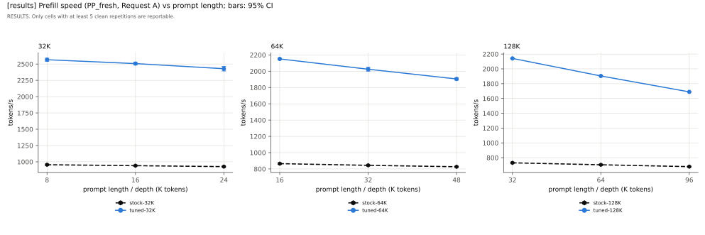
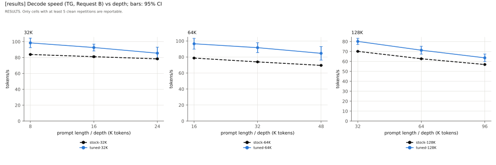
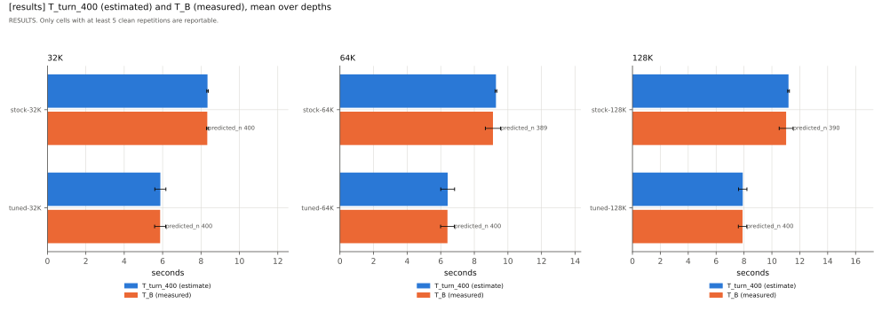
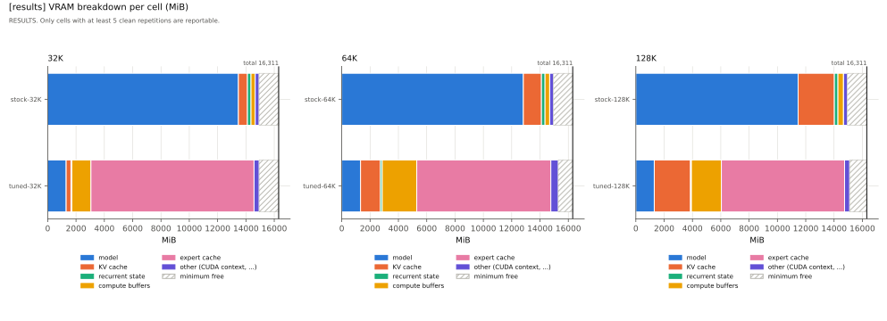
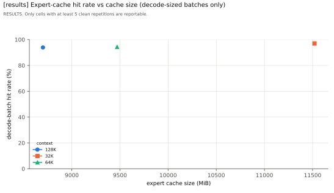

# Baseline report (results)

> **RESULTS. Only cells with at least 5 clean repetitions are reportable.**

## Provenance

- Plan version: v1.8
- Regenerate with: `python -m smallpc.report render --sessions data/raw/stage3-32K data/raw/stage3-64K data/raw/stage3-128K --out reports/stage3 --label results`
- Statistics: mean, n, min, max and a 95% CI (wider of the percentile-bootstrap interval, 10,000 resamples, fixed seed, and the t interval); CIs shown for n of at least 2. Paired ratios: geometric mean with the wider of the bootstrap CI and a t-interval on the log ratios, back-transformed.

> RESULTS. Only cells with at least 5 clean repetitions are reportable.

| session | spec / sha-256 | manifest sha-256 | session commit | record commits | snapshot ids | llama.cpp | state |
|---|---|---|---|---|---|---|---|
| stage3-32K | stage3 `41a0e384d622fcb2` | `ed750c1c73355d08` | 80964618df | `80964618df`, `ba24bf9267` | `66c04f6c276af71a` | `57d04820df` | complete |
| stage3-64K | stage3 `41a0e384d622fcb2` | `ed750c1c73355d08` | a80b2dd31a | `a80b2dd31a`, `dc7f760374` | `66c04f6c276af71a` | `57d04820df` | complete |
| stage3-128K | stage3 `41a0e384d622fcb2` | `ed750c1c73355d08` | b5b7396231 | `b5b7396231`, `d6a8e0be65` | `66c04f6c276af71a` | `57d04820df` | complete |

## Session health

> RESULTS. Only cells with at least 5 clean repetitions are reportable.

| session | systemd-inhibit | idle precondition | drift flag |
|---|---|---|---|
| stage3-32K | checked True, active True | 7 checks, 0 failed, total wait 0 s, max busy 0.68 % | main: none, rerun: none |
| stage3-64K | checked True, active True | 7 checks, 0 failed, total wait 0 s, max busy 0.22 % | main: none, rerun: none |
| stage3-128K | checked True, active True | 7 checks, 0 failed, total wait 0 s, max busy 0.29 % | main: none, rerun: none |

Canaries (never part of cell statistics):

> RESULTS. Only cells with at least 5 clean repetitions are reportable.

| session | run | phase | reps | PP_fresh 16K (tok/s) | TG 16K (tok/s) | TG short (tok/s) | flags |
|---|---|---|---|---|---|---|---|
| stage3-32K | main | start | 3 | 949.0 [928.1, 970.0] | 79.1 [78.8, 79.5] | 89.4 [88.1, 90.6] | - |
| stage3-32K | main | end | 3 | 952.7 [946.1, 959.3] | 79.1 [78.7, 79.5] | 89.9 [89.2, 90.6] | - |
| stage3-32K | rerun | start | 3 | 951.3 [942.9, 959.6] | 79.1 [78.7, 79.4] | 89.7 [89.0, 90.5] | - |
| stage3-32K | rerun | end | 3 | 952.6 [947.6, 957.6] | 78.8 [78.1, 79.5] | 88.9 [87.3, 90.5] | paging |
| stage3-64K | main | start | 3 | 945.3 [925.6, 964.9] | 78.8 [78.5, 79.1] | 89.7 [89.3, 90.1] | - |
| stage3-64K | main | end | 3 | 954.2 [945.6, 962.8] | 79.0 [78.3, 79.7] | 89.5 [89.4, 89.5] | - |
| stage3-64K | rerun | start | 3 | 956.2 [946.0, 966.5] | 79.1 [79.0, 79.1] | 89.1 [88.6, 89.6] | - |
| stage3-64K | rerun | end | 3 | 953.5 [945.5, 961.4] | 78.9 [78.5, 79.3] | 89.1 [88.4, 89.9] | - |
| stage3-128K | main | start | 3 | 955.0 [931.2, 978.8] | 79.0 [78.8, 79.2] | 89.2 [88.7, 89.7] | - |
| stage3-128K | main | end | 3 | 952.3 [940.8, 963.7] | 78.7 [78.3, 79.1] | 89.1 [88.5, 89.8] | - |
| stage3-128K | rerun | start | 3 | 957.4 [948.8, 966.0] | 79.0 [78.9, 79.1] | 88.9 [88.7, 89.1] | - |
| stage3-128K | rerun | end | 3 | 953.2 [945.0, 961.3] | 79.1 [78.8, 79.4] | 89.1 [87.7, 90.5] | - |

## Results

### 32K

> RESULTS. Only cells with at least 5 clean repetitions are reportable.

| cell | n_clean/n_total | PP_fresh 8K (tok/s) | PP_fresh 16K (tok/s) | PP_fresh 24K (tok/s) | TG 8K (tok/s) | TG 16K (tok/s) | TG 24K (tok/s) | T_turn_400 (s) | T_B (s) | T_reread (s) | TTFT (s) | acceptance | flags |
|---|---|---|---|---|---|---|---|---|---|---|---|---|---|
| stock-32K | 5/5 | 955.5 [945.2, 965.7] | 941.0 [936.9, 945.0] | 926.4 [920.9, 931.9] | 83.9 [83.6, 84.2] | 81.1 [80.1, 82.0] | 78.3 [77.5, 79.2] | 8.34 [8.30, 8.38] | 8.33 [8.29, 8.37] (predicted_n 400) | 17.51 [17.42, 17.59] | 3.40 [3.37, 3.44] | - | 1 unit(s) re-run (attempt 2 used) |
| tuned-32K | 5/5 | 2566.1 [2543.1, 2589.1] | 2506.8 [2486.4, 2527.1] | 2428.3 [2393.8, 2462.9] | 98.4 [92.4, 104.4] | 92.6 [88.3, 96.9] | 85.5 [77.9, 93.0] | 5.88 [5.59, 6.17] | 5.87 [5.58, 6.16] (predicted_n 400) | 6.62 [6.55, 6.68] | 1.52 [1.48, 1.56] | - | - |

Values are mean [95% CI] over clean repetitions. T_turn_400, T_B, T_reread and TTFT are means over the depths of §5.3 per repetition. T_turn_400 is an estimate (400 tokens); T_B is the measured time of Request B and is always shown with its `predicted_n`.

### 64K

> RESULTS. Only cells with at least 5 clean repetitions are reportable.

| cell | n_clean/n_total | PP_fresh 16K (tok/s) | PP_fresh 32K (tok/s) | PP_fresh 48K (tok/s) | TG 16K (tok/s) | TG 32K (tok/s) | TG 48K (tok/s) | T_turn_400 (s) | T_B (s) | T_reread (s) | TTFT (s) | acceptance | flags |
|---|---|---|---|---|---|---|---|---|---|---|---|---|---|
| stock-64K | 5/5 | 864.8 [856.4, 873.1] | 844.2 [840.3, 848.0] | 826.7 [823.9, 829.5] | 78.7 [78.5, 78.9] | 73.9 [73.8, 74.0] | 69.5 [69.4, 69.7] | 9.29 [9.24, 9.34] | 9.11 [8.66, 9.56] (predicted_n 389) | 39.07 [38.90, 39.25] | 3.88 [3.83, 3.93] | - | - |
| tuned-64K | 5/5 | 2151.3 [2142.8, 2159.9] | 2024.9 [2001.7, 2048.0] | 1905.1 [1891.7, 1918.5] | 96.5 [89.8, 103.2] | 91.6 [85.5, 97.8] | 84.6 [76.1, 93.0] | 6.41 [6.00, 6.82] | 6.40 [5.99, 6.81] (predicted_n 400) | 16.53 [16.40, 16.66] | 1.99 [1.94, 2.04] | 77.1 [74.5, 79.8] % (pooled 77.1 %) | 4 unit(s) re-run (attempt 2 used) |

Values are mean [95% CI] over clean repetitions. T_turn_400, T_B, T_reread and TTFT are means over the depths of §5.3 per repetition. T_turn_400 is an estimate (400 tokens); T_B is the measured time of Request B and is always shown with its `predicted_n`.

### 128K

> RESULTS. Only cells with at least 5 clean repetitions are reportable.

| cell | n_clean/n_total | PP_fresh 32K (tok/s) | PP_fresh 64K (tok/s) | PP_fresh 96K (tok/s) | TG 32K (tok/s) | TG 64K (tok/s) | TG 96K (tok/s) | T_turn_400 (s) | T_B (s) | T_reread (s) | TTFT (s) | acceptance | flags |
|---|---|---|---|---|---|---|---|---|---|---|---|---|---|
| tuned-128K | 5/5 | 2141.1 [2138.7, 2143.6] | 1903.8 [1902.2, 1905.5] | 1688.9 [1687.9, 1690.0] | 80.1 [77.0, 83.1] | 71.2 [67.3, 75.2] | 63.6 [59.7, 67.4] | 7.91 [7.61, 8.21] | 7.90 [7.60, 8.20] (predicted_n 400) | 35.98 [35.96, 35.99] | 2.28 [2.27, 2.29] | - | - |

Values are mean [95% CI] over clean repetitions. T_turn_400, T_B, T_reread and TTFT are means over the depths of §5.3 per repetition. T_turn_400 is an estimate (400 tokens); T_B is the measured time of Request B and is always shown with its `predicted_n`.

## Eligibility and selection

Mode **final**: a cell needs at least 5 clean repetitions, a complete status, at least 512 MiB free VRAM at its tightest, no flagged unit and a sanity check that has not failed (and must pass).

### 32K

> RESULTS. Only cells with at least 5 clean repetitions are reportable.

| cell | role | n_clean/n_total | mean T_turn_400 (s) [95% CI] | eligible | reasons it is not | sanity |
|---|---|---|---|---|---|---|
| stock-32K | reference (stock) | 5/5 | 8.34 [8.30, 8.38] | no | output sanity check not run (must pass in final mode) | not run |
| tuned-32K | candidate | 5/5 | 5.88 [5.59, 6.17] | no | output sanity check not run (must pass in final mode) | not run |

**No eligible candidate**: no tuned configuration for this context.

### 64K

> RESULTS. Only cells with at least 5 clean repetitions are reportable.

| cell | role | n_clean/n_total | mean T_turn_400 (s) [95% CI] | eligible | reasons it is not | sanity |
|---|---|---|---|---|---|---|
| stock-64K | reference (stock) | 5/5 | 9.29 [9.24, 9.34] | no | output sanity check not run (must pass in final mode) | not run |
| tuned-64K | candidate | 5/5 | 6.41 [6.00, 6.82] | no | output sanity check not run (must pass in final mode) | not run |

**No eligible candidate**: no tuned configuration for this context.

### 128K

> RESULTS. Only cells with at least 5 clean repetitions are reportable.

| cell | role | n_clean/n_total | mean T_turn_400 (s) [95% CI] | eligible | reasons it is not | sanity |
|---|---|---|---|---|---|---|
| stock-128K | reference (stock) | 4/5 | 11.19 [11.13, 11.25] | no | flagged unit(s) stage3-128K:3 (paging); n_clean 4 is below 5 (final mode); output sanity check not run (must pass in final mode) | not run |
| tuned-128K | candidate | 5/5 | 7.91 [7.61, 8.21] | no | output sanity check not run (must pass in final mode) | not run |

**No eligible candidate**: no tuned configuration for this context.

## Paired comparisons with stock

### 32K

> RESULTS. Only cells with at least 5 clean repetitions are reportable.

| candidate vs stock | pairs | T_turn_400 ratio | PP_fresh ratio | TG ratio |
|---|---|---|---|---|
| tuned-32K | 5 | 0.705 [0.672, 0.739] | 2.657 [2.644, 2.670] | 1.136 [1.068, 1.207] |

### 64K

> RESULTS. Only cells with at least 5 clean repetitions are reportable.

| candidate vs stock | pairs | T_turn_400 ratio | PP_fresh ratio | TG ratio |
|---|---|---|---|---|
| tuned-64K | 5 | 0.690 [0.649, 0.734] | 2.398 [2.374, 2.423] | 1.226 [1.135, 1.325] |

### 128K

> RESULTS. Only cells with at least 5 clean repetitions are reportable.

| candidate vs stock | pairs | T_turn_400 ratio | PP_fresh ratio | TG ratio |
|---|---|---|---|---|
| tuned-128K | 4 | 0.711 [0.673, 0.750] | 2.713 [2.701, 2.726] | 1.125 [1.053, 1.202] |

Geometric mean of per-repetition ratios (candidate / stock, repetitions that are clean in both cells) with a 95% interval, shown for 2 or more pairs: the wider of the percentile-bootstrap CI (10,000 resamples) and a t-interval on the log ratios, back-transformed. A T_turn_400 ratio below 1 means the candidate is faster; PP_fresh and TG ratios above 1 mean it is faster.

## Headline (plan §5.4)

The clean-units and all-units versions agree in every context (sign, and whether each interval excludes 1.0).

### 32K: stock-32K and tuned-32K

**Headline: clean units** (5 clean, paired units).

> RESULTS. Only cells with at least 5 clean repetitions are reportable.

| metric | tuned / stock, geometric mean [95% CI] (paired units) | reading |
|---|---|---|
| t_turn_400 | 0.705 [0.672, 0.739] (n=5) | lower is faster |
| t_reread | 0.378 [0.375, 0.381] (n=5) | lower is faster |
| pp_fresh at 8K | 2.686 [2.671, 2.700] (n=5) | higher is faster |
| pp_fresh at 16K | 2.664 [2.644, 2.684] (n=5) | higher is faster |
| pp_fresh at 24K | 2.621 [2.586, 2.657] (n=5) | higher is faster |
| tg at 8K | 1.173 [1.101, 1.249] (n=5) | higher is faster |
| tg at 16K | 1.142 [1.089, 1.197] (n=5) | higher is faster |
| tg at 24K | 1.089 [0.996, 1.190] (n=5) | higher is faster |
| ttft at 8K | 0.431 [0.423, 0.440] (n=5) | lower is faster |
| ttft at 16K | 0.451 [0.428, 0.475] (n=5) | lower is faster |
| ttft at 24K | 0.455 [0.448, 0.462] (n=5) | lower is faster |

Same comparison on all units (flagged units included):

> RESULTS. Only cells with at least 5 clean repetitions are reportable.

| metric | tuned / stock, geometric mean [95% CI] (paired units) | reading |
|---|---|---|
| t_turn_400 | 0.705 [0.672, 0.739] (n=5) | lower is faster |
| t_reread | 0.378 [0.375, 0.381] (n=5) | lower is faster |
| pp_fresh at 8K | 2.686 [2.671, 2.700] (n=5) | higher is faster |
| pp_fresh at 16K | 2.664 [2.644, 2.684] (n=5) | higher is faster |
| pp_fresh at 24K | 2.621 [2.586, 2.657] (n=5) | higher is faster |
| tg at 8K | 1.173 [1.101, 1.249] (n=5) | higher is faster |
| tg at 16K | 1.142 [1.089, 1.197] (n=5) | higher is faster |
| tg at 24K | 1.089 [0.996, 1.190] (n=5) | higher is faster |
| ttft at 8K | 0.431 [0.423, 0.440] (n=5) | lower is faster |
| ttft at 16K | 0.451 [0.428, 0.475] (n=5) | lower is faster |
| ttft at 24K | 0.455 [0.448, 0.462] (n=5) | lower is faster |

### 64K: stock-64K and tuned-64K

**Headline: clean units** (5 clean, paired units).

> RESULTS. Only cells with at least 5 clean repetitions are reportable.

| metric | tuned / stock, geometric mean [95% CI] (paired units) | reading |
|---|---|---|
| t_turn_400 | 0.690 [0.649, 0.734] (n=5) | lower is faster |
| t_reread | 0.423 [0.419, 0.427] (n=5) | lower is faster |
| pp_fresh at 16K | 2.488 [2.459, 2.516] (n=5) | higher is faster |
| pp_fresh at 32K | 2.399 [2.366, 2.431] (n=5) | higher is faster |
| pp_fresh at 48K | 2.304 [2.287, 2.322] (n=5) | higher is faster |
| tg at 16K | 1.225 [1.143, 1.313] (n=5) | higher is faster |
| tg at 32K | 1.239 [1.158, 1.325] (n=5) | higher is faster |
| tg at 48K | 1.213 [1.095, 1.343] (n=5) | higher is faster |
| ttft at 16K | 0.479 [0.476, 0.482] (n=5) | lower is faster |
| ttft at 32K | 0.506 [0.502, 0.510] (n=5) | lower is faster |
| ttft at 48K | 0.551 [0.515, 0.590] (n=5) | lower is faster |

Same comparison on all units (flagged units included):

> RESULTS. Only cells with at least 5 clean repetitions are reportable.

| metric | tuned / stock, geometric mean [95% CI] (paired units) | reading |
|---|---|---|
| t_turn_400 | 0.690 [0.649, 0.734] (n=5) | lower is faster |
| t_reread | 0.423 [0.419, 0.427] (n=5) | lower is faster |
| pp_fresh at 16K | 2.488 [2.459, 2.516] (n=5) | higher is faster |
| pp_fresh at 32K | 2.399 [2.366, 2.431] (n=5) | higher is faster |
| pp_fresh at 48K | 2.304 [2.287, 2.322] (n=5) | higher is faster |
| tg at 16K | 1.225 [1.143, 1.313] (n=5) | higher is faster |
| tg at 32K | 1.239 [1.158, 1.325] (n=5) | higher is faster |
| tg at 48K | 1.213 [1.095, 1.343] (n=5) | higher is faster |
| ttft at 16K | 0.479 [0.476, 0.482] (n=5) | lower is faster |
| ttft at 32K | 0.506 [0.502, 0.510] (n=5) | lower is faster |
| ttft at 48K | 0.551 [0.515, 0.590] (n=5) | lower is faster |

### 128K: stock-128K and tuned-128K

**Headline: all units, labelled "includes paging-flagged stock windows".** S4(d) deviation for this context: the headline rests on 1 stock unit(s) with an unresolved flag (stage3-128K:3: paging) because stock-128K has 4 clean and tuned-128K 5 clean unit(s) (4 paired; at least 5 needed for the clean-units headline). Rule S4(d): No selected or recommended configuration, and no headline number, rests on a measurement with an unresolved flag.

> RESULTS. Only cells with at least 5 clean repetitions are reportable.

| metric | tuned / stock, geometric mean [95% CI] (paired units) | reading |
|---|---|---|
| t_turn_400 | 0.706 [0.679, 0.735] (n=5) | lower is faster |
| t_reread | 0.382 [0.381, 0.384] (n=5) | lower is faster |
| pp_fresh at 32K | 2.926 [2.904, 2.949] (n=5) | higher is faster |
| pp_fresh at 64K | 2.701 [2.689, 2.712] (n=5) | higher is faster |
| pp_fresh at 96K | 2.487 [2.475, 2.500] (n=5) | higher is faster |
| tg at 32K | 1.143 [1.100, 1.189] (n=5) | higher is faster |
| tg at 64K | 1.136 [1.074, 1.202] (n=5) | higher is faster |
| tg at 96K | 1.125 [1.046, 1.209] (n=5) | higher is faster |
| ttft at 32K | 0.418 [0.412, 0.424] (n=5) | lower is faster |
| ttft at 64K | 0.473 [0.466, 0.480] (n=5) | lower is faster |
| ttft at 96K | 0.521 [0.516, 0.526] (n=5) | lower is faster |

Clean-units figures beside it:

> RESULTS. Only cells with at least 5 clean repetitions are reportable.

| metric | tuned / stock, geometric mean [95% CI] (paired units) | reading |
|---|---|---|
| t_turn_400 | 0.711 [0.673, 0.750] (n=4) | lower is faster |
| t_reread | 0.382 [0.380, 0.384] (n=4) | lower is faster |
| pp_fresh at 32K | 2.932 [2.909, 2.955] (n=4) | higher is faster |
| pp_fresh at 64K | 2.703 [2.690, 2.717] (n=4) | higher is faster |
| pp_fresh at 96K | 2.487 [2.469, 2.506] (n=4) | higher is faster |
| tg at 32K | 1.141 [1.078, 1.208] (n=4) | higher is faster |
| tg at 64K | 1.123 [1.049, 1.202] (n=4) | higher is faster |
| tg at 96K | 1.107 [1.017, 1.204] (n=4) | higher is faster |
| ttft at 32K | 0.416 [0.411, 0.422] (n=4) | lower is faster |
| ttft at 64K | 0.472 [0.464, 0.480] (n=4) | lower is faster |
| ttft at 96K | 0.521 [0.514, 0.528] (n=4) | lower is faster |

## Swap sensitivity

Every results table and paired comparison, recomputed without the clean units whose window shows more than 64 MiB of llama-server swap growth (`swap_activity_mib`, plan §5.5 and §5.6). Swap activity is a note, not a flag: the numbers in the other sections keep those units.

> RESULTS. Only cells with at least 5 clean repetitions are reportable.

| removed unit (cell, session, repetition) | swap growth (MiB) | source |
|---|---|---|
| stock-32K, stage3-32K, 2 | 231.3 | summary |
| tuned-32K, stage3-32K, 2 | 115.0 | summary |
| tuned-32K, stage3-32K, 4 | 145.4 | summary |

Units above the threshold that are already excluded by a flag (not affected here): stock-128K stage3-128K:3 (4200 MiB, paging).

### 32K

> RESULTS. Only cells with at least 5 clean repetitions are reportable.

| cell | n_clean (all) | T_turn_400 (s), all units | n_clean (no swap-heavy) | T_turn_400 (s), without swap-heavy units |
|---|---|---|---|---|
| stock-32K | 5 | 8.34 [8.30, 8.38] | 4 | 8.33 [8.28, 8.39] |
| tuned-32K | 5 | 5.88 [5.59, 6.17] | 3 | 5.95 [5.20, 6.70] |

> RESULTS. Only cells with at least 5 clean repetitions are reportable.

| candidate vs stock | pairs (all) | T_turn_400 ratio | PP_fresh ratio | TG ratio | pairs (without) | T_turn_400 ratio | PP_fresh ratio | TG ratio |
|---|---|---|---|---|---|---|---|---|
| tuned-32K | 5 | 0.705 [0.672, 0.739] | 2.657 [2.644, 2.670] | 1.136 [1.068, 1.207] | 3 | 0.712 [0.629, 0.807] | 2.660 [2.629, 2.691] | 1.120 [0.955, 1.314] |

### 64K

> RESULTS. Only cells with at least 5 clean repetitions are reportable.

| cell | n_clean (all) | T_turn_400 (s), all units | n_clean (no swap-heavy) | T_turn_400 (s), without swap-heavy units |
|---|---|---|---|---|
| stock-64K | 5 | 9.29 [9.24, 9.34] | 5 | 9.29 [9.24, 9.34] |
| tuned-64K | 5 | 6.41 [6.00, 6.82] | 5 | 6.41 [6.00, 6.82] |

> RESULTS. Only cells with at least 5 clean repetitions are reportable.

| candidate vs stock | pairs (all) | T_turn_400 ratio | PP_fresh ratio | TG ratio | pairs (without) | T_turn_400 ratio | PP_fresh ratio | TG ratio |
|---|---|---|---|---|---|---|---|---|
| tuned-64K | 5 | 0.690 [0.649, 0.734] | 2.398 [2.374, 2.423] | 1.226 [1.135, 1.325] | 5 | 0.690 [0.649, 0.734] | 2.398 [2.374, 2.423] | 1.226 [1.135, 1.325] |

### 128K

> RESULTS. Only cells with at least 5 clean repetitions are reportable.

| cell | n_clean (all) | T_turn_400 (s), all units | n_clean (no swap-heavy) | T_turn_400 (s), without swap-heavy units |
|---|---|---|---|---|
| stock-128K | 4 | 11.19 [11.13, 11.25] | 4 | 11.19 [11.13, 11.25] |
| tuned-128K | 5 | 7.91 [7.61, 8.21] | 5 | 7.91 [7.61, 8.21] |

> RESULTS. Only cells with at least 5 clean repetitions are reportable.

| candidate vs stock | pairs (all) | T_turn_400 ratio | PP_fresh ratio | TG ratio | pairs (without) | T_turn_400 ratio | PP_fresh ratio | TG ratio |
|---|---|---|---|---|---|---|---|---|
| tuned-128K | 4 | 0.711 [0.673, 0.750] | 2.713 [2.701, 2.726] | 1.125 [1.053, 1.202] | 4 | 0.711 [0.673, 0.750] | 2.713 [2.701, 2.726] | 1.125 [1.053, 1.202] |

**Verdict.**

- A headline comparison changed sign: no.
- An interval changed materially (an endpoint moved by more than the interval's half-width): **YES**: tuned-32K: T_turn_400 interval; tuned-32K: T_turn_400 ratio interval; tuned-32K: PP_fresh ratio interval; tuned-32K: TG ratio interval

## VRAM breakdown

### 32K

> RESULTS. Only cells with at least 5 clean repetitions are reportable.

| cell | model | KV | recurrent state | compute buffers | expert cache | other | peak used | min free (final windows) | expert layers on CPU |
|---|---|---|---|---|---|---|---|---|---|
| stock-32K | 13,468 | 640 (f16) | 251 | 299 | 0 | 268 | 14,926 | 1,385 | 15 |
| tuned-32K | 1,303 | 340 (q8_0) | 63 | 1,348 | 11,520 | 359 | 14,932 | 1,379 | - |

### 64K

> RESULTS. Only cells with at least 5 clean repetitions are reportable.

| cell | model | KV | recurrent state | compute buffers | expert cache | other | peak used | min free (final windows) | expert layers on CPU |
|---|---|---|---|---|---|---|---|---|---|
| stock-64K | 12,825 | 1,280 (f16) | 251 | 331 | 0 | 269 | 14,956 | 1,355 | 16 |
| tuned-64K | 1,326 | 1,408 (f16) | 126 | 2,436 | 9,471 | 523 | 15,290 | 1,021 | - |

### 128K

> RESULTS. Only cells with at least 5 clean repetitions are reportable.

| cell | model | KV | recurrent state | compute buffers | expert cache | other | peak used | min free (final windows) | expert layers on CPU |
|---|---|---|---|---|---|---|---|---|---|
| stock-128K | 11,463 | 2,560 (f16) | 251 | 396 | 0 | 272 | 14,942 | 1,369 | 19 |
| tuned-128K | 1,303 | 2,560 (f16) | 63 | 2,116 | 8,701 | 358 | 15,100 | 1,211 | - |

MiB, from each cell summary's parsed placement (buffers on the GPU) and its windows. 'expert cache' is the `--moe-cache-mib` size the server reports; 'other' is peak used minus the listed parts (CUDA context, graphs, allocator slack).

## Expert cache

> RESULTS. Only cells with at least 5 clean repetitions are reportable.

| cell | cache MiB | decode-batch hit rate | hits | misses | large-batch experts copied | uploaded MiB |
|---|---|---|---|---|---|---|
| tuned-32K | 11,520 | 97.0 % | 2,585,352 | 79,316 | 1,484,937 | 146,491 |
| tuned-64K | 9,471 | 94.3 % | 4,257,457 | 257,252 | 3,894,861 | 473,795 |
| tuned-128K | 8,701 | 93.9 % | 2,501,814 | 162,842 | 3,569,853 | 301,304 |

Limitation: the server's statistics give hit rates for **decode-sized batches only** (`ubatch <= 8`); prefill-sized batches report only how many experts were copied from the cache. The counts cover everything the server served (warm-up, every repetition and attempt), not only clean repetitions.

## Excluded diagnostic results

> excluded diagnostic result. RESULTS. Only cells with at least 5 clean repetitions are reportable.

| cell | session | repetition | attempt | flags | T_turn_400 (s), mean over depths | why |
|---|---|---|---|---|---|---|
| stock-128K | stage3-128K | 1 | 1 | paging | 11.19 | attempt 1 of a unit re-run as attempt 2 |
| stock-128K | stage3-128K | 3 | 1 | paging | 11.13 | attempt 1 of a unit re-run as attempt 2 |
| stock-128K | stage3-128K | 3 | 2 | paging | 11.19 | flagged unit |
| stock-32K | stage3-32K | 3 | 1 | paging | 8.19 | attempt 1 of a unit re-run as attempt 2 |
| tuned-64K | stage3-64K | 1 | 1 | paging | 7.23 | attempt 1 of a unit re-run as attempt 2 |
| tuned-64K | stage3-64K | 2 | 1 | paging | 6.42 | attempt 1 of a unit re-run as attempt 2 |
| tuned-64K | stage3-64K | 3 | 1 | paging | 6.37 | attempt 1 of a unit re-run as attempt 2 |
| tuned-64K | stage3-64K | 4 | 1 | paging | 6.17 | attempt 1 of a unit re-run as attempt 2 |

These units are not in any headline number above. Flagged units stay here with their flags; attempt 1 of a re-run unit is replaced by attempt 2.

## Appendix: cells below 5 clean repetitions

Cells with fewer than 5 clean repetitions are excluded from the clean-units tables above (§5.5); their figures here use clean units only. A Stage 3 stock cell in this list may still carry its context's headline on all units, labelled "includes paging-flagged stock windows" (plan §5.4, "Headline rule"): see the Headline section above, or run `python -m smallpc.stage3 headline`.

> RESULTS. Only cells with at least 5 clean repetitions are reportable.

| cell | context | n_clean/n_total | T_turn_400 (s) |
|---|---|---|---|
| stock-128K | 128K | 4/5 | 11.19 [11.13, 11.25] |

## Figures

