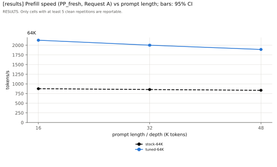
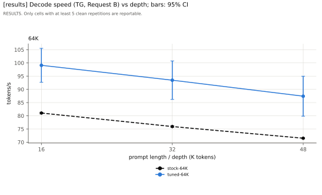
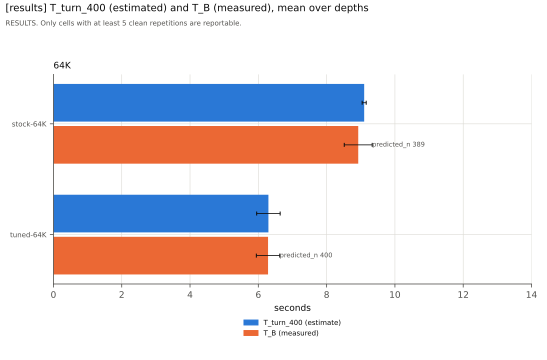
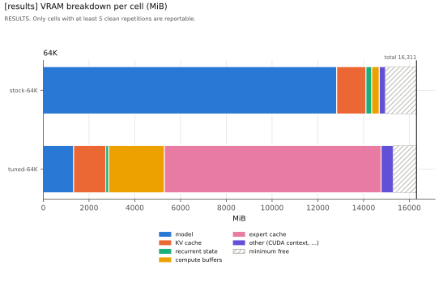
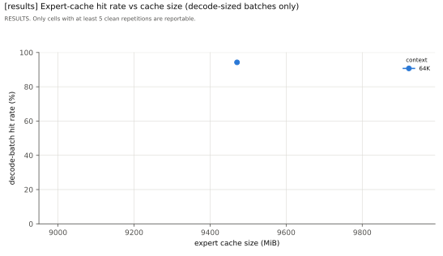

# Baseline report (results)

> **RESULTS. Only cells with at least 5 clean repetitions are reportable.**

## Provenance

- Plan version: v1.8
- Regenerate with: `python -m smallpc.report render --sessions data/raw/stage4-run2 --out reports/stage4-run2 --label results`
- Statistics: mean, n, min, max and a 95% CI (wider of the percentile-bootstrap interval, 10,000 resamples, fixed seed, and the t interval); CIs shown for n of at least 2. Paired ratios: geometric mean with the wider of the bootstrap CI and a t-interval on the log ratios, back-transformed.

> RESULTS. Only cells with at least 5 clean repetitions are reportable.

| session | spec / sha-256 | manifest sha-256 | session commit | record commits | snapshot ids | llama.cpp | state |
|---|---|---|---|---|---|---|---|
| stage4-run2 | stage4 `6a11e6b13d8f94de` | `ed750c1c73355d08` | c4bdc4db4a | `c4bdc4db4a` | `f66a698dee8dbca0` | `57d04820df` | complete |

## Session health

> RESULTS. Only cells with at least 5 clean repetitions are reportable.

| session | systemd-inhibit | idle precondition | drift flag |
|---|---|---|---|
| stage4-run2 | checked True, active True | 7 checks, 0 failed, total wait 0 s, max busy 0.84 % | main: none, rerun: none |

Canaries (never part of cell statistics):

> RESULTS. Only cells with at least 5 clean repetitions are reportable.

| session | run | phase | reps | PP_fresh 16K (tok/s) | TG 16K (tok/s) | TG short (tok/s) | flags |
|---|---|---|---|---|---|---|---|
| stage4-run2 | main | start | 3 | 955.0 [948.3, 961.6] | 79.7 [79.7, 79.8] | 90.3 [90.0, 90.6] | - |
| stage4-run2 | main | end | 3 | 951.1 [922.6, 979.5] | 79.5 [78.8, 80.2] | 90.1 [89.2, 90.9] | - |
| stage4-run2 | rerun | start | 3 | 956.3 [941.2, 971.4] | 79.7 [79.5, 79.9] | 90.1 [89.8, 90.3] | - |
| stage4-run2 | rerun | end | 3 | 952.7 [933.2, 972.3] | 79.5 [79.3, 79.7] | 90.1 [88.9, 91.2] | - |

## Results

### 64K

> RESULTS. Only cells with at least 5 clean repetitions are reportable.

| cell | n_clean/n_total | PP_fresh 16K (tok/s) | PP_fresh 32K (tok/s) | PP_fresh 48K (tok/s) | TG 16K (tok/s) | TG 32K (tok/s) | TG 48K (tok/s) | T_turn_400 (s) | T_B (s) | T_reread (s) | TTFT (s) | acceptance | flags |
|---|---|---|---|---|---|---|---|---|---|---|---|---|---|
| stock-64K | 5/5 | 875.4 [869.4, 881.3] | 853.9 [847.4, 860.3] | 834.1 [831.0, 837.3] | 81.0 [80.8, 81.3] | 75.9 [75.6, 76.2] | 71.5 [71.4, 71.6] | 9.10 [9.04, 9.16] | 8.93 [8.52, 9.34] (predicted_n 389) | 38.67 [38.47, 38.88] | 3.84 [3.78, 3.89] | - | 1 unit(s) re-run (attempt 2 used) |
| tuned-64K | 5/5 | 2129.5 [2124.4, 2134.6] | 2000.9 [1982.5, 2019.3] | 1890.7 [1888.2, 1893.2] | 99.1 [92.7, 105.5] | 93.5 [86.2, 100.7] | 87.4 [79.9, 95.0] | 6.30 [5.95, 6.64] | 6.28 [5.94, 6.63] (predicted_n 400) | 16.69 [16.65, 16.73] | 1.99 [1.98, 2.00] | 77.1 [74.5, 79.8] % (pooled 77.1 %) | - |

Values are mean [95% CI] over clean repetitions. T_turn_400, T_B, T_reread and TTFT are means over the depths of §5.3 per repetition. T_turn_400 is an estimate (400 tokens); T_B is the measured time of Request B and is always shown with its `predicted_n`.

## Eligibility and selection

Mode **final**: a cell needs at least 5 clean repetitions, a complete status, at least 512 MiB free VRAM at its tightest, no flagged unit and a sanity check that has not failed (and must pass).

### 64K

> RESULTS. Only cells with at least 5 clean repetitions are reportable.

| cell | role | n_clean/n_total | mean T_turn_400 (s) [95% CI] | eligible | reasons it is not | sanity |
|---|---|---|---|---|---|---|
| stock-64K | reference (stock) | 5/5 | 9.10 [9.04, 9.16] | no | output sanity check not run (must pass in final mode) | not run |
| tuned-64K | candidate | 5/5 | 6.30 [5.95, 6.64] | no | output sanity check not run (must pass in final mode) | not run |

**No eligible candidate**: no tuned configuration for this context.

## Paired comparisons with stock

### 64K

> RESULTS. Only cells with at least 5 clean repetitions are reportable.

| candidate vs stock | pairs | T_turn_400 ratio | PP_fresh ratio | TG ratio |
|---|---|---|---|---|
| tuned-64K | 5 | 0.691 [0.655, 0.730] | 2.349 [2.334, 2.364] | 1.223 [1.133, 1.321] |

Geometric mean of per-repetition ratios (candidate / stock, repetitions that are clean in both cells) with a 95% interval, shown for 2 or more pairs: the wider of the percentile-bootstrap CI (10,000 resamples) and a t-interval on the log ratios, back-transformed. A T_turn_400 ratio below 1 means the candidate is faster; PP_fresh and TG ratios above 1 mean it is faster.

## Headline (plan §5.4)

The clean-units and all-units versions agree in every context (sign, and whether each interval excludes 1.0).

### 64K: stock-64K and tuned-64K

**Headline: clean units** (5 clean, paired units).

> RESULTS. Only cells with at least 5 clean repetitions are reportable.

| metric | tuned / stock, geometric mean [95% CI] (paired units) | reading |
|---|---|---|
| t_turn_400 | 0.691 [0.655, 0.730] (n=5) | lower is faster |
| t_reread | 0.432 [0.429, 0.434] (n=5) | lower is faster |
| pp_fresh at 16K | 2.433 [2.416, 2.449] (n=5) | higher is faster |
| pp_fresh at 32K | 2.343 [2.316, 2.371] (n=5) | higher is faster |
| pp_fresh at 48K | 2.267 [2.256, 2.278] (n=5) | higher is faster |
| tg at 16K | 1.221 [1.143, 1.305] (n=5) | higher is faster |
| tg at 32K | 1.229 [1.132, 1.334] (n=5) | higher is faster |
| tg at 48K | 1.220 [1.114, 1.335] (n=5) | higher is faster |
| ttft at 16K | 0.489 [0.484, 0.493] (n=5) | lower is faster |
| ttft at 32K | 0.515 [0.509, 0.522] (n=5) | lower is faster |
| ttft at 48K | 0.547 [0.542, 0.552] (n=5) | lower is faster |

Same comparison on all units (flagged units included):

> RESULTS. Only cells with at least 5 clean repetitions are reportable.

| metric | tuned / stock, geometric mean [95% CI] (paired units) | reading |
|---|---|---|
| t_turn_400 | 0.691 [0.655, 0.730] (n=5) | lower is faster |
| t_reread | 0.432 [0.429, 0.434] (n=5) | lower is faster |
| pp_fresh at 16K | 2.433 [2.416, 2.449] (n=5) | higher is faster |
| pp_fresh at 32K | 2.343 [2.316, 2.371] (n=5) | higher is faster |
| pp_fresh at 48K | 2.267 [2.256, 2.278] (n=5) | higher is faster |
| tg at 16K | 1.221 [1.143, 1.305] (n=5) | higher is faster |
| tg at 32K | 1.229 [1.132, 1.334] (n=5) | higher is faster |
| tg at 48K | 1.220 [1.114, 1.335] (n=5) | higher is faster |
| ttft at 16K | 0.489 [0.484, 0.493] (n=5) | lower is faster |
| ttft at 32K | 0.515 [0.509, 0.522] (n=5) | lower is faster |
| ttft at 48K | 0.547 [0.542, 0.552] (n=5) | lower is faster |

## Swap sensitivity

Every results table and paired comparison, recomputed without the clean units whose window shows more than 64 MiB of llama-server swap growth (`swap_activity_mib`, plan §5.5 and §5.6). Swap activity is a note, not a flag: the numbers in the other sections keep those units.

No clean unit is above 64 MiB: both versions are identical.

### 64K

> RESULTS. Only cells with at least 5 clean repetitions are reportable.

| cell | n_clean (all) | T_turn_400 (s), all units | n_clean (no swap-heavy) | T_turn_400 (s), without swap-heavy units |
|---|---|---|---|---|
| stock-64K | 5 | 9.10 [9.04, 9.16] | 5 | 9.10 [9.04, 9.16] |
| tuned-64K | 5 | 6.30 [5.95, 6.64] | 5 | 6.30 [5.95, 6.64] |

> RESULTS. Only cells with at least 5 clean repetitions are reportable.

| candidate vs stock | pairs (all) | T_turn_400 ratio | PP_fresh ratio | TG ratio | pairs (without) | T_turn_400 ratio | PP_fresh ratio | TG ratio |
|---|---|---|---|---|---|---|---|---|
| tuned-64K | 5 | 0.691 [0.655, 0.730] | 2.349 [2.334, 2.364] | 1.223 [1.133, 1.321] | 5 | 0.691 [0.655, 0.730] | 2.349 [2.334, 2.364] | 1.223 [1.133, 1.321] |

**Verdict.**

No unit was removed, so no comparison changed.

## VRAM breakdown

### 64K

> RESULTS. Only cells with at least 5 clean repetitions are reportable.

| cell | model | KV | recurrent state | compute buffers | expert cache | other | peak used | min free (final windows) | expert layers on CPU |
|---|---|---|---|---|---|---|---|---|---|
| stock-64K | 12,825 | 1,280 (f16) | 251 | 331 | 0 | 269 | 14,956 | 1,353 | 16 |
| tuned-64K | 1,326 | 1,408 (f16) | 126 | 2,436 | 9,471 | 525 | 15,292 | 1,019 | - |

MiB, from each cell summary's parsed placement (buffers on the GPU) and its windows. 'expert cache' is the `--moe-cache-mib` size the server reports; 'other' is peak used minus the listed parts (CUDA context, graphs, allocator slack).

## Expert cache

> RESULTS. Only cells with at least 5 clean repetitions are reportable.

| cell | cache MiB | decode-batch hit rate | hits | misses | large-batch experts copied | uploaded MiB |
|---|---|---|---|---|---|---|
| tuned-64K | 9,471 | 94.3 % | 2,356,600 | 143,460 | 2,159,736 | 264,225 |

Limitation: the server's statistics give hit rates for **decode-sized batches only** (`ubatch <= 8`); prefill-sized batches report only how many experts were copied from the cache. The counts cover everything the server served (warm-up, every repetition and attempt), not only clean repetitions.

## Excluded diagnostic results

> excluded diagnostic result. RESULTS. Only cells with at least 5 clean repetitions are reportable.

| cell | session | repetition | attempt | flags | T_turn_400 (s), mean over depths | why |
|---|---|---|---|---|---|---|
| stock-64K | stage4-run2 | 2 | 1 | paging | 9.16 | attempt 1 of a unit re-run as attempt 2 |

These units are not in any headline number above. Flagged units stay here with their flags; attempt 1 of a re-run unit is replaced by attempt 2.

## Appendix: cells below 5 clean repetitions

Cells with fewer than 5 clean repetitions are excluded from the clean-units tables above (§5.5); their figures here use clean units only. A Stage 3 stock cell in this list may still carry its context's headline on all units, labelled "includes paging-flagged stock windows" (plan §5.4, "Headline rule"): see the Headline section above, or run `python -m smallpc.stage3 headline`.

No cell is below 5 clean repetitions.

## Figures

