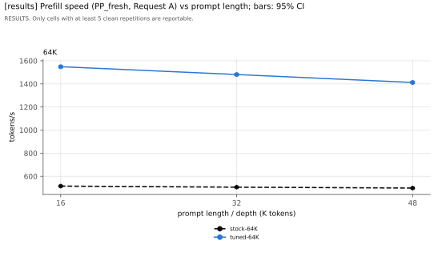
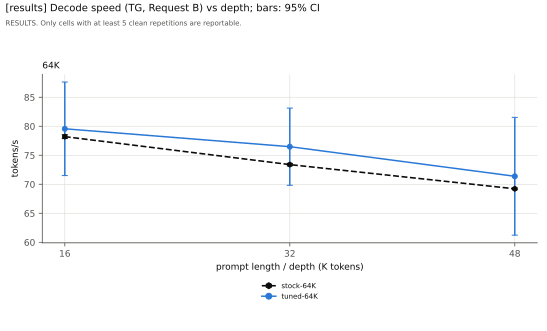
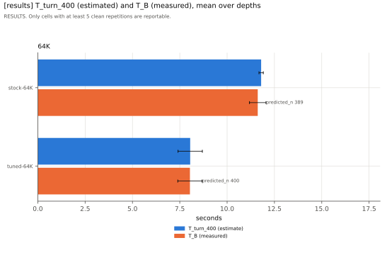
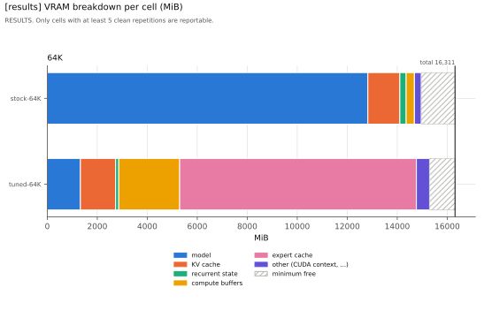
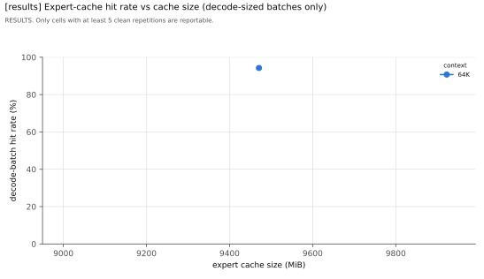

# Baseline report (results)

> **RESULTS. Only cells with at least 5 clean repetitions are reportable.**

## Provenance

- Plan version: v1.8
- Regenerate with: `python -m smallpc.report render --sessions data/raw/stage4 --out reports/stage4 --label results`
- Statistics: mean, n, min, max and a 95% CI (wider of the percentile-bootstrap interval, 10,000 resamples, fixed seed, and the t interval); CIs shown for n of at least 2. Paired ratios: geometric mean with the wider of the bootstrap CI and a t-interval on the log ratios, back-transformed.

> RESULTS. Only cells with at least 5 clean repetitions are reportable.

| session | spec / sha-256 | manifest sha-256 | session commit | record commits | snapshot ids | llama.cpp | state |
|---|---|---|---|---|---|---|---|
| stage4 | stage4 `6a11e6b13d8f94de` | `ed750c1c73355d08` | 1307244870 | `1307244870`, `2179877f9f` | `574cd25c8118710e` | `57d04820df` | complete |

## Session health

> RESULTS. Only cells with at least 5 clean repetitions are reportable.

| session | systemd-inhibit | idle precondition | drift flag |
|---|---|---|---|
| stage4 | checked True, active True | 7 checks, 0 failed, total wait 0 s, max busy 0.89 % | main: none, rerun: none |

Canaries (never part of cell statistics):

> RESULTS. Only cells with at least 5 clean repetitions are reportable.

| session | run | phase | reps | PP_fresh 16K (tok/s) | TG 16K (tok/s) | TG short (tok/s) | flags |
|---|---|---|---|---|---|---|---|
| stage4 | main | start | 3 | 575.6 [568.4, 582.7] | 78.4 [78.0, 78.7] | 88.3 [88.0, 88.6] | - |
| stage4 | main | end | 3 | 575.8 [569.4, 582.3] | 78.5 [78.2, 78.8] | 88.5 [88.5, 88.5] | - |
| stage4 | rerun | start | 3 | 573.7 [566.6, 580.7] | 78.4 [78.1, 78.8] | 88.3 [87.9, 88.6] | - |
| stage4 | rerun | end | 3 | 575.4 [568.5, 582.3] | 78.3 [78.3, 78.4] | 88.3 [87.7, 88.9] | - |

## Results

### 64K

> RESULTS. Only cells with at least 5 clean repetitions are reportable.

| cell | n_clean/n_total | PP_fresh 16K (tok/s) | PP_fresh 32K (tok/s) | PP_fresh 48K (tok/s) | TG 16K (tok/s) | TG 32K (tok/s) | TG 48K (tok/s) | T_turn_400 (s) | T_B (s) | T_reread (s) | TTFT (s) | acceptance | flags |
|---|---|---|---|---|---|---|---|---|---|---|---|---|---|
| stock-64K | 5/5 | 515.0 [511.7, 518.3] | 505.9 [502.3, 509.5] | 498.1 [496.1, 500.0] | 78.2 [77.9, 78.5] | 73.4 [73.2, 73.6] | 69.2 [69.1, 69.3] | 11.80 [11.68, 11.91] | 11.62 [11.18, 12.06] (predicted_n 389) | 65.09 [64.77, 65.42] | 6.35 [6.25, 6.46] | - | - |
| tuned-64K | 5/5 | 1548.9 [1539.7, 1558.0] | 1481.1 [1471.3, 1490.8] | 1412.3 [1402.3, 1422.3] | 79.6 [71.5, 87.6] | 76.5 [69.8, 83.1] | 71.4 [61.2, 81.5] | 8.05 [7.41, 8.69] | 8.04 [7.40, 8.68] (predicted_n 400) | 22.50 [22.36, 22.65] | 2.73 [2.71, 2.75] | 77.1 [74.5, 79.8] % (pooled 77.1 %) | 3 unit(s) re-run (attempt 2 used) |

Values are mean [95% CI] over clean repetitions. T_turn_400, T_B, T_reread and TTFT are means over the depths of §5.3 per repetition. T_turn_400 is an estimate (400 tokens); T_B is the measured time of Request B and is always shown with its `predicted_n`.

## Eligibility and selection

Mode **final**: a cell needs at least 5 clean repetitions, a complete status, at least 512 MiB free VRAM at its tightest, no flagged unit and a sanity check that has not failed (and must pass).

### 64K

> RESULTS. Only cells with at least 5 clean repetitions are reportable.

| cell | role | n_clean/n_total | mean T_turn_400 (s) [95% CI] | eligible | reasons it is not | sanity |
|---|---|---|---|---|---|---|
| stock-64K | reference (stock) | 5/5 | 11.80 [11.68, 11.91] | no | output sanity check not run (must pass in final mode) | not run |
| tuned-64K | candidate | 5/5 | 8.05 [7.41, 8.69] | no | output sanity check not run (must pass in final mode) | not run |

**No eligible candidate**: no tuned configuration for this context.

## Paired comparisons with stock

### 64K

> RESULTS. Only cells with at least 5 clean repetitions are reportable.

| candidate vs stock | pairs | T_turn_400 ratio | PP_fresh ratio | TG ratio |
|---|---|---|---|---|
| tuned-64K | 5 | 0.681 [0.630, 0.736] | 2.925 [2.901, 2.948] | 1.027 [0.918, 1.149] |

Geometric mean of per-repetition ratios (candidate / stock, repetitions that are clean in both cells) with a 95% interval, shown for 2 or more pairs: the wider of the percentile-bootstrap CI (10,000 resamples) and a t-interval on the log ratios, back-transformed. A T_turn_400 ratio below 1 means the candidate is faster; PP_fresh and TG ratios above 1 mean it is faster.

## Swap sensitivity

Every results table and paired comparison, recomputed without the clean units whose window shows more than 64 MiB of llama-server swap growth (`swap_activity_mib`, plan §5.5 and §5.6). Swap activity is a note, not a flag: the numbers in the other sections keep those units.

> RESULTS. Only cells with at least 5 clean repetitions are reportable.

| removed unit (cell, session, repetition) | swap growth (MiB) | source |
|---|---|---|
| tuned-64K, stage4, 1 | 201.5 | summary |
| tuned-64K, stage4, 3 | 115.4 | summary |

### 64K

> RESULTS. Only cells with at least 5 clean repetitions are reportable.

| cell | n_clean (all) | T_turn_400 (s), all units | n_clean (no swap-heavy) | T_turn_400 (s), without swap-heavy units |
|---|---|---|---|---|
| stock-64K | 5 | 11.80 [11.68, 11.91] | 5 | 11.80 [11.68, 11.91] |
| tuned-64K | 5 | 8.05 [7.41, 8.69] | 3 | 7.87 [7.14, 8.60] |

> RESULTS. Only cells with at least 5 clean repetitions are reportable.

| candidate vs stock | pairs (all) | T_turn_400 ratio | PP_fresh ratio | TG ratio | pairs (without) | T_turn_400 ratio | PP_fresh ratio | TG ratio |
|---|---|---|---|---|---|---|---|---|
| tuned-64K | 5 | 0.681 [0.630, 0.736] | 2.925 [2.901, 2.948] | 1.027 [0.918, 1.149] | 3 | 0.663 [0.607, 0.725] | 2.935 [2.902, 2.968] | 1.059 [0.919, 1.221] |

**Verdict.**

- A headline comparison changed sign: no.
- An interval changed materially (an endpoint moved by more than the interval's half-width): no.

## VRAM breakdown

### 64K

> RESULTS. Only cells with at least 5 clean repetitions are reportable.

| cell | model | KV | recurrent state | compute buffers | expert cache | other | peak used | min free (final windows) | expert layers on CPU |
|---|---|---|---|---|---|---|---|---|---|
| stock-64K | 12,825 | 1,280 (f16) | 251 | 331 | 0 | 271 | 14,958 | 1,353 | 16 |
| tuned-64K | 1,326 | 1,408 (f16) | 126 | 2,436 | 9,471 | 525 | 15,292 | 1,019 | - |

MiB, from each cell summary's parsed placement (buffers on the GPU) and its windows. 'expert cache' is the `--moe-cache-mib` size the server reports; 'other' is peak used minus the listed parts (CUDA context, graphs, allocator slack).

## Expert cache

> RESULTS. Only cells with at least 5 clean repetitions are reportable.

| cell | cache MiB | decode-batch hit rate | hits | misses | large-batch experts copied | uploaded MiB |
|---|---|---|---|---|---|---|
| tuned-64K | 9,471 | 94.2 % | 3,795,531 | 231,358 | 3,469,314 | 426,035 |

Limitation: the server's statistics give hit rates for **decode-sized batches only** (`ubatch <= 8`); prefill-sized batches report only how many experts were copied from the cache. The counts cover everything the server served (warm-up, every repetition and attempt), not only clean repetitions.

## Excluded diagnostic results

> excluded diagnostic result. RESULTS. Only cells with at least 5 clean repetitions are reportable.

| cell | session | repetition | attempt | flags | T_turn_400 (s), mean over depths | why |
|---|---|---|---|---|---|---|
| tuned-64K | stage4 | 0 | 1 | paging | 8.25 | attempt 1 of a unit re-run as attempt 2 |
| tuned-64K | stage4 | 2 | 1 | paging | 7.92 | attempt 1 of a unit re-run as attempt 2 |
| tuned-64K | stage4 | 4 | 1 | paging | 7.67 | attempt 1 of a unit re-run as attempt 2 |

These units are not in any headline number above. Flagged units stay here with their flags; attempt 1 of a re-run unit is replaced by attempt 2.

## Appendix: cells below 5 clean repetitions

Cells with fewer than 5 clean repetitions are not reportable in the tables above (§5.5). Their figures here use clean units only. A Stage 3 stock cell in this list has its headline computed on all units and labelled by `python -m smallpc.stage3 headline` (plan §5.4, "Headline rule"); read the headline there.

No cell is below 5 clean repetitions.

## Figures

